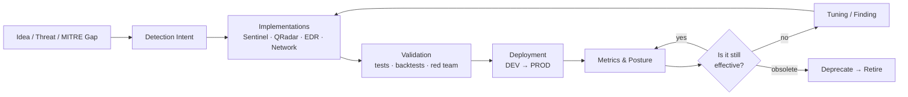
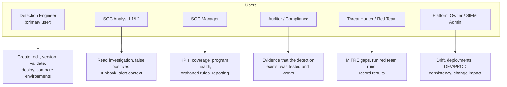

# 01 - Vision, Scope and Principles

---

## 1. The current problem

Today, detection knowledge is **fragmented across three silos that do not talk to each other**:

```
   Notes                   Sentinel                  QRadar
      │                       │                        │
 documentation            live KQL                 live AQL
 (what it does,           (DEV and PROD,           (legacy, no
 how to investigate)       possibly                 associated
                           divergent)               documentation)
      │                       │                        │
      └───────── [FAIL] no formal relationship ────────┘
```

Measurable consequences:

| Symptom | Impact |
|---------|--------|
| There is no unique "detection" identifier | KQL and AQL for the same thing are treated as two different rules |
| `last_tested: 2026-08-26` does not say **what** was tested | Impossible to audit |
| DEV and PROD diverge without anyone noticing | The wrong version gets deployed |
| There is no computed MITRE coverage | It is impossible to answer "what are we not detecting?" |
| Tuning findings get lost in chats/tickets | The same analysis is repeated 6 months later |
| There is no formal owner | Orphaned rules that nobody maintains |
| There is no program KPI | The SOC Manager cannot report upward |

---

## 2. Vision

> **A single platform where a detection is born, documented, implemented in N technologies,
> validated with evidence, deployed, measured and retired - without ever leaving it.**



---

## 3. Goals (in scope)

### 3.1 Functional goals

| # | Goal | Measured by |
|---|------|-------------|
| O-1 | Single detection catalog with stable IDs | 100% of rules with `DET-XXXX` |
| O-2 | Documentation versioned alongside the logic | 0 documents in notes with no equivalent in Git |
| O-3 | Multiple implementations per detection | Sentinel + QRadar coexisting under one `DET-` |
| O-4 | Full validation traceability with evidence | Every `ValidationRun` with `evidence_ref` |
| O-5 | Drift detection between environments and against Sigma | Automatic DEV vs PROD report |
| O-6 | Computed MITRE / data source / layer coverage | ATT&CK heatmap generated |
| O-7 | Detection Score per rule and program-level Posture Score | Dashboard with 7 dimensions |
| O-8 | Persistent, actionable Findings | Detection backlog with status |
| O-9 | Real inventory discovered via connectors | Diff between "what Git says" and "what is in Sentinel" |
| O-10 | Reporting for audit and for the SOC Manager | Signed and dated PDF/CSV export |

### 3.2 Non-functional goals

| # | Requirement | Target |
|---|-------------|--------|
| NF-1 | Open source, no mandatory proprietary licenses | 100% of the critical path |
| NF-2 | Extensible via plugins (connectors, validators, exporters) | Add a SIEM without touching the core |
| NF-3 | Operable by 1-3 people | Deployment with `docker compose up` |
| NF-4 | Git-first: everything reproducible from the repo | The DB can be deleted and rebuilt |
| NF-5 | Auditable | Immutable log of state changes |
| NF-6 | Air-gap friendly | No mandatory calls to the Internet |
| NF-7 | Performance | Catalog of 5,000 detections with search < 300 ms |

---

## 4. Non-goals (explicitly out of scope)

This is as important as the scope. **DEP is NOT:**

| Is not | Why |
|--------|-----|
| A SIEM | It does not ingest or store security logs |
| A real-time correlation engine | Detection runs in Sentinel/QRadar |
| A SOAR / case manager | It integrates with one, it does not replace it |
| A replacement for Sigma | Sigma is an internal component |
| A substitute for the SIEM's native console | It complements it; the console continues to exist |
| A data lake | Backtests run *against* the SIEM, not in DEP |
| A multi-tenant SaaS product (in v1.0) | Single-tenant on-prem first |

---

## 5. Personas and their needs



| Persona | Main screen | What they must NOT be able to do |
|---------|-------------|----------------------------------|
| Detection Engineer | Detection Editor | Approve their own PR to PROD |
| SOC Analyst | Detection Read-only + Runbook | Edit logic |
| SOC Manager | Posture Dashboard | Edit detections |
| Auditor | Reports + Evidence | Any write |
| Threat Hunter | Coverage / ATT&CK | Deploy to PROD |
| Platform Owner | Deployments / Connectors | - |

---

## 6. Main use cases

| UC | Name | Actor | Summary description |
|----|------|-------|---------------------|
| UC-01 | Create a detection from scratch | DE | Intent → MITRE → data sources → implementation → validation |
| UC-02 | Migrate an existing Sentinel rule | DE | Import KQL, wrap it in a `DET-`, document |
| UC-03 | Migrate a QRadar rule to Sentinel | DE | Add a 2nd implementation under the same `DET-` |
| UC-04 | Run a historical backtest | DE | Lookback N days, record matches and noise |
| UC-05 | Record a noise Finding | DE | FP pattern → recommendation → exclusion |
| UC-06 | Promote DEV → PROD | DE + PO | Compare versions, approve, deploy |
| UC-07 | Detect drift | System | Connector discovers that PROD ≠ Git |
| UC-08 | Query MITRE coverage | SM / TH | Heatmap with gaps |
| UC-09 | Generate an audit report | AU | PDF with evidence per detection |
| UC-10 | Retire a detection | DE + SM | Deprecate, reason, replacement, date |
| UC-11 | Review program health | SM | N detections → M with open findings… |
| UC-12 | Translate Sigma → KQL/AQL | DE | SigmaForge in the backend, manual review |
| UC-13 | Validate data availability | System | Does the table/field exist and have data? |
| UC-14 | Search "what detects X" | All | Search by technique, log source, keyword |

---

## 7. Positioning against existing tools

| Capability | Sigma | SigmaForge | Native Sentinel | CardinalOps | **DEP** |
|------------|:-----:|:----------:|:---------------:|:-----------:|:-------:|
| Portable detection language | Yes | - | No | partial | uses Sigma |
| Translation to KQL/AQL | No | Yes | No | Yes | uses SigmaForge |
| Catalog with stable IDs | No | No | partial | Yes | Yes |
| Integrated documentation | No | No | No | Yes | Yes |
| Multiple implementations per detection | No | No | No | Yes | Yes |
| Validation runs with evidence | No | No | No | partial | Yes |
| Persistent findings | No | No | No | Yes | Yes |
| Posture / scoring | No | No | No | Yes | Yes |
| DEV/PROD drift | No | No | No | Yes | Yes |
| Open source | Yes | Yes | No | No | Yes |
| Git as source of truth | Yes | - | No | No | Yes |

**Project thesis:** *get close to CardinalOps' value proposition while keeping
the system open source, self-hosted and extensible, with Git as the source of truth.*

---

## 8. Constraints and assumptions

### Constraints
- The real environment has **Sentinel (DEV + PROD)** and **QRadar (PROD, legacy)**.
- Initial volume: **tens to hundreds of detections**.
- There are rules with logic that cannot be expressed in Sigma (`binary_and()`, `_GetWatchlist()`,
  `summarize`, `make_set()`, joins, watchlists).
- There are rules inherited from Microsoft's **Content Hub**.

### Assumptions to validate
| # | Assumption | How to validate it |
|---|------------|--------------------|
| S-1 | The Sentinel/Log Analytics API can be queried with a read-only service principal | Connectivity test in week 1 |
| S-2 | QRadar exposes its REST API to list rules | Test in week 1 |
| S-3 | SigmaForge can be invoked as a library/CLI from the backend | Technical spike |
| S-4 | RSigma is applicable to at least 30% of detections | Spike over the 10 representative ones |
| S-5 | The Markdown in the notes uses convertible wikilinks | Conversion script over 5 documents |
