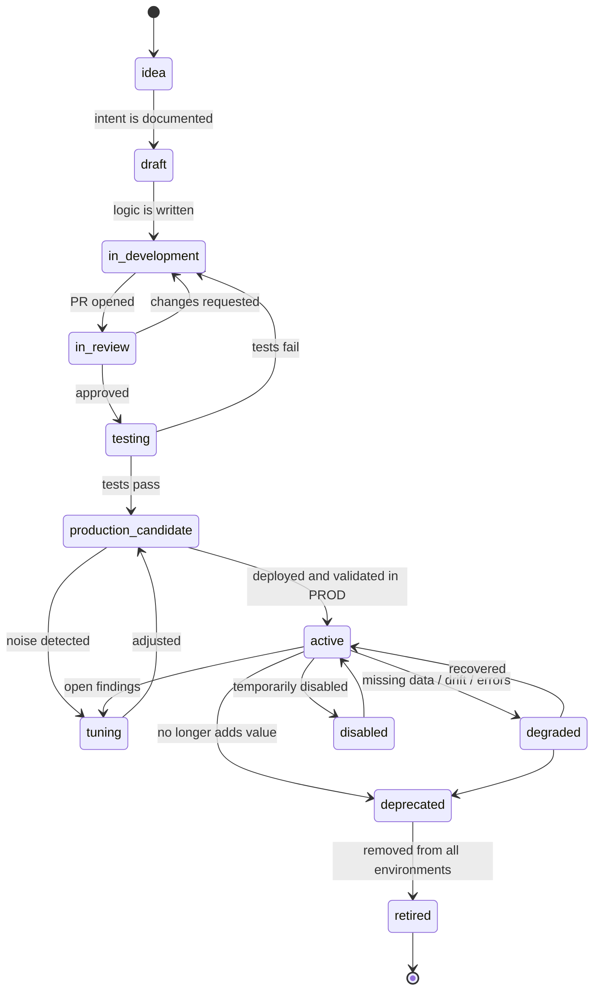
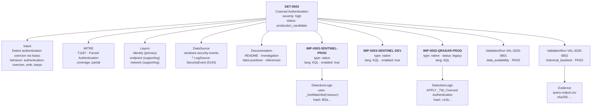
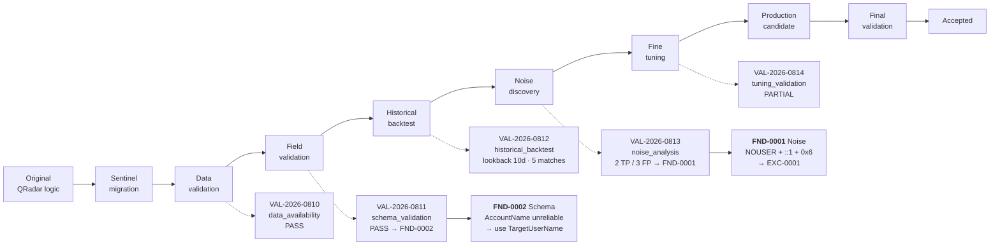

# 02 - Data Model (Phase 1)

> This is the central document of the project. It defines **what exists**, **which attributes it has**
> and **how it relates**. The YAML, the SQL schema, the API and the UI all derive from here.

---

## 1. Model overview

```mermaid
flowchart TB
    subgraph L1["LAYER 1 - INTENT (what we want to detect)"]
        DET["Detection"]
        INT["DetectionIntent"]
        MIT["MitreMapping"]
        LAY["DetectionLayer"]
        DS["DataSource"]
        LS["LogSource"]
        DOC["Documentation"]
        REF["Reference"]
        TAG["Tag / Taxonomy"]
        THR["ThreatMapping"]
        REL["DetectionRelationship"]
    end

    subgraph L2["LAYER 2 - IMPLEMENTATION (how we detect it)"]
        IMP["Implementation"]
        PLT["Platform"]
        ENV["Environment"]
        LOG["DetectionLogic"]
        EXC["ExceptionRule"]
        ENR["EnrichmentAsset"]
        DEPL["Deployment"]
        VER["Version"]
    end

    subgraph L3["LAYER 3 - VALIDATION (how we know it works)"]
        TST["Test"]
        VAL["ValidationRun"]
        EVD["Evidence"]
        FND["Finding"]
    end

    subgraph L4["LAYER 4 - POSTURE (how good it is)"]
        MET["Metric"]
        SCO["DetectionScore"]
        SNAP["PostureSnapshot"]
        COV["CoverageItem"]
    end

    subgraph GOV["CROSS-CUTTING - GOVERNANCE"]
        OWN["Owner / Team"]
        USR["User"]
        REV["Review / Approval"]
        AUD["AuditEvent"]
        RUN["Runbook"]
    end

    DET --> INT
    DET --> MIT
    DET --> LAY
    DET --> DS
    DS --> LS
    DET --> DOC
    DOC --> REF
    DET --> TAG
    DET --> THR
    DET --> REL
    DET --> IMP
    IMP --> PLT
    IMP --> ENV
    IMP --> LOG
    IMP --> EXC
    IMP --> ENR
    IMP --> DEPL
    IMP --> VER
    DET --> TST
    TST --> VAL
    IMP --> VAL
    VAL --> EVD
    VAL --> FND
    FND --> EVD
    DET --> MET
    IMP --> MET
    DET --> SCO
    SCO --> SNAP
    MIT --> COV
    DS --> COV
    LAY --> COV
    DET --> OWN
    OWN --> USR
    DET --> REV
    DET --> AUD
    DET --> RUN
```

---

## 2. Entity-relationship diagram (ERD)

```mermaid
erDiagram
    DETECTION ||--|| DETECTION_INTENT : "has 1"
    DETECTION ||--o{ MITRE_MAPPING : "maps to N"
    DETECTION }o--o{ DETECTION_LAYER : "covers N"
    DETECTION }o--o{ DATA_SOURCE : "requires N"
    DATA_SOURCE ||--o{ LOG_SOURCE : "materializes as"
    LOG_SOURCE ||--o{ SCHEMA_FIELD : "exposes"
    DETECTION ||--o{ DOCUMENTATION : "documented by"
    DOCUMENTATION ||--o{ REFERENCE : "cites"
    DETECTION }o--o{ TAG : "classified by"
    DETECTION ||--o{ THREAT_MAPPING : "associated with"
    DETECTION ||--o{ DETECTION_RELATIONSHIP : "related to"
    DETECTION ||--o{ IMPLEMENTATION : "implemented as N"
    DETECTION ||--o{ VERSION : "versioned"
    DETECTION }o--|| OWNER : "belongs to"
    DETECTION ||--o{ RUNBOOK : "guided by"

    IMPLEMENTATION }o--|| PLATFORM : "on"
    IMPLEMENTATION }o--|| ENVIRONMENT : "in"
    IMPLEMENTATION ||--|| DETECTION_LOGIC : "contains"
    IMPLEMENTATION ||--o{ EXCEPTION_RULE : "excludes"
    IMPLEMENTATION }o--o{ ENRICHMENT_ASSET : "uses"
    IMPLEMENTATION ||--o{ DEPLOYMENT : "deployed by"
    IMPLEMENTATION ||--o{ VERSION : "versioned"

    DETECTION ||--o{ TEST : "defines"
    TEST ||--o{ VALIDATION_RUN : "executed as"
    IMPLEMENTATION ||--o{ VALIDATION_RUN : "validated by"
    VALIDATION_RUN ||--o{ EVIDENCE : "produces"
    VALIDATION_RUN ||--o{ FINDING : "uncovers"
    FINDING ||--o{ EVIDENCE : "supported by"
    FINDING }o--o| EXCEPTION_RULE : "resolved with"

    DETECTION ||--o{ METRIC : "measures"
    IMPLEMENTATION ||--o{ METRIC : "measures"
    DETECTION ||--o{ DETECTION_SCORE : "scored"
    DETECTION_SCORE }o--|| POSTURE_SNAPSHOT : "aggregated in"

    OWNER ||--o{ USER : "composed of"
    DETECTION ||--o{ REVIEW : "reviewed"
    DETECTION ||--o{ AUDIT_EVENT : "audited"
```

---

## 3. The 16 agreed entities

### 3.1 `Detection` - root entity

Represents **the behavior we want to detect**. It is technology-independent.

| Attribute | Type | Req. | Description |
|----------|------|:----:|-------------|
| `id` | string `DET-\d{4}` | Yes | Stable, immutable identifier. Never reused. |
| `uuid` | uuid | Yes | Global identifier (to federate catalogs). |
| `name` | string(160) | Yes | Human-readable name. E.g. `Coerced Authentication`. |
| `slug` | string | Yes | Derived from the name, used in Git paths. |
| `version` | semver | Yes | Version of the detection (not of the implementation). |
| `status` | enum `LifecycleStatus` | Yes | See §5.1. |
| `description` | text (markdown) | Yes | Executive summary, 2-5 sentences. |
| `severity` | enum `info\|low\|medium\|high\|critical` | Yes | Default alert severity. |
| `confidence` | enum `low\|medium\|high` | Optional | Expected confidence in the signal. |
| `risk_score` | int 0-100 | Optional | Risk score if the SIEM supports it. |
| `detection_type` | enum | Yes | `signature`, `threshold`, `anomaly`, `correlation`, `behavioral`, `ml`, `threat_intel`, `hunting` |
| `alert_disposition` | enum | Optional | `alert`, `incident`, `hunt_only`, `enrichment_only` |
| `false_positive_rate_expected` | enum `low\|medium\|high` | Optional | Declared expectation; compared against real metrics. |
| `tlp` | enum `clear\|green\|amber\|red` | Optional | Sharing classification. |
| `visibility` | enum `internal\|shareable\|restricted` | Optional | Export control. |
| `owner_id` | fk → `Owner` | Yes | Responsible team. |
| `author` | string | Yes | Original author. |
| `created_at` | timestamptz | Yes | |
| `updated_at` | timestamptz | Yes | |
| `review_cadence_days` | int | Optional | How often it must be reviewed. Default 180. |
| `next_review_due` | date | Optional | Computed. |
| `deprecation` | object | Optional | `{reason, date, replaced_by: DET-XXXX}` |
| `tags` | array<string> | Optional | Free + controlled taxonomy. |
| `source_origin` | enum | Optional | `custom`, `content_hub`, `sigma_community`, `vendor`, `migrated_qradar` |
| `source_reference` | string | Optional | ID/URL of the original rule if inherited. |
| `git_path` | string | Yes | Canonical path in the repository. |

**Invariants**
- `id` is immutable for life, even after the detection is retired.
- A `Detection` **may** exist with 0 implementations (`draft` / `gap` state).
- If `status = deprecated`, `deprecation.reason` is mandatory.

---

### 3.2 `DetectionIntent` - the formalized "what"

Deliberately separated from `Detection`: it is the part that can be reasoned about, compared and used
to compute coverage, independent of the free-text wording of the description.

| Attribute | Type | Req. | Description |
|----------|------|:----:|-------------|
| `detection_id` | fk | Yes | 1:1 with Detection. |
| `summary` | text | Yes | One sentence: "Detect authentication coercion attempts through lsarpc". |
| `adversary_behavior` | array<string> | Yes | Controlled vocabulary: `authentication-coercion`, `smb`, `lsarpc`. |
| `hypothesis` | text | Optional | Detection hypothesis: "If an attacker forces NTLM authentication…". |
| `preconditions` | array<string> | Optional | What must be true for the detection to work. |
| `assumptions` | array<string> | Optional | Environment assumptions (e.g. "object access auditing enabled"). |
| `scope_included` | array<string> | Optional | What it covers (e.g. `domain controllers`). |
| `scope_excluded` | array<string> | Optional | What it does NOT cover (e.g. `does not cover coercion via EFSRPC`). |
| `evasion_notes` | text | Optional | How this detection could be evaded. |
| `kill_chain_phase` | array<string> | Optional | Lockheed Martin / Unified Kill Chain. |
| `attack_surface` | array<string> | Optional | `identity`, `endpoint`, `network`, `cloud`, `saas`, `ot` |

---

### 3.3 `Implementation` - the "how" on a specific technology

> **Decision D-02:** AQL and KQL for the same detection are **two implementations**, not two rules.

| Attribute | Type | Req. | Description |
|----------|------|:----:|-------------|
| `id` | string `IMP-...` | Yes | `IMP-0003-SENTINEL-PROD` |
| `detection_id` | fk | Yes | |
| `platform_id` | fk → `Platform` | Yes | `sentinel`, `qradar`, `crowdstrike`, `zeek`… |
| `environment_id` | fk → `Environment` | Yes | `dev`, `staging`, `prod` |
| `implementation_type` | enum | Yes | `generated` / `generated_customized` / `native` - see doc 09 |
| `status` | enum `ImplementationStatus` | Yes | See §5.2 |
| `enabled` | boolean | Yes | Reflects the **real** state in the SIEM (discovered by connector). |
| `enabled_declared` | boolean | Yes | **Declared** state in Git. Divergence => drift. |
| `logic_id` | fk → `DetectionLogic` | Yes | The actual query. |
| `native_rule_id` | string | Optional | Rule ID in the SIEM (Sentinel GUID, QRadar ID). |
| `native_rule_name` | string | Optional | Real name in the SIEM (may differ from `Detection.name`). |
| `schedule` | object | Optional | `{frequency: PT1H, lookback: PT24H, cron: null}` |
| `threshold` | object | Optional | `{operator: gt, value: 5, group_by: [Account]}` |
| `suppression` | object | Optional | `{enabled: true, duration: PT5H}` |
| `entity_mappings` | array<object> | Optional | Mapping to SIEM entities (Account, Host, IP, FileHash). |
| `custom_details` | map<string,string> | Optional | Custom fields exposed in the alert. |
| `alert_grouping` | object | Optional | Incident grouping rules. |
| `performance` | object | Optional | `{avg_runtime_ms, avg_rows_scanned, cost_estimate}` |
| `version` | semver | Yes | Version of **this** implementation. |
| `sigma_backed` | boolean | Yes | Does it derive from a canonical Sigma? |
| `sigma_hash` | sha256 | Optional | Hash of the Sigma it was generated from. |
| `generated_at` | timestamptz | Optional | When SigmaForge generated it. |
| `customized` | boolean | Yes | Was there manual editing after generation? |
| `drift_status` | enum | Yes | `in_sync`, `local_ahead`, `remote_ahead`, `diverged`, `unknown`, `not_deployed` |
| `drift_detected_at` | timestamptz | Optional | |
| `last_deployed_at` | timestamptz | Optional | |
| `deprecation_notes` | text | Optional | E.g. "Legacy QRadar, keep until migration is complete". |

**Invariants**
- The tuple `(detection_id, platform_id, environment_id)` is **unique**.
- `implementation_type = generated` => `sigma_backed = true` and `customized = false`.
- `implementation_type = native` => `sigma_backed = false`.
- If `enabled ≠ enabled_declared` => a `Finding` of type `drift` is generated.

---

### 3.4 `Environment`

| Attribute | Type | Req. | Description |
|----------|------|:----:|-------------|
| `id` | string | Yes | `dev`, `staging`, `prod` |
| `name` | string | Yes | `Sentinel DEV` |
| `platform_id` | fk | Yes | Which platform it belongs to |
| `tier` | enum `dev\|test\|staging\|prod` | Yes | |
| `region` | string | Optional | |
| `workspace_ref` | string | Optional | Log Analytics workspace ID / QRadar console |
| `promotion_target` | fk → Environment | Optional | Where it is promoted to (`dev → prod`) |
| `requires_approval` | boolean | Yes | `prod = true` |
| `connector_id` | fk | Optional | Connector that discovers it |
| `data_retention_days` | int | Optional | Relevant for backtests |
| `is_authoritative_for_metrics` | boolean | Yes | Only PROD counts toward real effectiveness |

---

### 3.5 `DataSource` (+ `LogSource` + `SchemaField`)

It is split into three levels, because the real problem (`AccountName` unreliable in 4768/4771)
occurs at the **field** level, not the source level.

**`DataSource`** - logical concept
| Attribute | Type | Req. | Description |
|----------|------|:----:|-------------|
| `id` | string | Yes | `windows-security-events` |
| `name` | string | Yes | |
| `category` | enum | Yes | `identity`, `endpoint`, `network`, `cloud`, `application`, `saas`, `ot` |
| `attack_data_source` | string | Optional | Mapping to MITRE Data Source (`DS0028 Logon Session`) |
| `attack_data_component` | string | Optional | `Logon Session Creation` |
| `criticality` | enum | Optional | How much it hurts to lose it |
| `owner_id` | fk | Optional | Who owns the ingestion pipeline |

**`LogSource`** - materialization on a platform
| Attribute | Type | Req. | Description |
|----------|------|:----:|-------------|
| `id` | string | Yes | `sentinel/SecurityEvent` |
| `data_source_id` | fk | Yes | |
| `platform_id` | fk | Yes | |
| `table_or_stream` | string | Yes | `SecurityEvent`, `qradar:eventlog` |
| `event_ids` | array<string> | Optional | `[4768, 4771, 5145]` |
| `ingest_status` | enum | Yes | `active`, `degraded`, `absent` (discovered by connector) |
| `last_seen_at` | timestamptz | Optional | Last observed event |
| `avg_daily_volume` | bigint | Optional | |
| `retention_days` | int | Optional | |

**`SchemaField`** - the concrete field
| Attribute | Type | Req. | Description |
|----------|------|:----:|-------------|
| `log_source_id` | fk | Yes | |
| `field_name` | string | Yes | `TargetUserName` |
| `data_type` | string | Optional | |
| `reliability` | enum | Optional | `reliable`, `partial`, `unreliable`, `absent` |
| `reliability_notes` | text | Optional | "AccountName not populated for 4768/4771" |
| `populated_ratio` | float 0-1 | Optional | Measured by data validation |
| `verified_at` | timestamptz | Optional | |
| `ecs_mapping` / `asim_mapping` / `ocsf_mapping` | string | Optional | Normalization |

> **This split exists because of Kerberos Finding #002.** Without it, that finding
> has nowhere to live in a structured way.

---

### 3.6 `DetectionLayer`

| Attribute | Type | Req. | Description |
|----------|------|:----:|-------------|
| `id` | string | Yes | `identity`, `endpoint`, `network`, `cloud`, `email`, `application`, `data`, `ot` |
| `name` | string | Yes | |
| `description` | text | Optional | |
| `weight` | float | Optional | Weight in the Layer Coverage calculation |
| `target_coverage_pct` | int | Optional | Program target for that layer |

The `Detection <-> DetectionLayer` relationship is N:M with an attribute:

| Attribute | Type | Description |
|----------|------|-------------|
| `coverage_strength` | enum `primary\|supporting\|partial` | Whether the layer is the main or an auxiliary one |

---

### 3.7 `MitreMapping`

| Attribute | Type | Req. | Description |
|----------|------|:----:|-------------|
| `detection_id` | fk | Yes | |
| `tactic` | string | Yes | `TA0006` (derivable from the technique but persisted) |
| `technique` | string | Yes | `T1187` |
| `subtechnique` | string | Optional | `T1187.001` |
| `attack_version` | string | Yes | `v15.1` - framework version used |
| `coverage_level` | enum | Yes | `none`, `minimal`, `partial`, `significant`, `complete` (DeTT&CT scale) |
| `detection_confidence` | enum | Optional | `low`, `medium`, `high` |
| `is_primary` | boolean | Yes | The main technique of the detection |
| `notes` | text | Optional | Why coverage is partial |

**Future extension:** support for `d3fend`, `atlas` (ML), `mitre_ics`.

---

### 3.8 `ValidationRun`

> **Decision D-08.** Replaces `last_tested: 2026-08-26`.

| Attribute | Type | Req. | Description |
|----------|------|:----:|-------------|
| `id` | string `VAL-YYYY-NNNN` | Yes | |
| `detection_id` | fk | Yes | |
| `implementation_id` | fk | Optional | Null if the validation is of the detection in the abstract |
| `test_id` | fk → `Test` | Optional | Null if it was ad-hoc |
| `type` | enum `ValidationType` | Yes | See §5.3 |
| `executed_at` | timestamptz | Yes | |
| `engineer` | string / fk User | Yes | |
| `environment_id` | fk | Yes | |
| `query_version` | semver / sha256 | Yes | Exact version of the query that was tested |
| `input_dataset` | object | Yes | `{type: historical\|synthetic\|live\|atomic, lookback: 10d, source: ...}` |
| `expected_result` | text | Yes | What was expected |
| `actual_result` | text | Yes | What happened |
| `result` | enum | Yes | `pass`, `fail`, `partial`, `blocked`, `not_applicable` |
| `metrics` | object | Optional | `{matches: 5, tp: 2, fp: 3, precision: 0.4}` |
| `duration_ms` | int | Optional | |
| `automated` | boolean | Yes | Was it run by the system or by a person? |
| `tooling` | string | Optional | `rsigma`, `atomic-red-team`, `manual`, `caldera` |
| `evidence_ids` | array<fk> | Optional | |
| `finding_ids` | array<fk> | Optional | |
| `notes` | text | Optional | |
| `signature` | string | Optional | Hash/signature for audit integrity |

---

### 3.9 `Test` - the reusable *definition*

Key difference: `Test` is the **specification**; `ValidationRun` is the **execution**.

| Attribute | Type | Req. | Description |
|----------|------|:----:|-------------|
| `id` | string `TST-...` | Yes | |
| `detection_id` | fk | Yes | |
| `name` | string | Yes | `Kerberos BF - 5 failures in 10 min from the same IP` |
| `type` | enum `ValidationType` | Yes | |
| `description` | text | Yes | |
| `given` | text | Yes | Precondition (Gherkin-style) |
| `when` | text | Yes | Action / dataset |
| `then` | text | Yes | Expected result |
| `test_data_ref` | string | Optional | Path to the fixture (`tests/data/krb-bf-positive.json`) |
| `expected_match_count` | int | Optional | |
| `expected_fields` | array<string> | Optional | Fields that must come populated |
| `is_negative_test` | boolean | Yes | Test that must **not** fire |
| `automation_status` | enum | Yes | `manual`, `semi_automated`, `automated` |
| `runner` | enum | Optional | `rsigma`, `kql_unit`, `atomic`, `custom` |
| `frequency` | enum | Optional | `on_change`, `daily`, `weekly`, `quarterly` |
| `enabled` | boolean | Yes | |
| `atomic_test_ref` | string | Optional | Atomic Red Team ID if applicable |

---

### 3.10 `Finding`

> **Decision D-09.** A test produces findings that outlive the test.

| Attribute | Type | Req. | Description |
|----------|------|:----:|-------------|
| `id` | string `FND-NNNN` | Yes | |
| `detection_id` | fk | Yes | |
| `implementation_id` | fk | Optional | |
| `validation_run_id` | fk | Optional | Origin of the finding |
| `type` | enum `FindingType` | Yes | See §5.4 |
| `title` | string | Yes | `Noise: NOUSER + ::1 + 0x6` |
| `observation` | text | Yes | What was observed |
| `pattern` | text | Optional | Technical pattern: `NOUSER + ::1 + 0x6` |
| `severity` | enum `low\|medium\|high\|critical` | Yes | |
| `impact` | text | Optional | What it implies if not fixed |
| `recommendation` | text | Yes | `Exclude loopback + NOUSER` |
| `status` | enum | Yes | `open`, `acknowledged`, `in_progress`, `resolved`, `accepted_risk`, `wont_fix` |
| `assigned_to` | fk User | Optional | |
| `opened_at` / `resolved_at` | timestamptz | Yes/Optional | |
| `resolution` | text | Optional | How it was resolved |
| `resolution_ref` | string | Optional | Commit, PR or `ExceptionRule` that resolves it |
| `blocks_promotion` | boolean | Yes | If `true`, it prevents moving to PROD |
| `evidence_ids` | array<fk> | Optional | |
| `recurrence_count` | int | Optional | Number of times it has reappeared |

---

### 3.11 `Evidence`

| Attribute | Type | Req. | Description |
|----------|------|:----:|-------------|
| `id` | string `EVD-...` | Yes | |
| `type` | enum | Yes | `screenshot`, `query_output`, `log_sample`, `csv`, `json`, `pcap`, `report`, `link`, `video` |
| `title` | string | Yes | |
| `file_path` | string | Optional | Relative path in the repo (`evidence/2026-08-26/logs-validation.png`) |
| `external_url` | string | Optional | If it lives elsewhere (ticket, wiki) |
| `sha256` | string | Yes | Integrity - **mandatory** for audit |
| `size_bytes` | bigint | Optional | |
| `captured_at` | timestamptz | Yes | |
| `captured_by` | string | Yes | |
| `redacted` | boolean | Yes | Does it contain anonymized sensitive data? |
| `retention_until` | date | Optional | Retention policy |
| `linked_to` | polymorphic | Yes | `{entity_type, entity_id}` - ValidationRun, Finding, Deployment |

> **Storage note:** large binaries do NOT go into plain Git. See doc 05 §6
> (Git LFS or object storage with a pointer + sha256 in the repo).

---

### 3.12 `Deployment`

| Attribute | Type | Req. | Description |
|----------|------|:----:|-------------|
| `id` | string `DEP-YYYY-NNNN` | Yes | |
| `implementation_id` | fk | Yes | |
| `environment_id` | fk | Yes | |
| `action` | enum | Yes | `create`, `update`, `enable`, `disable`, `delete`, `rollback` |
| `from_version` / `to_version` | semver | Optional/Yes | |
| `git_commit` | sha | Yes | Deployed commit |
| `triggered_by` | fk User | Yes | |
| `trigger_type` | enum | Yes | `manual`, `pipeline`, `scheduled`, `auto_rollback` |
| `approved_by` | fk User | Optional | Mandatory if `Environment.requires_approval` |
| `approval_ref` | string | Optional | PR / change request |
| `started_at` / `finished_at` | timestamptz | Yes | |
| `status` | enum | Yes | `pending`, `in_progress`, `success`, `failed`, `rolled_back`, `partial` |
| `error_message` | text | Optional | |
| `dry_run` | boolean | Yes | |
| `rollback_of` | fk Deployment | Optional | |
| `post_deploy_validation_id` | fk ValidationRun | Optional | Automatic validation after deploying |

---

### 3.13 `Metric`

> **Decision D-10:** `scope = detection` is distinguished from `scope = program`. **They are never mixed.**

| Attribute | Type | Req. | Description |
|----------|------|:----:|-------------|
| `id` | uuid | Yes | |
| `scope` | enum `detection\|implementation\|program\|platform\|team` | Yes | |
| `subject_id` | string | Optional | `DET-0001`, `IMP-...`, or null if `program` |
| `metric_key` | string | Yes | See catalog in doc 07 |
| `value` | numeric | Yes | |
| `unit` | string | Optional | `count`, `percent`, `ratio`, `days`, `ms` |
| `period_start` / `period_end` | timestamptz | Yes | |
| `granularity` | enum | Yes | `hourly`, `daily`, `weekly`, `monthly`, `snapshot` |
| `source` | enum | Yes | `connector`, `computed`, `manual`, `soar` |
| `environment_id` | fk | Optional | |
| `collected_at` | timestamptz | Yes | |
| `confidence` | enum | Optional | If the data comes from a partial source |

Time series → stored append-only, never updated.

---

### 3.14 `Owner`

| Attribute | Type | Req. | Description |
|----------|------|:----:|-------------|
| `id` | string | Yes | `detection-engineering` |
| `type` | enum `team\|individual\|vendor` | Yes | |
| `name` | string | Yes | |
| `email` | string | Optional | |
| `slack_channel` / `teams_channel` | string | Optional | |
| `escalation_contact` | string | Optional | |
| `members` | array<fk User> | Optional | |
| `responsibilities` | array<string> | Optional | `authoring`, `tuning`, `on_call`, `approval` |
| `sla_response_days` | int | Optional | For assigned findings |

The relationship with `Detection` can be refined:

| Role | Description |
|-----|-------------|
| `owner` | Ultimately responsible (mandatory) |
| `author` | Who wrote it |
| `maintainer` | Who maintains it day to day |
| `approver` | Who approves changes to PROD |
| `stakeholder` | Interested party (e.g. IAM team) |

---

### 3.15 `Documentation`

| Attribute | Type | Req. | Description |
|----------|------|:----:|-------------|
| `detection_id` | fk | Yes | |
| `doc_type` | enum | Yes | `overview`, `investigation`, `false_positives`, `response`, `tuning`, `changelog`, `references`, `architecture` |
| `file_path` | string | Yes | `README.md`, `investigation.md` |
| `content` | text (markdown) | Yes | Indexed in the DB, lives in Git |
| `format` | enum | Yes | `markdown`, `asciidoc` |
| `language` | string | Optional | `es`, `en` |
| `completeness_score` | float | Optional | Computed (see doc 07) |
| `last_reviewed_at` | timestamptz | Optional | |
| `word_count` | int | Optional | |
| `has_required_sections` | boolean | Optional | Validated against template |

**Minimum mandatory sections per `doc_type`** (validated in CI):

| doc_type | Required sections |
|----------|----------------------|
| `overview` | Summary, Detection Logic (prose), Data Sources, MITRE, Severity Rationale |
| `investigation` | Triage steps, Pivot queries, What to escalate, What to close |
| `false_positives` | Known patterns, Cause, Recommended exclusion, Risk of excluding |
| `response` | Containment, Eradication, Communication |

---

### 3.16 `Version`

| Attribute | Type | Req. | Description |
|----------|------|:----:|-------------|
| `id` | uuid | Yes | |
| `entity_type` | enum `detection\|implementation\|documentation\|test` | Yes | |
| `entity_id` | string | Yes | |
| `version` | semver | Yes | |
| `git_commit` | sha | Yes | |
| `git_tag` | string | Optional | |
| `change_type` | enum | Yes | `major`, `minor`, `patch` |
| `change_category` | enum | Yes | `logic`, `documentation`, `metadata`, `tuning`, `bugfix`, `deprecation` |
| `changelog` | text | Yes | |
| `author` | fk User | Yes | |
| `created_at` | timestamptz | Yes | |
| `content_hash` | sha256 | Yes | Hash of the versioned content |
| `breaking` | boolean | Yes | Does it break compatibility with previous alerts? |

**Semantic versioning rules applied to detections:**

| Change | Bump |
|--------|------|
| The detected behavior or the intent changes | `major` |
| An implementation or data source is added | `minor` |
| Tuning, exclusion, threshold change | `minor` |
| Documentation fix, typo, metadata | `patch` |
| Change that alters the alert schema | `major` + `breaking = true` |

---

## 4. Additional entities (not in the list, but the model needs them)

### 4.1 `Platform`
| Attribute | Type | Description |
|----------|------|-------------|
| `id` | string | `sentinel`, `qradar`, `crowdstrike`, `zeek`, `elastic` |
| `type` | enum | `siem`, `edr`, `ndr`, `cnapp`, `waf`, `dlp` |
| `query_language` | string | `kql`, `aql`, `eql`, `spl`, `lucene` |
| `sigmaforge_backend` | string | Name of the translation backend |
| `supports_deployment_api` | boolean | Can it be deployed via API? |
| `supports_query_api` | boolean | Can a backtest be run via API? |
| `vendor` / `version` | string | |

### 4.2 `DetectionLogic`
Separate from `Implementation` so the query can be versioned independently and hashed.

| Attribute | Type | Description |
|----------|------|-------------|
| `id` | uuid | |
| `implementation_id` | fk | |
| `language` | string | `kql`, `aql`, `sigma` |
| `code` | text | **The literal query, preserved without transformation** |
| `code_hash` | sha256 | |
| `file_path` | string | `implementations/sentinel/prod/rule.kql` |
| `line_count` | int | |
| `complexity_score` | int | Heuristic: joins, subqueries, functions |
| `uses_functions` | array<string> | `binary_and`, `make_set`, `summarize`, `_GetWatchlist` |
| `external_dependencies` | array<string> | Watchlists, lookups, saved functions |
| `parsed_ok` | boolean | Does the language linter validate it? |
| `lint_warnings` | array<string> | |

### 4.3 `SigmaRule` (canonical logic)
| Attribute | Type | Description |
|----------|------|-------------|
| `detection_id` | fk | |
| `sigma_yaml` | text | Canonical Sigma |
| `sigma_id` | uuid | Native Sigma ID |
| `sigma_hash` | sha256 | |
| `is_authoritative` | boolean | Is it the source of truth for the logic, or documentation only? |
| `translation_coverage` | enum | `full`, `partial`, `documentation_only` |
| `untranslatable_parts` | array<string> | What cannot be expressed in Sigma |

### 4.4 `ExceptionRule` (tuning / exclusions)
> Born directly from Kerberos Finding #001.

| Attribute | Type | Description |
|----------|------|-------------|
| `id` | string | `EXC-0001` |
| `implementation_id` | fk | |
| `finding_id` | fk | Finding that originated it |
| `type` | enum | `exclusion`, `allowlist`, `threshold_adjust`, `suppression`, `time_window` |
| `expression` | text | The query fragment that excludes |
| `justification` | text | **Mandatory** |
| `risk_accepted` | text | What we stop detecting by excluding this |
| `approved_by` | fk User | |
| `expires_at` | date | Temporary exclusions expire |
| `review_required_at` | date | |
| `active` | boolean | |
| `scope` | enum | `global`, `environment`, `entity` |

### 4.5 `EnrichmentAsset` (watchlists, lookups)
| Attribute | Type | Description |
|----------|------|-------------|
| `id` | string | `nessus` |
| `type` | enum | `watchlist`, `lookup`, `reference_set`, `threat_intel_feed`, `saved_function` |
| `platform_id` | fk | |
| `native_name` | string | Name in the SIEM |
| `owner_id` | fk | |
| `refresh_frequency` | string | |
| `last_updated_at` | timestamptz | Discovered by connector |
| `row_count` | int | |
| `staleness_threshold_days` | int | If exceeded → Finding |

### 4.6 `PostureSnapshot`
| Attribute | Type | Description |
|----------|------|-------------|
| `id` | uuid | |
| `taken_at` | timestamptz | |
| `scope` | enum | `program`, `platform`, `team`, `layer` |
| `scores` | jsonb | `{coverage: 81, quality: 76, ...}` |
| `overall` | int | |
| `detection_count` | int | |
| `breakdown` | jsonb | Counters: stale, no owner, no test… |
| `git_commit` | sha | Repo state at that moment |

Enables **historical posture**: "have we improved compared to last quarter?"

### 4.7 `CoverageItem`
| Attribute | Type | Description |
|----------|------|-------------|
| `dimension` | enum | `mitre_technique`, `data_source`, `layer`, `platform`, `threat_actor` |
| `key` | string | `T1187` |
| `detection_ids` | array | Detections that cover it |
| `coverage_level` | enum | Maximum across the detections |
| `is_gap` | boolean | |
| `priority` | enum | Priority of closing the gap |
| `justification` | text | If it is an accepted gap, why |

### 4.8 `AuditEvent`
| Attribute | Type | Description |
|----------|------|-------------|
| `id` | uuid | |
| `timestamp` | timestamptz | |
| `actor` | string | User or `system` |
| `action` | string | `detection.updated`, `implementation.deployed` |
| `entity_type` / `entity_id` | string | |
| `before` / `after` | jsonb | Diff |
| `source` | enum | `ui`, `api`, `git`, `connector`, `pipeline` |
| `ip_address` | inet | |
| `request_id` | string | |

**Append-only** table, no UPDATE or DELETE.

### 4.9 `Review` / `Approval`
| Attribute | Type | Description |
|----------|------|-------------|
| `id` | uuid | |
| `detection_id` | fk | |
| `type` | enum | `peer_review`, `periodic_review`, `promotion_approval`, `deprecation_approval` |
| `reviewer` | fk User | |
| `decision` | enum | `approved`, `changes_requested`, `rejected`, `pending` |
| `comments` | text | |
| `checklist` | jsonb | Verified items |
| `reviewed_at` | timestamptz | |
| `git_pr_ref` | string | |

### 4.10 `Runbook`
| Attribute | Type | Description |
|----------|------|-------------|
| `detection_id` | fk | |
| `triage_steps` | array<object> | Step, query, decision criterion |
| `escalation_criteria` | text | |
| `containment_actions` | array<string> | |
| `soar_playbook_ref` | string | |
| `estimated_triage_minutes` | int | Feeds analyst cost metrics |

### 4.11 `ThreatMapping`
| Attribute | Type | Description |
|----------|------|-------------|
| `detection_id` | fk | |
| `type` | enum | `actor`, `campaign`, `malware`, `tool`, `cve`, `report` |
| `identifier` | string | `G0016`, `CVE-2021-36942`, `PetitPotam` |
| `name` | string | |
| `relevance` | enum | `direct`, `related` |
| `source` | string | URL / feed |

### 4.12 `DetectionRelationship`
| Attribute | Type | Description |
|----------|------|-------------|
| `from_detection_id` | fk | |
| `to_detection_id` | fk | |
| `type` | enum | `supersedes`, `superseded_by`, `duplicates`, `complements`, `depends_on`, `variant_of`, `broader_than`, `narrower_than` |
| `notes` | text | |

Enables answering: *"do we have 3 rules that detect the same thing?"*

---

## 5. Controlled vocabularies (enums)

### 5.1 `LifecycleStatus` (Detection)

| State | Meaning | Counts toward posture? |
|--------|-------------|:---------------------:|
| `idea` | Gap identified, no work done | No |
| `draft` | Intent documented | Partial |
| `in_development` | Logic under construction | Partial |
| `in_review` | Under peer review | Partial |
| `testing` | Under validation | Partial |
| `production_candidate` | Ready, pending approval | Yes |
| `active` | In production and working | Yes |
| `tuning` | Active but with findings | Yes (penalized) |
| `degraded` | Active but broken (no data, drift) | Yes (heavily penalized) |
| `disabled` | Turned off on purpose | No, but reported |
| `deprecated` | Marked for retirement | No |
| `retired` | Removed | No (historical) |

### 5.2 `ImplementationStatus`
`draft` · `active` · `legacy` · `deprecated` · `disabled` · `failed` · `not_deployed`

### 5.3 `ValidationType`

| Type | What it checks | Automatable |
|------|---------------|:-------------:|
| `data_availability` | Do the required logs exist? | Yes |
| `schema_validation` | Do the fields exist and are they populated? | Yes |
| `syntax_validation` | Does the query compile? | Yes |
| `logic_review` | Human review of the logic | No |
| `unit_test` | Test with a synthetic dataset | Yes |
| `historical_backtest` | Execution over historical data | Yes |
| `noise_analysis` | FP analysis in backtest | Semi |
| `tuning_validation` | Did the exclusion work without losing TPs? | Semi |
| `red_team` | Adversary simulation | Semi |
| `atomic_test` | Atomic Red Team | Yes |
| `purple_team` | Joint exercise | No |
| `production_validation` | Does it fire correctly in PROD? | Semi |
| `performance_test` | Execution cost/time | Yes |
| `regression_test` | Did a change break something? | Yes |
| `deployment_validation` | Was what we thought deployed actually deployed? | Yes |

### 5.4 `FindingType`

| Type | Real example |
|------|--------------|
| `noise` | `NOUSER + ::1 + 0x6` generates FPs |
| `schema` / `data_quality` | `AccountName` unreliable in 4768/4771 |
| `data_gap` | The table has not received events for 3 days |
| `logic_error` | The threshold is never reached |
| `coverage_gap` | The detection does not cover the subtechnique |
| `performance` | The query takes 90s and consumes too much |
| `drift` | PROD ≠ Git |
| `governance` | No owner / no review in 12 months |
| `documentation` | Missing false positives section |
| `evasion` | Bypass identified in red team |
| `duplication` | Overlaps with DET-0045 |
| `dependency` | The `nessus` watchlist has not been updated in 60 days |

---

## 6. Example: `DET-0003` instantiated in the model

---

## 7. Example: `DET-0001` Kerberos Brute Force - the rich case

This is the case that **justifies the Validation model**. Its real history:

**What the old model lost and the new one preserves:**

| Information | `last_tested: 2026-08-26` | DEP model |
|-------------|:-------------------------:|:----------:|
| That data availability was tested | No | Yes `VAL-2026-0810` |
| That `TargetAccount/TargetUserName` were indeed populated | No | Yes `SchemaField.reliability` |
| That the backtest covered 10 days | No | Yes `input_dataset.lookback` |
| That there were 5 matches: 2 real, 3 noise | No | Yes `metrics` + `FND-0001` |
| That tuning ended up PARTIAL | No | Yes `result: partial` |
| That the loopback exclusion is pending | No | Yes `Finding.status: open` |
| Which exact query version was tested | No | Yes `query_version` |
| The screenshot that proves it | No | Yes `Evidence` + sha256 |

---

## 8. Cardinality summary

| Relationship | Cardinality | Note |
|----------|:------------:|------|
| Detection → Intent | 1:1 | Mandatory |
| Detection → Implementation | 1:N | N can be 0 (gap) |
| Detection → MitreMapping | 1:N | ≥1 recommended, not mandatory |
| Detection → DataSource | N:M | |
| Detection → DetectionLayer | N:M | with `coverage_strength` |
| Detection → Documentation | 1:N | by `doc_type` |
| Detection → Test | 1:N | |
| Test → ValidationRun | 1:N | |
| Implementation → ValidationRun | 1:N | |
| ValidationRun → Evidence | 1:N | |
| ValidationRun → Finding | 1:N | |
| Finding → ExceptionRule | 1:0..1 | |
| Implementation → Deployment | 1:N | historical |
| Implementation → DetectionLogic | 1:1 per version | |
| Detection → Owner | N:1 | |
| Detection → Version | 1:N | |

---

## 9. Integrity rules (validated in CI and in the API)

| # | Rule | Severity |
|---|-------|:---------:|
| R-01 | `DET-` id unique and with a valid format | error |
| R-02 | `(detection_id, platform, environment)` unique in Implementation | error |
| R-03 | Every Detection in `active` must have ≥1 `active` Implementation | error |
| R-04 | Every Detection in `active` must have `owner_id` | error |
| R-05 | Every Detection must have `README.md` (overview) | error |
| R-06 | MITRE technique must exist in the declared ATT&CK version | error |
| R-07 | Referenced `DataSource` must exist in the catalog | error |
| R-08 | A `ValidationRun` must reference an existing `query_version` | error |
| R-09 | Every `Evidence` must have `sha256` | error |
| R-10 | `ExceptionRule` must have `justification` and `risk_accepted` | error |
| R-11 | Promotion to PROD blocked if there is a Finding with `blocks_promotion=true` | error |
| R-12 | `active` Detection with no ValidationRun in the last N days → `stale` | warning |
| R-13 | `implementation_type=generated` with `customized=true` → inconsistent | error |
| R-14 | Detection without `investigation.md` in `active` state | warning |
| R-15 | Two detections with the same MITRE + same data source → possible duplicate | info |
| R-16 | Expired `ExceptionRule` that is still active | warning |
| R-17 | Referenced `EnrichmentAsset` that does not exist on the platform | error |
| R-18 | `active` detection whose `LogSource.ingest_status = absent` | error → `degraded` |

---

## 10. What remains to be decided (open questions of the model)

| # | Question | Options | Recommendation |
|---|----------|----------|---------------|
| Q-1 | Can the same detection have 2 implementations on the *same* platform+environment (e.g. two complementary KQLs)? | Yes with `variant` / No | **No** in v0.1; use `DetectionRelationship: complements` |
| Q-2 | Are real alerts/incidents imported into DEP? | Yes / Aggregates only | **Aggregates only** in `Metric`; do not bring in PII |
| Q-3 | Is Sigma mandatory for all? | Yes / Optional | **Optional** (D-06/D-07) |
| Q-4 | Multi-tenant? | v1.0 / future | **Future**; but `tenant_id` reserved in the schema from day 1 |
| Q-5 | Do thresholds live in Implementation or in Detection? | | **Implementation** (they vary by environment) |
| Q-6 | Is evidence versioned? | | It is not versioned: it is immutable + hash |
| Q-7 | How is a Content Hub rule that Microsoft updates identified? | | `source_origin=content_hub` + `source_reference` + drift against the upstream template |
