# 03 - Architecture

---

## 1. Logical architecture (frozen vision)

This is the agreed architecture, formalized:

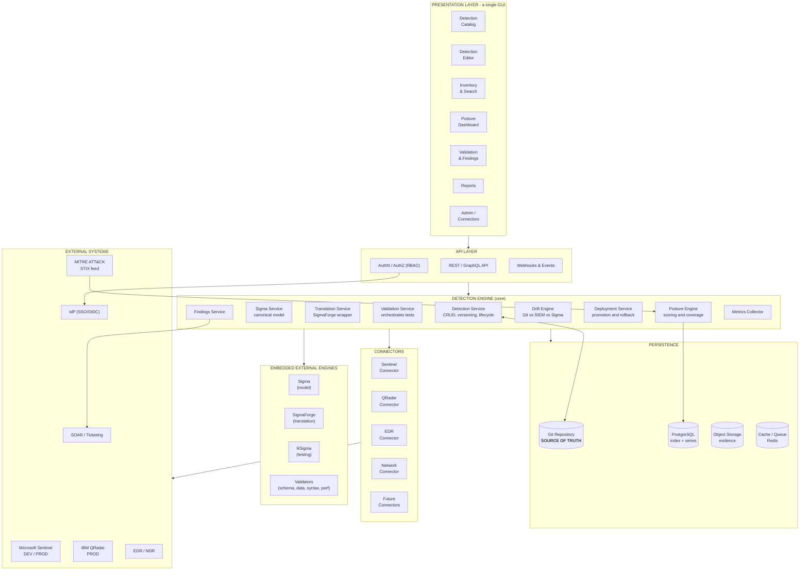

---

## 2. C4 Diagram - Level 1 (Context)

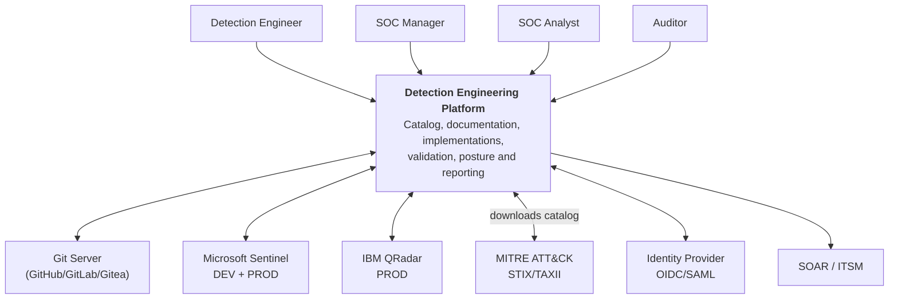

---

## 3. C4 Diagram - Level 2 (Containers)

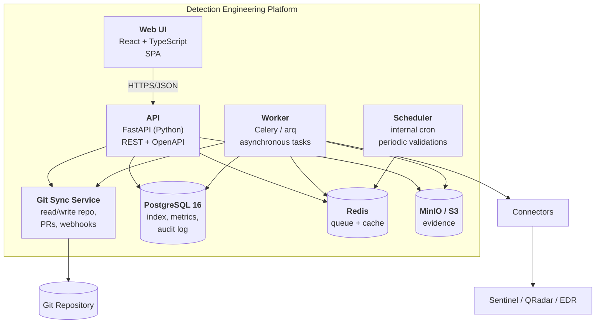

**Stack rationale (proposed, subject to review):**

| Component | Choice | Why |
|-----------|--------|-----|
| Backend | Python 3.12 + FastAPI | pySigma, SigmaForge and the detection ecosystem are Python |
| Model validation | Pydantic v2 | The same model serves the API, YAML and DB |
| ORM | SQLAlchemy 2 + Alembic | Controlled migrations |
| Queue | Celery or `arq` on Redis | Backtests and syncs are long-running |
| Frontend | React + TypeScript + TanStack Query | Mature ecosystem, complex tables |
| UI kit | shadcn/ui + Tailwind | Fast, consistent, open source |
| Query editor | Monaco Editor | KQL/AQL/YAML syntax highlighting |
| ATT&CK diagrams | ATT&CK Navigator layer export | De facto standard |
| Git | GitPython + provider API | Programmatic PRs |
| Auth | OIDC (Keycloak/Entra ID) | Corporate SSO |
| Deployment | Docker Compose (v0.1) → Helm (v1.0) | Operable by 1-3 people |

---

## 4. C4 Diagram - Level 3 (Detection Engine Components)

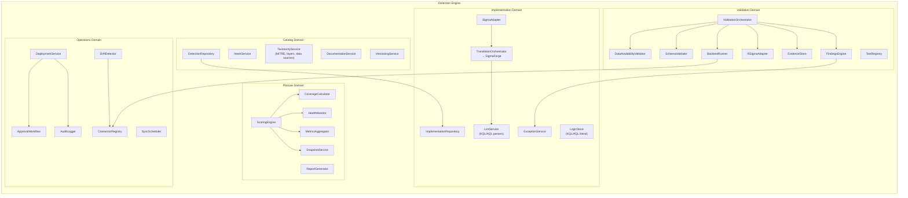

---

## 5. Main data flow

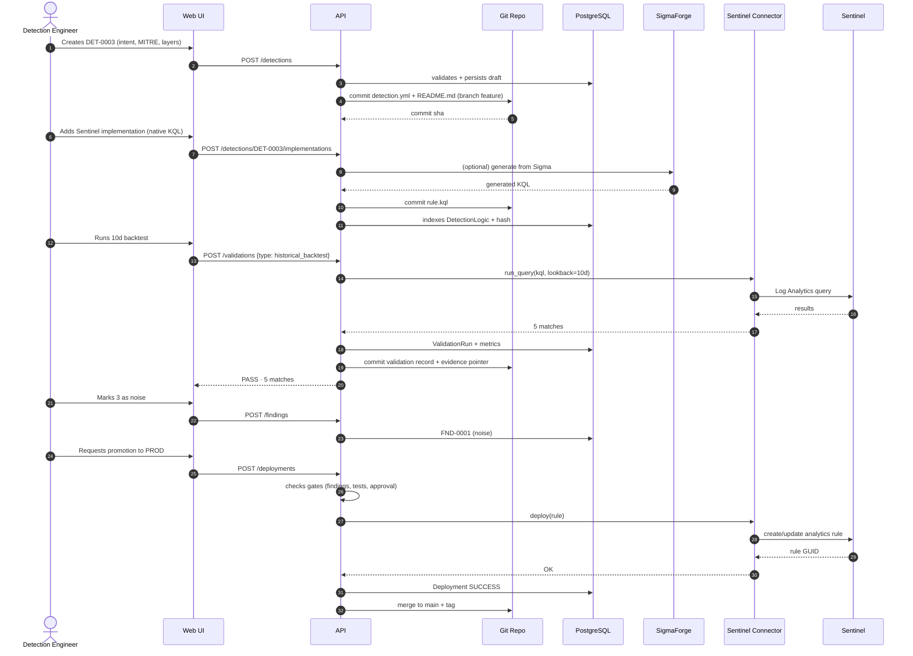

---

## 6. The Data Collector and the Posture Engine

This is the piece that makes sure **the platform does not lie**.

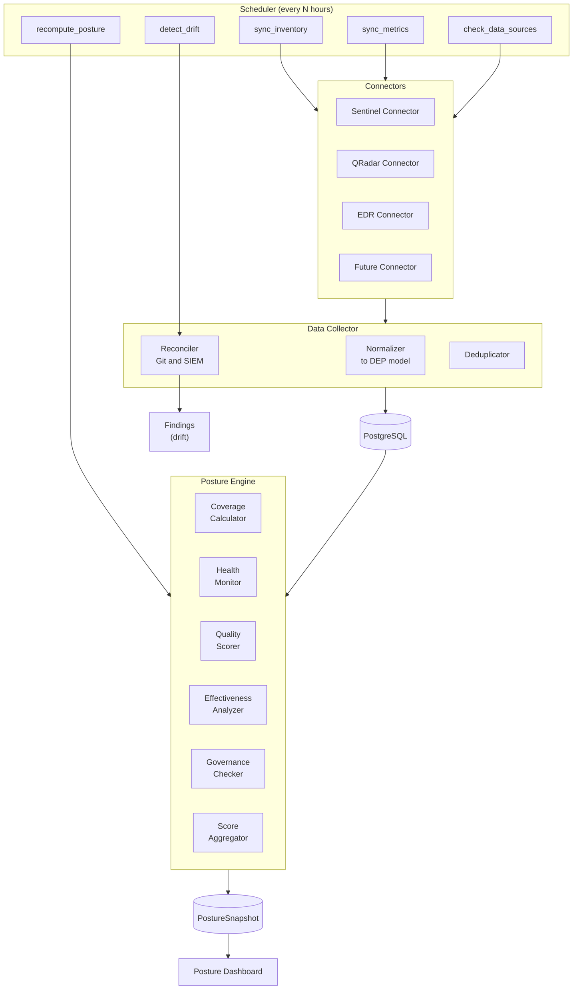

**What each connector collects:**

| Data collected | Sentinel | QRadar | Use |
|----------------|:--------:|:------:|-----|
| List of rules and their status (enabled/disabled) | Yes | Yes | Real inventory, drift |
| Literal query of each rule | Yes | Yes | Comparison with Git |
| Last modification and by whom | Yes | partial | Drift, audit |
| No. of alerts generated per rule | Yes | Yes | Effectiveness |
| Incidents closed as TP/FP | Yes | Yes | Precision |
| Available tables and volume | Yes | Yes | Data availability |
| Fields present in the tables | Yes | partial | Schema validation |
| Watchlists / reference sets | Yes | Yes | EnrichmentAsset staleness |
| Execution cost/time | Yes | partial | Performance |
| Rule execution errors | Yes | Yes | Health → `degraded` |

---

## 7. Deployment model

### 7.1 Development / MVP (v0.1)

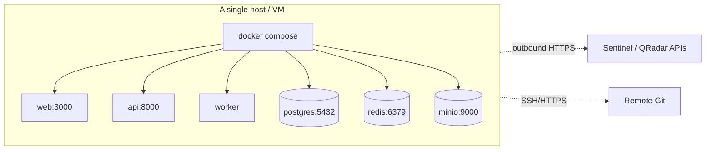

### 7.2 Production (v1.0)

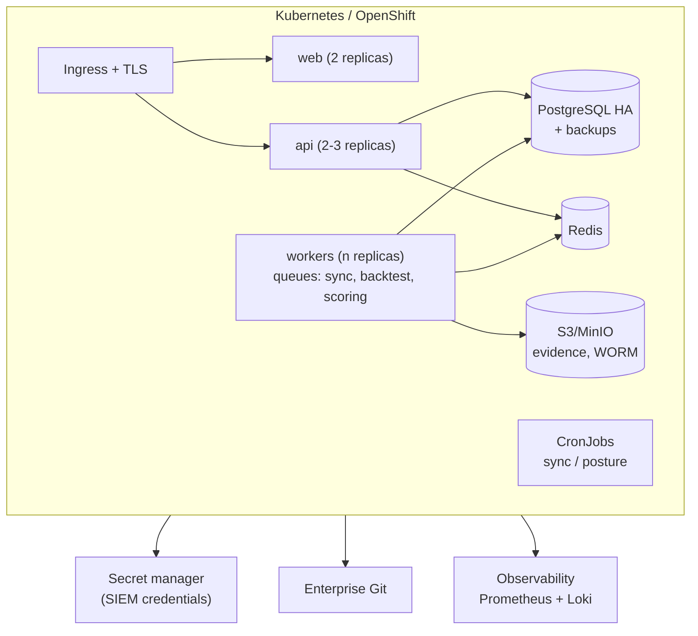

---

## 8. Security architecture

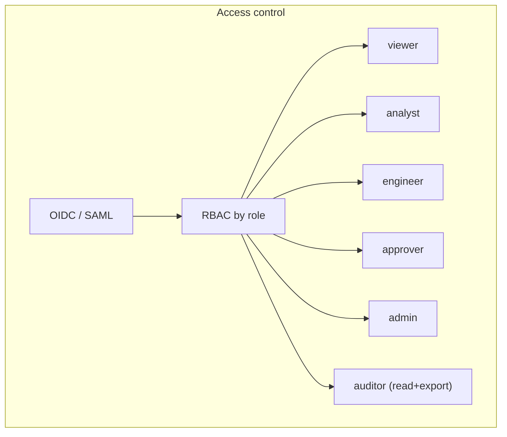

| Resource / action | viewer | analyst | engineer | approver | admin | auditor |
|-------------------|:------:|:-------:|:--------:|:--------:|:-----:|:-------:|
| View catalog and documentation | Yes | Yes | Yes | Yes | Yes | Yes |
| View logic (KQL/AQL) | No | Yes | Yes | Yes | Yes | Yes |
| Create/edit detection | No | No | Yes | Yes | Yes | No |
| Run backtest in DEV | No | No | Yes | Yes | Yes | No |
| Run backtest in PROD | No | No | Limited | Yes | Yes | No |
| Deploy to DEV | No | No | Yes | Yes | Yes | No |
| Deploy to PROD | No | No | No | Yes | Yes | No |
| Create/close Findings | No | Yes | Yes | Yes | Yes | No |
| Accept risk (`accepted_risk`) | No | No | No | Yes | Yes | No |
| Manage connectors and credentials | No | No | No | No | Yes | No |
| Export audit reports | No | No | Yes | Yes | Yes | Yes |
| View full audit log | No | No | No | Yes | Yes | Yes |

**Additional controls:**

| Control | Implementation |
|---------|----------------|
| SIEM credentials | Never in Git or in the DB. Vault / K8s secrets / Managed Identity |
| Principle of least privilege | Read-only account for sync; separate account with write access only for deployment |
| Segregation of duties | The author of a change cannot approve it (rule in `ApprovalWorkflow`) |
| Evidence integrity | Mandatory sha256 + optional WORM storage |
| Audit log | Append-only table + signed export |
| Sensitive data in evidence | `redacted` flag + review before uploading log samples |
| Protection of the logic | Detection logic is sensitive information: RBAC + `visibility` + TLP |
| Secrets scanning in CI | Prevent a KQL containing an API key from ending up in the repo |
| Rate limiting toward the SIEM | Backtests can cost money (Log Analytics) → per-user quotas |

---

## 9. "Single GUI" view (decision D-05 formalized)

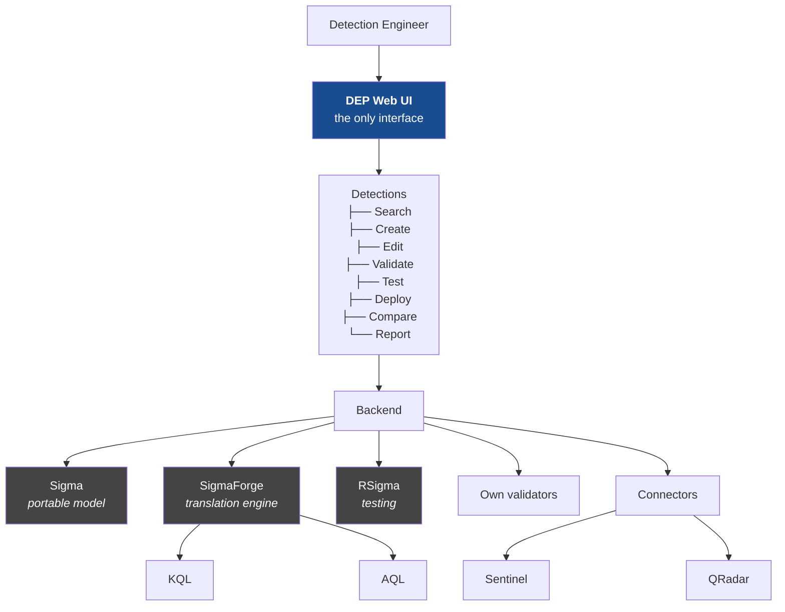

> The engineer **never** thinks *"now I have to open SigmaForge"*.
> They click **Generate Implementation → Target: Microsoft Sentinel** and the platform
> runs SigmaForge behind the scenes.

---

## 10. Extensibility: plugin model

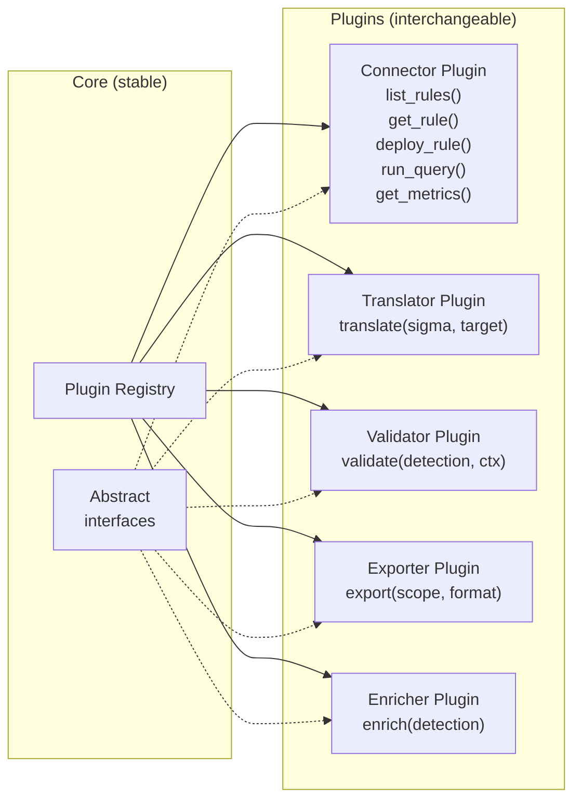

**Minimum contract of a Connector** (Python interface):

```python
class BaseConnector(Protocol):
    platform_id: str
    capabilities: set[Capability]   # {LIST, READ, DEPLOY, QUERY, METRICS, SCHEMA}

    def health_check(self) -> HealthStatus: ...
    def list_rules(self, env: Environment) -> list[RemoteRule]: ...
    def get_rule(self, env: Environment, native_id: str) -> RemoteRule: ...
    def deploy_rule(self, env: Environment, impl: Implementation,
                    dry_run: bool = False) -> DeploymentResult: ...
    def disable_rule(self, env: Environment, native_id: str) -> DeploymentResult: ...
    def run_query(self, env: Environment, query: str,
                  timespan: timedelta, limit: int) -> QueryResult: ...
    def list_tables(self, env: Environment) -> list[RemoteTable]: ...
    def describe_table(self, env: Environment, table: str) -> TableSchema: ...
    def get_rule_metrics(self, env: Environment, native_id: str,
                         period: DateRange) -> RuleMetrics: ...
    def list_enrichment_assets(self, env: Environment) -> list[RemoteAsset]: ...
```

A connector can declare partial capabilities. E.g., `QRadar` can declare
`{LIST, READ, QUERY, METRICS}` without `DEPLOY` if it is decided not to automate legacy deployments.
The UI **disables** unsupported actions instead of failing.

---

## 11. Git <-> Database strategy

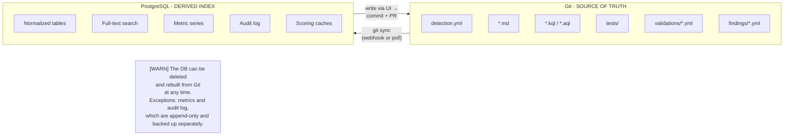

| Data | Lives in Git | Lives in DB | Rebuildable |
|------|:------------:|:-----------:|:-----------:|
| Detection metadata (`detection.yml`) | Yes | index | Yes |
| Markdown documentation | Yes | FTS index | Yes |
| KQL/AQL logic | Yes | index | Yes |
| Canonical Sigma | Yes | index | Yes |
| Test definitions | Yes | index | Yes |
| ValidationRun records | Yes (YAML) | Yes | Yes |
| Findings | Yes (YAML) | Yes | Yes |
| Evidence (binaries) | pointer + hash | metadata | Warning: requires object storage |
| Time-series metrics | No | Yes | No (own backup) |
| Audit log | No | Yes | No (own backup) |
| PostureSnapshots | No (or periodic export) | Yes | recomputable |

---

## 12. Operational requirements

| Aspect | Definition |
|--------|------------|
| **Backup** | Daily PostgreSQL + remote Git + replicated object storage |
| **RTO / RPO** | RTO 4h / RPO 24h (not a real-time system) |
| **Observability** | Prometheus metrics, structured JSON logs, OpenTelemetry traces |
| **Health endpoints** | `/healthz`, `/readyz`, `/metrics` |
| **Operational alerts** | Connector down, failed sync, stuck queue, posture not computed in 48h |
| **ATT&CK update** | Monthly job that downloads the STIX bundle and flags obsolete mappings |
| **Retention** | Metrics 24 months, evidence per policy (default 24 months), audit log 7 years |
| **Languages** | UI in `es` and `en`; documentation in the language the team decides |
