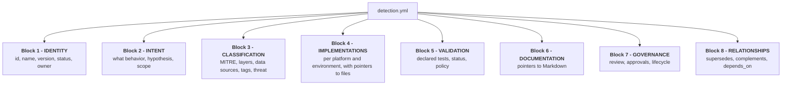
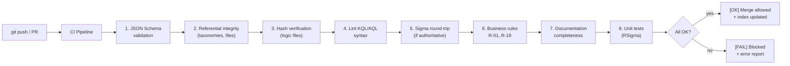

# 04 - Canonical YAML Schema (`detection.yml`)

> **Decision D-06:** `detection.yml` **is not** a giant Sigma YAML.
> Sigma is *one* of the logic formats it can contain, not the container.

---

## 1. Separation principle in the YAML



**Golden rule:** the YAML **never contains the query inline**. Queries live in their own
files (`.kql`, `.aql`, Sigma `.yml`) and the YAML points to them. Reasons:

1. The exact KQL/AQL is preserved, with no escaping or reindentation.
2. The Monaco editor can open the file with real syntax highlighting.
3. Git diffs on logic are readable.
4. The file can be hashed independently.

---

## 2. Complete `detection.yml` - reference version

```yaml
# =============================================================================
# DEP - Detection Definition
# schema_version: 1.0.0
# =============================================================================
schema_version: "1.0.0"

# ---------------------------------------------------------------- IDENTITY --
id: DET-0003
uuid: 7c1f4e9a-2b3d-4c5e-9a8b-1d2e3f4a5b6c
name: Coerced Authentication
slug: coerced-authentication
version: 1.0.0
status: production_candidate        # see LifecycleStatus
description: >
  Detects attempts to coerce authentication over a local system involving
  the lsarpc protocol and Windows Event ID 5145. Coerced authentication is
  commonly abused to relay NTLM credentials against privileged services.

severity: high
confidence: medium
risk_score: 75
detection_type: signature           # signature|threshold|anomaly|correlation|behavioral|ml|threat_intel|hunting
alert_disposition: alert            # alert|incident|hunt_only|enrichment_only
false_positive_rate_expected: medium

tlp: amber
visibility: internal

source:
  origin: custom                    # custom|content_hub|sigma_community|vendor|migrated_qradar
  reference: null
  original_author: null

# ------------------------------------------------------------------ INTENT --
intent:
  summary: >
    Detect authentication coercion attempts through lsarpc.

  hypothesis: >
    An adversary with network access will invoke MS-RPC methods over the
    lsarpc named pipe to force a machine account to authenticate to an
    attacker-controlled host, enabling NTLM relay.

  adversary_behavior:
    - authentication-coercion
    - smb
    - lsarpc
    - ntlm-relay

  preconditions:
    - "Object Access auditing (5145) enabled on target hosts"
    - "Detailed File Share auditing enabled"

  assumptions:
    - "Domain Controllers forward Security events to the SIEM"

  scope:
    included:
      - "Domain Controllers"
      - "File servers"
    excluded:
      - "Coercion via EFSRPC (covered by DET-0004)"
      - "Coercion via DFSNM"

  evasion_notes: >
    An adversary can use alternative named pipes (efsrpc, dfsnm, netlogon)
    that are not covered by this detection. Event 5145 can be disabled by
    policy.

  kill_chain_phase:
    - credential-access
    - lateral-movement

  attack_surface:
    - identity
    - endpoint
    - network

# ---------------------------------------------------------- CLASSIFICATION --
mitre:
  attack_version: "v15.1"
  mappings:
    - tactic: TA0006                # Credential Access
      technique: T1187              # Forced Authentication
      subtechnique: null
      coverage_level: significant   # none|minimal|partial|significant|complete
      detection_confidence: medium
      primary: true
      notes: "Covers lsarpc pipe only"
    - tactic: TA0008                # Lateral Movement
      technique: T1550
      subtechnique: T1550.002
      coverage_level: minimal
      primary: false
      notes: "Indirect: coercion often precedes relay"

layers:
  - id: identity
    strength: primary
  - id: endpoint
    strength: supporting
  - id: network
    strength: supporting

data_sources:
  - id: windows-security-events
    required: true
    log_sources:
      - platform: sentinel
        table: SecurityEvent
        event_ids: ["5145"]
        required_fields:
          - EventID
          - RelativeTargetName
          - ShareName
          - SubjectUserName
          - IpAddress
      - platform: qradar
        log_source_type: "Microsoft Windows Security Event Log"
        event_ids: ["5145"]

enrichment_assets:
  - id: nessus
    type: watchlist
    platform: sentinel
    required: false
    purpose: "Exclude authorized vulnerability scanners"

threat:
  - type: tool
    identifier: PetitPotam
    name: PetitPotam
    relevance: direct
  - type: cve
    identifier: CVE-2021-36942
    relevance: direct
  - type: actor
    identifier: G0016
    name: APT29
    relevance: related

tags:
  - windows
  - ntlm
  - coercion
  - lateral-movement
  - dc-protection

# --------------------------------------------------------- IMPLEMENTATIONS --
implementations:

  - id: IMP-0003-SENTINEL
    platform: sentinel
    type: native                    # generated|generated_customized|native
    status: active
    enabled: true
    logic:
      language: kql
      file: implementations/sentinel/rule.kql
      hash: "sha256:8f2a1c...".      # computed by CI
    native_rule_id: "a1b2c3d4-0000-0000-0000-abcdefabcdef"
    native_rule_name: "ORG_Coerced Authentication"
    schedule:
      frequency: PT1H
      lookback: PT1H
    threshold:
      operator: gt
      value: 0
    suppression:
      enabled: false
    entity_mappings:
      - entity: Account
        identifier: FullName
        column: SubjectUserName
      - entity: Host
        identifier: HostName
        column: Computer
      - entity: IP
        identifier: Address
        column: IpAddress
    custom_details:
      SharePath: RelativeTargetName
    depends_on:
      - watchlist:nessus
    version: 1.0.0
    notes: >
      Uses _GetWatchlist('nessus') which is not expressible in Sigma.

  # The environment (DEV/PROD) is NOT declared here: it is determined by the branch (ADR-013).
  - id: IMP-0003-QRADAR
    platform: qradar
    type: native
    status: legacy
    enabled: true
    logic:
      language: aql
      file: implementations/qradar/rule.aql
      hash: "sha256:c41b77..."
    native_rule_id: "1874"
    native_rule_name: "TW_Coerced Authentication"
    version: 0.9.0
    deprecation_notes: >
      Kept until Sentinel migration is fully validated. Do not modify.

# ---------------------------------------------------- CANONICAL LOGIC (opt) --
sigma:
  present: true
  authoritative: false              # if true, implementations are generated from here
  file: logic/sigma.yml
  hash: "sha256:d9e8..."
  translation_coverage: partial     # full|partial|documentation_only
  untranslatable:
    - "_GetWatchlist('nessus') exclusion"
    - "custom entity mapping"

# ---------------------------------------------------------------- TESTING --
validation:
  status: partial                   # not_started|in_progress|partial|passed|failed|stale
  policy:
    require_before_prod:
      - data_availability
      - schema_validation
      - syntax_validation
      - historical_backtest
    revalidate_every_days: 180
  last_run: 2026-08-26
  last_result: partial
  runs_index: validations/index.yml

tests:
  - id: TST-COERCE-001
    name: "5145 with lsarpc target fires"
    type: unit_test
    given: "SecurityEvent with EventID 5145"
    when: "RelativeTargetName == 'lsarpc'"
    then: "Detection returns 1 row"
    data: tests/data/positive-lsarpc.json
    expected_match_count: 1
    negative: false
    automation_status: automated
    runner: rsigma

  - id: TST-COERCE-002
    name: "5145 with other pipe does not fire"
    type: unit_test
    given: "SecurityEvent with EventID 5145"
    when: "RelativeTargetName == 'spoolss'"
    then: "Detection returns 0 rows"
    data: tests/data/negative-spoolss.json
    expected_match_count: 0
    negative: true
    automation_status: automated
    runner: rsigma

  - id: TST-COERCE-003
    name: "PetitPotam simulation detected"
    type: red_team
    given: "Lab DC with auditing enabled"
    when: "PetitPotam executed against DC"
    then: "Alert raised within 1 scheduling interval"
    automation_status: manual
    frequency: quarterly

# ----------------------------------------------------------- DOCUMENTATION --
documentation:
  overview: README.md
  investigation: docs/investigation.md
  false_positives: docs/false-positives.md
  response: docs/response.md
  tuning: docs/tuning.md
  changelog: CHANGELOG.md
  references:
    - title: "MITRE T1187"
      url: "https://attack.mitre.org/techniques/T1187/"
    - title: "PetitPotam original research"
      url: "https://github.com/topotam/PetitPotam"

runbook:
  estimated_triage_minutes: 15
  soar_playbook_ref: null
  escalation_criteria: >
    Escalate if the source IP is not a known scanner and the target is a
    Domain Controller.

# ------------------------------------------------------------- GOVERNANCE --
governance:
  owner:
    team: detection-engineering
    contact: detection-eng@example.com
  roles:
    author: j.perez
    maintainer: j.perez
    approver: soc-lead
    stakeholders:
      - identity-team
  review:
    cadence_days: 180
    last_reviewed: 2026-08-20
    next_due: 2027-02-16
  lifecycle:
    created: 2026-08-15
    promoted_to_prod: null
    deprecated: null
    retired: null
  compliance:
    frameworks:
      - name: "ISO 27001"
        control: "A.8.16"
      - name: "NIST CSF"
        control: "DE.CM-1"

# ---------------------------------------------------------- RELATIONSHIPS --
relationships:
  - type: complements
    detection: DET-0004
    notes: "EFSRPC coercion variant"
  - type: depends_on
    detection: null
    asset: "watchlist:nessus"

# ------------------------------------------------------------- EXCEPTIONS --
exceptions:
  - id: EXC-0003-01
    applies_to: IMP-0003-SENTINEL
    type: exclusion
    finding: FND-0007
    expression_file: implementations/sentinel/exclusions.kql
    justification: "Authorized vulnerability scanners generate 5145 lsarpc access"
    risk_accepted: "An attacker operating from a scanner host would be missed"
    approved_by: soc-lead
    approved_at: 2026-08-24
    expires_at: 2027-08-24
    active: true
```

---

## 3. Field reference - normative table

| Path | Type | Req. | Default | Validation |
|------|------|:----:|---------|------------|
| `schema_version` | semver string | Yes | - | must be a supported version |
| `id` | string | Yes | - | `^DET-\d{4,}$`, unique |
| `uuid` | uuid v4 | Yes | auto-generated | globally unique |
| `name` | string ≤160 | Yes | - | unique (warning if duplicated) |
| `slug` | string | Yes | derived from `name` | `^[a-z0-9-]+$` |
| `version` | semver | Yes | `0.1.0` | |
| `status` | enum | Yes | `draft` | see 02 §5.1 |
| `description` | string | Yes | - | ≥ 20 characters |
| `severity` | enum | Yes | `medium` | |
| `confidence` | enum | Optional | `medium` | |
| `risk_score` | int | Optional | - | 0-100 |
| `detection_type` | enum | Yes | `signature` | |
| `alert_disposition` | enum | Optional | `alert` | |
| `tlp` | enum | Optional | `amber` | |
| `source.origin` | enum | Optional | `custom` | |
| `intent.summary` | string | Yes | - | one sentence |
| `intent.hypothesis` | string | Optional | - | recommended for `behavioral`/`anomaly` |
| `intent.adversary_behavior` | array | Yes | - | controlled vocabulary (`taxonomy/behaviors.yml`) |
| `intent.scope.excluded` | array | Optional | `[]` | **strongly recommended**: avoids a false sense of coverage |
| `mitre.attack_version` | string | Yes | global version | must exist in the loaded catalog |
| `mitre.mappings[].technique` | string | Yes | - | `^T\d{4}$`, must exist |
| `mitre.mappings[].coverage_level` | enum | Yes | `partial` | DeTT&CT scale |
| `mitre.mappings[].primary` | bool | Yes | `false` | exactly one `true` |
| `layers[].id` | enum | Yes | - | from the `taxonomy/layers.yml` catalog |
| `layers[].strength` | enum | Yes | `primary` | |
| `data_sources[].id` | string | Yes | - | from the `taxonomy/data-sources.yml` catalog |
| `data_sources[].log_sources[].table` | string | Yes | - | |
| `data_sources[].log_sources[].required_fields` | array | Optional | `[]` | used by `schema_validation` |
| `implementations[].id` | string | Yes | derivable | `^IMP-\d{4,}-[A-Z0-9]+(-[A-Z0-9]+)*$` |
| `implementations[].platform` | string | Yes | - | from the `taxonomy/platforms.yml` catalog |
| ~~`implementations[].environment`~~ | - | [BLOCKED] | - | **removed (ADR-013)**: the environment is given by the branch; see `.dep/environments.yml`. `validate-repo` emits `DEP-ENV-004` if it appears |
| `implementations[].type` | enum | Yes | - | `generated\|generated_customized\|native` |
| `implementations[].logic.file` | path | Yes | - | the file must exist |
| `implementations[].logic.hash` | string | Yes (CI) | computed | CI recomputes it and fails if it differs |
| `implementations[].enabled` | bool | Yes | `false` | **declared** value; the real one is set by the connector |
| `sigma.present` | bool | Yes | `false` | |
| `sigma.authoritative` | bool | Optional | `false` | if `true`, CI regenerates and compares |
| `validation.policy.require_before_prod` | array | Optional | global policy | promotion gates |
| `tests[].id` | string | Yes | - | unique within the detection |
| `documentation.overview` | path | Yes | `README.md` | the file must exist |
| `governance.owner.team` | string | Yes | - | from the `taxonomy/owners.yml` catalog |
| `governance.review.cadence_days` | int | Optional | 180 | |
| `exceptions[].justification` | string | Yes if an exception exists | - | ≥ 20 characters |
| `exceptions[].risk_accepted` | string | Yes if an exception exists | - | |

---

## 4. Satellite files of the YAML

```
DET-0003-coerced-authentication/
├── detection.yml                 ← this document
├── README.md                     ← overview
├── CHANGELOG.md
├── logic/
│   └── sigma.yml                 ← canonical Sigma (optional)
├── implementations/
│   ├── sentinel/
│   │   ├── rule.kql
│   │   └── exclusions.kql
│   └── qradar/
│       └── rule.aql
├── docs/
│   ├── investigation.md
│   ├── false-positives.md
│   ├── response.md
│   └── tuning.md
├── tests/
│   ├── data/
│   │   ├── positive-lsarpc.json
│   │   └── negative-spoolss.json
│   └── expectations.yml
├── validations/
│   ├── index.yml
│   └── 2026-08-26-VAL-2026-0801.yml
├── findings/
│   └── FND-0007.yml
└── evidence/
    └── 2026-08-26/
        ├── logs-validation.png
        ├── query-output.csv
        └── manifest.yml          ← names + sha256 + captured_by
```

---

## 5. `ValidationRun` format (standalone file)

`validations/2026-08-26-VAL-2026-0812.yml`

```yaml
schema_version: "1.0.0"
id: VAL-2026-0812
detection: DET-0001
implementation: IMP-0001-SENTINEL
test: null                        # ad-hoc
type: historical_backtest
executed_at: 2026-08-26T11:42:00Z
engineer: j.perez
environment: dev
automated: false
tooling: manual

query_version: "1.2.0"
query_hash: "sha256:5b7c9d..."

input_dataset:
  type: historical
  lookback: P10D
  source: "Sentinel DEV / SecurityEvent"
  row_count_scanned: 4128773

expected_result: >
  Expect a small number of matches; any match should correspond to a
  genuine burst of Kerberos pre-auth failures from a single source.

actual_result: >
  5 matching patterns found: 2 genuine brute-force bursts against service
  accounts, 3 noise patterns originating from loopback with NOUSER.

result: pass

metrics:
  matches: 5
  true_positives: 2
  false_positives: 3
  precision: 0.4
  duration_ms: 18422

findings:
  - FND-0001

evidence:
  - id: EVD-2026-1187
    type: query_output
    file: ../evidence/2026-08-26/backtest-output.csv
    sha256: "9a8b7c..."
  - id: EVD-2026-1188
    type: screenshot
    file: ../evidence/2026-08-26/backtest-screenshot.png
    sha256: "1f2e3d..."

notes: >
  Loopback + NOUSER pattern requires exclusion before promotion.
```

---

## 6. `Finding` format (standalone file)

`findings/FND-0001.yml`

```yaml
schema_version: "1.0.0"
id: FND-0001
detection: DET-0001
implementation: IMP-0001-SENTINEL-DEV
validation_run: VAL-2026-0812

type: noise
title: "Loopback NOUSER pre-auth failures generate false positives"
severity: medium

observation: >
  During the 10-day backtest, 3 of 5 matches originated from ::1 with
  TargetUserName = NOUSER and failure code 0x6, produced by a local
  service enumerating accounts.

pattern: "NOUSER + ::1 + 0x6"

impact: >
  Approximately 60% of alerts from this detection would be false positives,
  eroding analyst trust.

recommendation: "Exclude loopback source addresses combined with NOUSER accounts."

status: resolved
assigned_to: j.perez
opened_at: 2026-08-26
resolved_at: 2026-08-28
resolution: >
  Added exclusion EXC-0001-01. Re-ran backtest: 2 matches, 2 TP, 0 FP.
resolution_ref: "EXC-0001-01"
blocks_promotion: true
recurrence_count: 0

evidence:
  - id: EVD-2026-1189
    type: query_output
    file: ../evidence/2026-08-26/noise-pattern.csv
    sha256: "4c5d6e..."
```

---

## 7. Taxonomy files (global repo catalogs)

They live in `taxonomy/` and are referenced by every `detection.yml`.

| File | Content | Example entry |
|---------|-----------|--------------------|
| `taxonomy/platforms.yml` | Supported platforms | `sentinel: {type: siem, language: kql, sigmaforge_backend: microsoft365defender}` |
| `taxonomy/environments.yml` | Environments (`tier`, `requires_approval`); each one's branch is declared in `.dep/environments.yml` | `prod: {tier: prod, requires_approval: true}` |
| `taxonomy/layers.yml` | Detection layers | `identity: {weight: 1.0, target_coverage_pct: 85}` |
| `taxonomy/data-sources.yml` | Logical data sources | `windows-security-events: {category: endpoint, attack_ds: DS0028}` |
| `taxonomy/log-sources.yml` | Per-platform materialization | table, event IDs, retention |
| `taxonomy/behaviors.yml` | `adversary_behavior` vocabulary | `authentication-coercion` |
| `taxonomy/owners.yml` | Teams and contacts | `detection-engineering` |
| `taxonomy/severity.yml` | Definition of each severity + SLA | `high: {triage_sla_minutes: 30}` |
| `taxonomy/attack/` | Snapshot of the ATT&CK catalog in use | `v15.1/enterprise-attack.json` |
| `taxonomy/scoring.yml` | Detection Score weights | see doc 07 |
| `taxonomy/policies.yml` | Promotion gates, cadences, staleness thresholds | |

> **Why this matters:** without controlled catalogs, coverage cannot be computed
> (two detections would write `windows security events` and `Windows Security Events`
> and count as distinct sources).

---

## 8. Migration from the original draft YAML

The agreed draft maps as follows (nothing is lost):

| Draft field | Destination in the final schema | Note |
|--------------------|-----------------------------|------|
| `id` | `id` | same |
| `name` | `name` | same |
| `version` | `version` | same |
| `status: pending` | `status: production_candidate` | `pending` was not a clear lifecycle state |
| `description` | `description` | same |
| `intent.summary` | `intent.summary` | same |
| `intent.behavior` | `intent.adversary_behavior` | renamed and with a controlled vocabulary |
| `mitre.techniques: [T1187]` | `mitre.mappings[]` | extended with tactic, coverage_level, primary |
| `layers` | `layers[].id` + `strength` | extended |
| `data_sources` | `data_sources[].id` | extended with log_sources |
| `log_types: [SecurityEvent]` | `data_sources[].log_sources[].table` | moved inside data source |
| `events: [5145]` | `data_sources[].log_sources[].event_ids` | moved |
| `severity` | `severity` | same |
| `owner.team` | `governance.owner.team` | moved to the governance block |
| `implementations.sentinel.environments: [dev, prod]` | a single entry per platform | **important change (ADR-013, supersedes ADR-006)**: the environment is determined by the branch, not by the content |
| `implementations.*.languages` | `implementations[].logic.language` | one per implementation |
| `documentation.*` | `documentation.*` | same, extended |
| `validation.status: pending` | `validation.status` + `validation.policy` + `validations/*.yml` files | **important change**: validation stops being a field |

> **The only structural change relative to the draft** is taking the environment out of the content:
> `develop` and `main` can carry different versions of the same implementation, and
> "DEV v1.4 vs PROD v1.2" is simply `git diff develop..main`.

---

## 9. YAML validation in CI



Proposed error codes (for actionable messages):

| Code | Meaning |
|--------|-------------|
| `DEP-SCH-001` | The YAML does not comply with the JSON Schema |
| `DEP-REF-002` | Reference to a nonexistent MITRE technique |
| `DEP-REF-003` | Data source does not exist in the taxonomy |
| `DEP-FIL-004` | Referenced logic file not found |
| `DEP-HSH-005` | The declared hash does not match the file |
| `DEP-SYN-006` | Syntax error in the query |
| `DEP-BIZ-007` | `active` detection without an owner |
| `DEP-BIZ-008` | `active` detection without an active implementation |
| `DEP-DOC-009` | A mandatory section is missing from the documentation |
| `DEP-TST-010` | Declared test without a data file |
| `DEP-EXC-011` | Exception without justification or without accepted risk |
| `DEP-DUP-012` | Duplicate ID |
