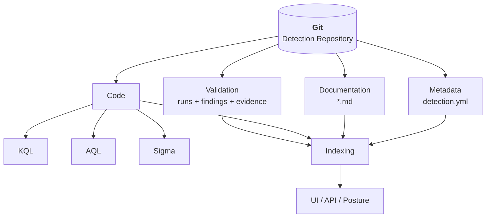
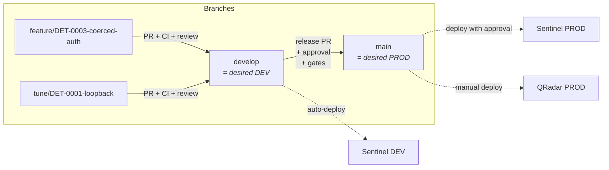
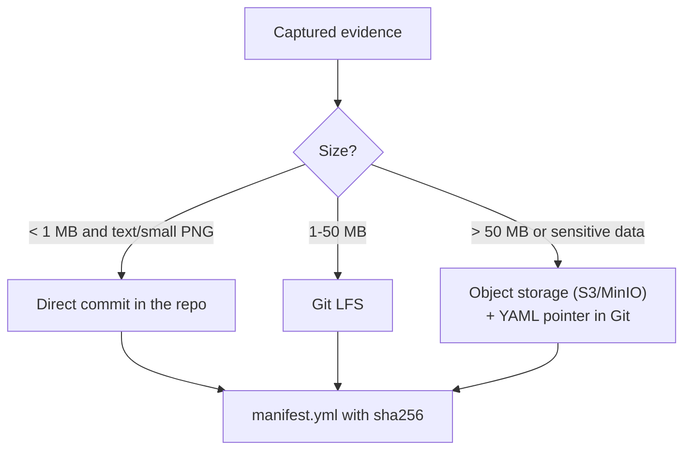
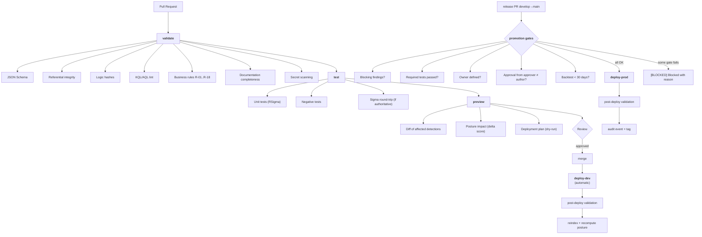
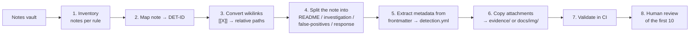
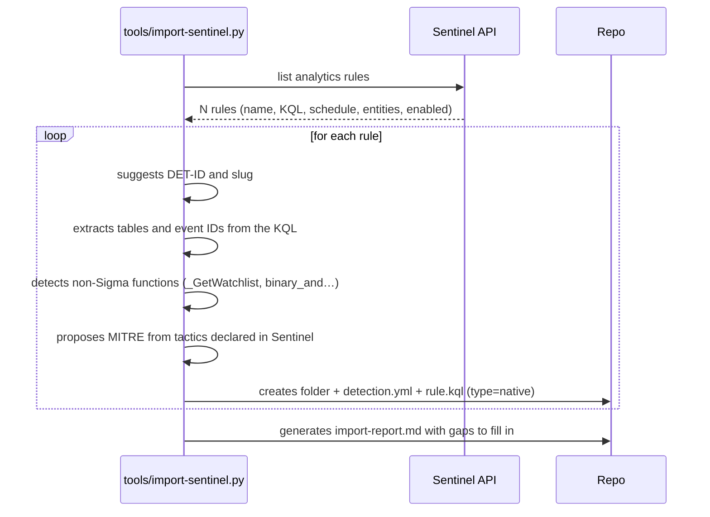
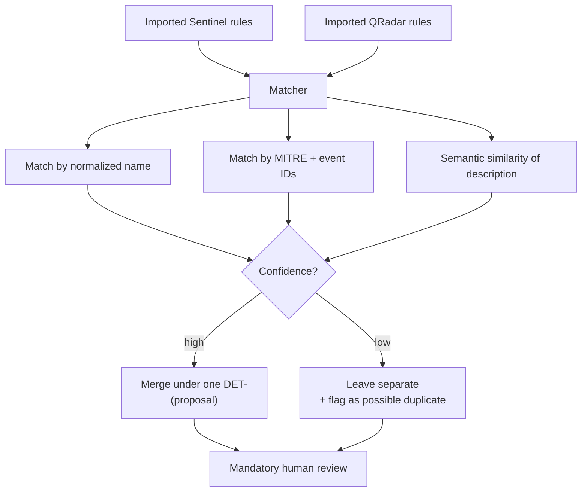

# 05 - Git Repository Structure

> **Decision D-04:** Git is the source of truth. The database is a derived index
> that can be deleted and rebuilt.

---

## 1. The model change

**Before:**

```
Notes ──── documentation        (isolated)
Sentinel ──── KQL                  (isolated)
QRadar  ───── AQL                  (isolated)
```

**Now:**



> **The documentation from the notes migrates almost directly:** it is Markdown, and Markdown
> lives alongside the code. See §8 for the migration plan.

---

## 2. Full repository layout

```
detection-repository/
│
├── README.md                          # How to use the repo
├── CONTRIBUTING.md                    # Workflow, conventions
├── CODEOWNERS                         # Approvers per folder
├── .dep/
│   ├── config.yml                     # Platform configuration
│   ├── policies.yml                   # Gates, cadences, thresholds
│   ├── environments.yml               # Branch → environment map (ADR-013)
│   └── schema/
│       ├── detection.schema.json
│       ├── validation.schema.json
│       └── finding.schema.json
│
├── taxonomy/                          # Controlled catalogs (see doc 04 §7)
│   ├── platforms.yml
│   ├── environments.yml
│   ├── layers.yml
│   ├── data-sources.yml
│   ├── log-sources.yml
│   ├── behaviors.yml
│   ├── owners.yml
│   ├── severity.yml
│   ├── scoring.yml
│   └── attack/
│       └── v15.1/enterprise-attack.json
│
├── detections/                        # The catalog
│   ├── identity/
│   │   ├── DET-0001-kerberos-brute-force/
│   │   └── DET-0002-password-spray/
│   ├── endpoint/
│   │   └── DET-0003-coerced-authentication/
│   ├── network/
│   ├── cloud/
│   └── email/
│
├── shared/                            # Reusable across detections
│   ├── functions/
│   │   ├── sentinel/
│   │   │   └── normalize_account.kql
│   │   └── qradar/
│   ├── exclusions/
│   │   └── global-scanners.kql        # Global exclusions
│   ├── enrichment/
│   │   └── watchlists.yml             # Inventory of watchlists in use
│   └── snippets/
│
├── coverage/                          # Generated output (do not edit by hand)
│   ├── attack-navigator-layer.json
│   ├── data-source-coverage.md
│   └── gaps.yml                       # Accepted gaps with justification
│
├── reports/                           # Exported snapshots
│   └── 2026-Q3/posture-report.pdf
│
├── docs/                              # Program documentation, not rule documentation
│   ├── detection-engineering-policy.md
│   ├── severity-guide.md
│   ├── naming-conventions.md
│   ├── onboarding.md
│   └── runbooks/
│
├── tools/                             # Repo scripts
│   ├── validate.py
│   ├── new-detection.py               # Scaffolding
│   ├── import-notes.py             # Migration
│   ├── import-sentinel.py             # Import existing rules
│   └── import-qradar.py
│
└── .github/workflows/                 # or .gitlab-ci.yml
    ├── validate.yml
    ├── test.yml
    ├── deploy-dev.yml
    ├── deploy-prod.yml
    └── nightly-sync.yml
```

---

## 3. Anatomy of a detection folder

```
detections/identity/DET-0001-kerberos-brute-force/
│
├── detection.yml                      # Canonical metadata
├── README.md                          # Overview (mandatory)
├── CHANGELOG.md                       # Human-readable history
│
├── logic/
│   └── sigma.yml                      # Canonical Sigma (if applicable)
│
├── implementations/
│   ├── sentinel/
│   │   ├── rule.kql                   # Identical on all branches;
│   │   └── exclusions.kql             # the environment comes from the branch (ADR-013)
│   └── qradar/
│       └── rule.aql
│
├── docs/
│   ├── investigation.md               # How to triage
│   ├── false-positives.md             # Known FPs and why
│   ├── response.md                    # What to do if it is real
│   ├── tuning.md                      # Tuning history
│   └── migration.md                   # (optional) QRadar→Sentinel migration notes
│
├── tests/
│   ├── expectations.yml
│   └── data/
│       ├── positive-burst.json
│       ├── negative-single-failure.json
│       └── noise-loopback.json
│
├── validations/
│   ├── index.yml                      # Summary of all runs
│   ├── 2026-08-26-VAL-2026-0810.yml
│   ├── 2026-08-26-VAL-2026-0811.yml
│   ├── 2026-08-26-VAL-2026-0812.yml
│   ├── 2026-08-26-VAL-2026-0813.yml
│   └── 2026-08-26-VAL-2026-0814.yml
│
├── findings/
│   ├── FND-0001.yml                   # Noise: NOUSER + ::1 + 0x6
│   └── FND-0002.yml                   # Schema: AccountName not reliable
│
└── evidence/
    └── 2026-08-26/
        ├── manifest.yml
        ├── logs-validation.png
        ├── field-validation.png
        └── backtest-output.csv
```

---

## 4. Conventions

### 4.1 Folder and file names

| Element | Convention | Example |
|----------|------------|---------|
| Detection folder | `DET-NNNN-<slug>` | `DET-0001-kerberos-brute-force` |
| Top-level grouping | by primary `layer` | `detections/identity/` |
| Logic file | `rule.<ext>` | `rule.kql`, `rule.aql` |
| Exclusions | `exclusions.<ext>` | `exclusions.kql` |
| Validation run | `YYYY-MM-DD-VAL-YYYY-NNNN.yml` | |
| Finding | `FND-NNNN.yml` | |
| Evidence | `evidence/YYYY-MM-DD/<descriptive>.<ext>` | |

### 4.2 Detection names

Recommended format: `<Behavior> [via <Mechanism>]`

| Good | Bad |
|---------|---------|
| `Kerberos Brute Force` | `ORG_KRB_RULE_v2_final` |
| `Coerced Authentication via lsarpc` | `Rule 1874` |
| `Suspicious Service Installation` | `Windows Alert` |

The native name in the SIEM (`ORG_Kerberos Brute Force`) is kept in
`implementations[].native_rule_name` - it is not lost, but it does not pollute the catalog.

### 4.3 Commits

`type(scope): subject` convention, compatible with Conventional Commits:

| Type | Use | Bump |
|------|-----|------|
| `feat(DET-0001)` | New detection or implementation | minor |
| `fix(DET-0001)` | Logic fix | patch/minor |
| `tune(DET-0001)` | Adjustment, exclusion | minor |
| `docs(DET-0001)` | Documentation only | patch |
| `test(DET-0001)` | Tests | patch |
| `valid(DET-0001)` | Validation record | patch |
| `find(DET-0001)` | Finding opened or closed | patch |
| `deprecate(DET-0001)` | Mark as obsolete | major |
| `chore(taxonomy)` | Catalog changes | - |
| `breaking(DET-0001)` | Alert schema change | major |

Example:
```
tune(DET-0001): exclude loopback NOUSER pre-auth failures

Resolves FND-0001. Backtest after exclusion: 2 matches, 2 TP, 0 FP.
Validation: VAL-2026-0815

Refs: FND-0001, EXC-0001-01
```

---

## 5. Branching strategy and GitOps flow



| Branch | Reflects | Deployment | Approval |
|------|---------|:----------:|:----------:|
| `feature/*`, `tune/*` | work in progress | none | - |
| `develop` | desired state of DEV | automatic | 1 reviewer |
| `main` | desired state of PROD | manual/approved | 1 approver ≠ author |

**Tags:** `DET-0001@1.2.0` for detection versions; `release/2026-09-01` for batches.

---

## 6. Binary evidence management

Problem: screenshots and large CSVs bloat the repo.



`evidence/2026-08-26/manifest.yml`:
```yaml
captured_by: j.perez
captured_at: 2026-08-26T11:42:00Z
redacted: true
redaction_notes: "Usernames replaced with USER-01..USER-05"
retention_until: 2028-08-26
items:
  - id: EVD-2026-1187
    file: backtest-output.csv
    storage: git
    sha256: "9a8b7c..."
    size_bytes: 184322
  - id: EVD-2026-1190
    file: null
    storage: s3
    uri: "s3://dep-evidence/DET-0001/2026-08-26/full-dump.csv"
    sha256: "aa11bb..."
    size_bytes: 91234522
```

**Rule:** the `sha256` **always** lives in Git, even when the binary does not. This makes it possible to
prove integrity during an audit even if the file is stored elsewhere.

---

## 7. CI/CD pipeline



### Scheduled jobs (nightly)

| Job | Frequency | What it does |
|-----|:----------:|----------|
| `sync-inventory` | 4h | Discovers real rules in Sentinel/QRadar |
| `detect-drift` | 4h | Compares Git <-> SIEM <-> Sigma, generates findings |
| `sync-metrics` | daily | Alerts, TP/FP, cost |
| `check-data-sources` | daily | Are logs still arriving? |
| `check-staleness` | daily | Expired validations, overdue reviews, expired exceptions |
| `recompute-posture` | daily | Scores + snapshot |
| `update-attack` | monthly | New ATT&CK version, flags obsolete mappings |
| `enrichment-freshness` | daily | Outdated watchlists |

---

## 8. Migration plan from notes



**Conversion rules:**

| Notes | Destination |
|----------|---------|
| YAML frontmatter | `detection.yml` fields |
| `# Description` | `description` + `README.md` |
| `# Investigation` / `# Triage` | `docs/investigation.md` |
| `# False positives` | `docs/false-positives.md` |
| `# References` | `documentation.references[]` |
| `[[Another rule]]` | `relationships[]` or relative link |
| `![[image.png]]` | `docs/img/image.png` |
| Tags `#kerberos` | `tags: [kerberos]` |
| Callouts `> [!warning]` | Kept (GitHub renders them partially) or converted to blockquote |

**Script:** `tools/import-notes.py --vault <path> --map mapping.csv --dry-run`

> **Nothing is lost.** The script generates a `migration-report.md` report listing
> which sections it could not classify, for manual review.

---

## 9. Importing existing rules

### 9.1 From Sentinel



**What can be extracted automatically and what cannot:**

| Field | Auto | Manual |
|-------|:----:|:------:|
| `name`, `native_rule_id`, `native_rule_name` | Yes | |
| Literal KQL | Yes | |
| `schedule`, `threshold`, `entity_mappings`, `custom_details` | Yes | |
| `enabled` | Yes | |
| `severity` | Yes | |
| MITRE (declared by Sentinel) | Yes | review `coverage_level` |
| Tables / event IDs (KQL parsing) | Yes | verify |
| `type` (native vs generated) | heuristic | Yes, confirm |
| `intent` | No | Yes |
| `layers` | heuristic | Yes |
| `owner` | No | Yes |
| Documentation | No (comes from the notes) | Yes |
| Tests, validations | No | Yes |

### 9.2 From QRadar

Same approach, with `import-qradar.py`. The extra step: **reconciliation** - if a QRadar rule
detects the same thing as a Sentinel one, they must end up as **two implementations of the same
`DET-`**, not as two detections.



> Merging is **never** automatic without review. A false merge hides a detection.

---

## 10. `CODEOWNERS` and segregation of duties

```
# The whole catalog requires detection-engineering review
detections/                     @org/detection-engineering

# Taxonomies require lead approval
taxonomy/                       @org/soc-leads

# Policies and gates, admins only
.dep/policies.yml               @org/soc-leads @org/platform-admins

# Production: the environment is determined by the branch (ADR-013).
# Protect `main` on the Git host (mandatory approval, author ≠ approver)
# instead of per-path rules.
.dep/environments.yml           @org/soc-leads @org/platform-admins
```

Additional rule enforced by the platform's `ApprovalWorkflow`:
**the change author cannot be the approver**, even if they have permissions in Git.
