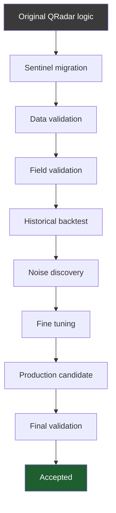
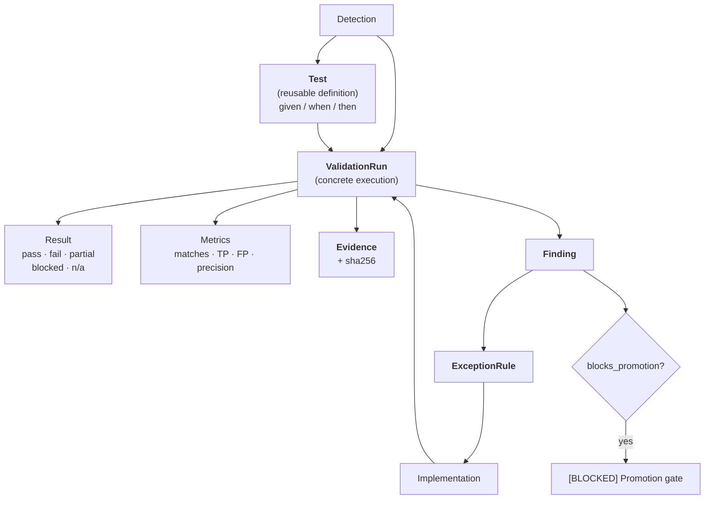
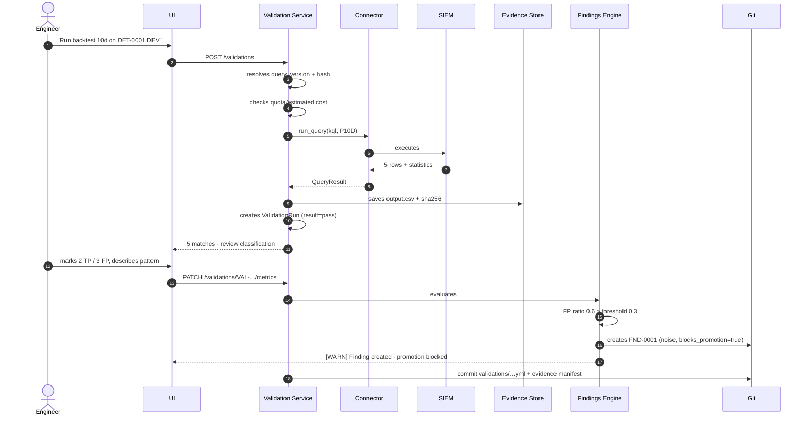
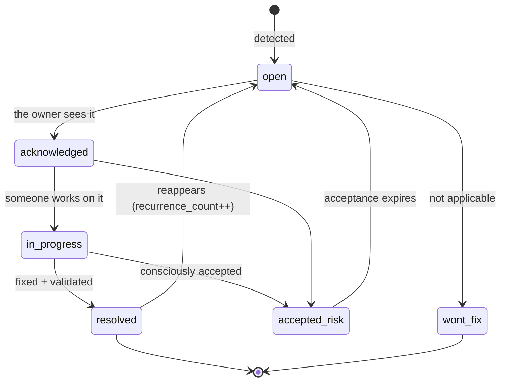
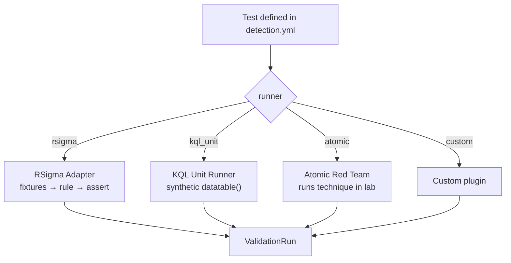
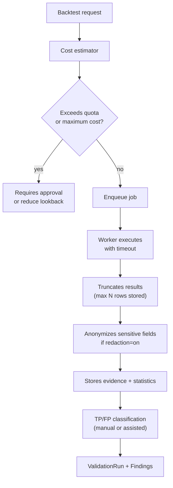

# 06 - Validation, Testing, Findings, and Evidence

> **Decision D-08:** `last_tested: 2026-08-26` is not enough.
> We need to store **what was tested, with what data, what was expected, and what happened.**

---

## 1. The Case That Justifies All of This

The real lifecycle of `DET-0001 - Kerberos Brute Force`:



Each of those steps is a **ValidationRun** with a type, dataset, result, and evidence.
Two of them produced **Findings** that survive the test and block promotion.

---

## 2. Validation Model



**Critical distinction:**

| Concept | What it is | Example |
|----------|--------|---------|
| `Test` | The **specification** of a test, reusable | "5 failed 4771 events in 10 min from the same IP must fire" |
| `ValidationRun` | A concrete **execution**, with date, engineer, and result | "On 08/26 I ran that test on DEV v1.2 → PASS" |
| `Finding` | A **finding** that survives the execution | "The NOUSER+::1 pattern generates noise" |
| `Evidence` | The **proof** of what happened | `backtest-output.csv` sha256 9a8b7c… |
| `ExceptionRule` | The **correction** applied | `where not (IpAddress == "::1" and Account == "NOUSER")` |

---

## 3. Catalog of Validation Types

```mermaid
flowchart LR
    subgraph PRE["1 - PREREQUISITES (can I detect?)"]
        A1["data_availability"]
        A2["schema_validation"]
        A3["syntax_validation"]
    end
    subgraph LOG["2 - LOGIC (does it detect the right thing?)"]
        B1["logic_review"]
        B2["unit_test"]
        B3["regression_test"]
    end
    subgraph REAL["3 - REALITY (what happens with real data?)"]
        C1["historical_backtest"]
        C2["noise_analysis"]
        C3["tuning_validation"]
        C4["performance_test"]
    end
    subgraph ADV["4 - ADVERSARY (does it detect the attacker?)"]
        D1["atomic_test"]
        D2["red_team"]
        D3["purple_team"]
    end
    subgraph PROD["5 - PRODUCTION (does it still work?)"]
        E1["deployment_validation"]
        E2["production_validation"]
    end
    PRE --> LOG --> REAL --> ADV --> PROD
```



### 3.1 Detail by type

| Type | Question it answers | Input | Expected output | Auto |
|------|-----------------------|-------|-----------------|:----:|
| `data_availability` | Does the table exist and receive data? | table + window | volume > 0, recent last_seen | Yes |
| `schema_validation` | Do the fields exist and are they populated? | required fields | population ratio per field | Yes |
| `syntax_validation` | Does the query compile? | query | parse OK / errors | Yes |
| `logic_review` | Does the logic express the intent? | query + intent | reviewed checklist | No |
| `unit_test` | Does it fire on the positive case and not on the negative? | fixtures | expected match count | Yes |
| `regression_test` | Did the change break previous tests? | full suite | all pass | Yes |
| `historical_backtest` | What would it have detected in the last N days? | lookback | no. of matches + samples | Yes |
| `noise_analysis` | How many of those matches are noise? | backtest results | TP/FP + patterns | Semi |
| `tuning_validation` | Did the exclusion remove FPs without losing TPs? | pre/post backtest | TP/FP delta | Semi |
| `performance_test` | How much does it cost to run? | query | ms, rows scanned, cost | Yes |
| `atomic_test` | Does it detect the atomic technique? | Atomic Red Team ID | alert generated | Yes |
| `red_team` | Does it detect the real operator? | exercise | detected yes/no + time | Semi |
| `purple_team` | Does it detect and does the analyst know what to do? | joint exercise | detection + triage | No |
| `deployment_validation` | Was exactly what we believed deployed? | rule in the SIEM | hash matches | Yes |
| `production_validation` | Is it generating quality alerts? | 30d metrics | precision, volume | Yes |

---

## 4. Validation Flow



---

## 5. Findings Engine - Automatic Rules

The system generates findings without human intervention when:

| Rule | Condition | Finding generated | Severity | Blocks PROD |
|-------|-----------|------------------|:---------:|:------------:|
| F-01 | `LogSource.last_seen` > 48h | `data_gap` | high | Yes |
| F-02 | Required field with `populated_ratio` < 0.5 | `schema` | high | Yes |
| F-03 | FP ratio in backtest > 0.3 | `noise` | medium | Yes |
| F-04 | Query does not compile | `logic_error` | critical | Yes |
| F-05 | `enabled` ≠ `enabled_declared` | `drift` | high | Yes |
| F-06 | PROD hash ≠ Git hash | `drift` | high | Yes |
| F-07 | `active` detection without owner | `governance` | medium | No |
| F-08 | No validation in > `revalidate_every_days` | `governance` | medium | No |
| F-09 | Query > runtime threshold | `performance` | low | No |
| F-10 | Referenced watchlist not updated in > N days | `dependency` | medium | No |
| F-11 | Expired and still-active exception | `governance` | medium | No |
| F-12 | Two detections with the same T#### + same data source | `duplication` | low | No |
| F-13 | `active` detection with 0 alerts in 90 days | `noise` (inverse) → *check whether it is broken* | medium | No |
| F-14 | `investigation.md` missing on an `active` detection | `documentation` | low | No |
| F-15 | Red team not detected | `evasion` | high | No (but opens a gap) |

**Finding lifecycle:**



`accepted_risk` **requires**: approver, justification, accepted risk, and expiry date.
When it expires, it automatically returns to `open`.

---

## 6. Integration with RSigma and Test Frameworks



**Strategy by implementation type:**

| `implementation_type` | Recommended test strategy |
|-----------------------|--------------------------------|
| `generated` | RSigma on the canonical Sigma + translation verification |
| `generated_customized` | RSigma on Sigma + unit test on the final KQL (the customization is not covered by Sigma) |
| `native` | Unit test with `datatable()` in KQL / synthetic dataset in AQL + mandatory backtest |

**Native unit test pattern in KQL** (without depending on the real SIEM):

```kusto
// tests/data/positive-burst.kql  → injected as a datatable
let TestData = datatable(TimeGenerated:datetime, EventID:int, TargetUserName:string,
                         IpAddress:string, Status:string)
[
    datetime(2026-08-26T10:00:00Z), 4771, "svc_backup", "10.0.0.5", "0x18",
    datetime(2026-08-26T10:01:00Z), 4771, "svc_backup", "10.0.0.5", "0x18",
    // ... 5 events in 10 minutes
];
// The runner replaces `SecurityEvent` with `TestData` and executes the real logic
```

> **Design requirement for rules:** the logic must start with a replaceable table
> reference (`let Source = SecurityEvent;`) so the runner can inject
> test data. This is added to `docs/naming-conventions.md` as a mandatory convention
> for new rules and as a progressive refactor for existing ones.

---

## 7. Backtesting: Design



| Parameter | Default | Note |
|-----------|---------|------|
| `lookback` | 7d | Configurable; limited by the environment's retention |
| `max_rows_stored` | 1,000 | The rest is summarized statistically |
| `timeout` | 5 min | |
| `cost_guard` | enabled | Estimates GB scanned before executing |
| `concurrency_per_env` | 2 | Avoids saturating the SIEM |
| `redaction` | enabled in PROD | Users/IPs hashed in the evidence |

**Assisted classification:** after the backtest, the UI groups results by pattern
(same user / same IP / same error code) so the engineer classifies
**patterns**, not rows. This is how `NOUSER + ::1 + 0x6` was discovered.

---

## 8. Validation Index (`validations/index.yml`)

Readable, queryable summary without opening each file:

```yaml
detection: DET-0001
summary:
  total_runs: 5
  last_run: 2026-08-26
  last_result: partial
  status: partial
  coverage_by_type:
    data_availability: pass
    schema_validation: pass
    historical_backtest: pass
    noise_analysis: pass
    tuning_validation: partial
    red_team: not_started
    production_validation: not_started
runs:
  - id: VAL-2026-0810
    date: 2026-08-26
    type: data_availability
    result: pass
    engineer: j.perez
    file: 2026-08-26-VAL-2026-0810.yml
  - id: VAL-2026-0811
    date: 2026-08-26
    type: schema_validation
    result: pass
    findings: [FND-0002]
    file: 2026-08-26-VAL-2026-0811.yml
  - id: VAL-2026-0812
    date: 2026-08-26
    type: historical_backtest
    result: pass
    metrics: {matches: 5, tp: 2, fp: 3}
    findings: [FND-0001]
    file: 2026-08-26-VAL-2026-0812.yml
  - id: VAL-2026-0813
    date: 2026-08-26
    type: noise_analysis
    result: pass
    file: 2026-08-26-VAL-2026-0813.yml
  - id: VAL-2026-0814
    date: 2026-08-26
    type: tuning_validation
    result: partial
    file: 2026-08-26-VAL-2026-0814.yml
```

---

## 9. UI View: Validation History of DET-0001

```
┌──────────────────────────────────────────────────────────────────────────┐
│ DET-0001 · Kerberos Brute Force            Validation          [Run new] │
├──────────────────────────────────────────────────────────────────────────┤
│  Status: PARTIAL          Last run: 2026-08-26        Next due: 2027-02-22│
│  Required for PROD: ████████░░  4/5 · missing: tuning_validation         │
├──────────────────────────────────────────────────────────────────────────┤
│ 2026-08-26  ● PASS   Data Availability                        j.perez    │
│             SecurityEvent present, 4.1M rows / 10d                       │
│             [file] logs-validation.png                                   │
├──────────────────────────────────────────────────────────────────────────┤
│ 2026-08-26  ● PASS   Field Validation                         j.perez    │
│             TargetAccount / TargetUserName populated (98.7%)             │
│             [WARN] FND-0002 · AccountName unreliable for 4768/4771       │
├──────────────────────────────────────────────────────────────────────────┤
│ 2026-08-26  ● PASS   Historical Backtest        lookback 10d  j.perez    │
│             5 matching patterns · 2 TP · 3 FP · precision 0.40           │
│             [file] backtest-output.csv  [file] backtest-screenshot.png   │
│             [WARN] FND-0001 · Noise: NOUSER + ::1 + 0x6                  │
├──────────────────────────────────────────────────────────────────────────┤
│ 2026-08-28  ◐ PARTIAL Tuning Validation                       j.perez    │
│             Exclusion applied · 2 matches · 2 TP · 0 FP                  │
│             Pending: confirm no TP loss over 30d window                  │
├──────────────────────────────────────────────────────────────────────────┤
│ ── Not started ──                                                        │
│ ○ Red Team          ○ Production Validation                              │
└──────────────────────────────────────────────────────────────────────────┘
```

---

## 10. Validation Policy (`.dep/policies.yml`)

```yaml
validation_policy:
  # What is required before promoting to production
  gates:
    prod:
      required_validations:
        - data_availability
        - schema_validation
        - syntax_validation
        - historical_backtest
      max_age_days: 30           # the backtest cannot be older than 30d
      block_on_findings:
        severities: [critical, high]
        types: [noise, logic_error, data_gap, drift]
      require_approval: true
      approver_must_differ_from_author: true
    dev:
      required_validations:
        - syntax_validation
      require_approval: false

  # How often to revalidate
  revalidation:
    default_days: 180
    by_severity:
      critical: 90
      high: 120
      medium: 180
      low: 365

  # Thresholds that trigger findings
  thresholds:
    max_fp_ratio: 0.30
    min_field_population: 0.50
    max_query_runtime_ms: 60000
    data_source_staleness_hours: 48
    enrichment_staleness_days: 30
    zero_alerts_review_days: 90

  # Backtest quotas
  backtest:
    max_lookback_days: 30
    max_concurrent_per_env: 2
    max_rows_stored: 1000
    require_approval_above_gb_scanned: 100
```

---

## 11. Quality Metrics of the Validation Itself

Meta-metrics: *are we validating well?*

| Metric | Formula | Target |
|---------|---------|---------:|
| `validation_coverage` | detections with ≥1 run / total | > 90% |
| `test_automation_ratio` | automated tests / total | > 60% |
| `backtest_coverage` | detections with backtest < 180d / total active | > 80% |
| `red_team_coverage` | critical detections with red team / critical | > 50% |
| `mean_time_to_resolve_finding` | mean of `resolved_at - opened_at` | < 30 days |
| `finding_recurrence_rate` | findings with `recurrence_count > 0` / total | < 10% |
| `stale_validation_ratio` | detections with expired validation / total | < 10% |
