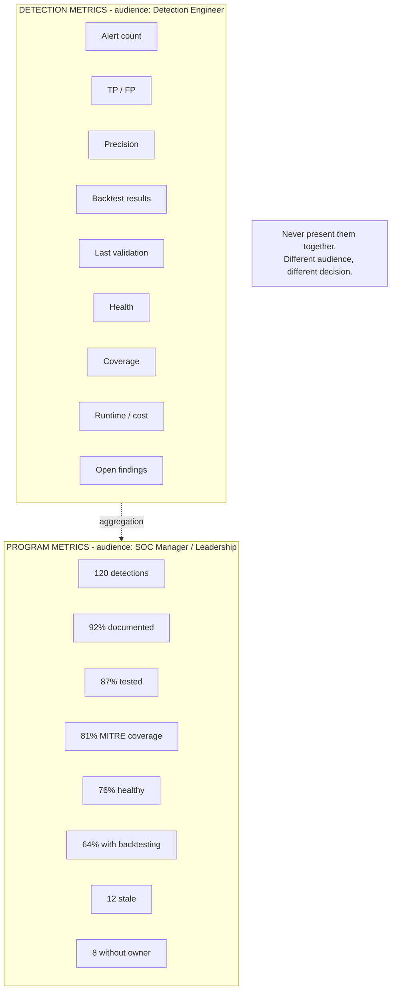
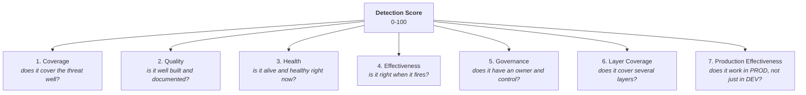
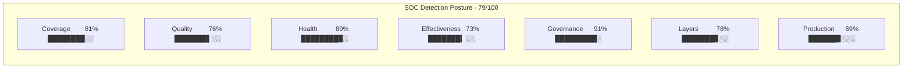
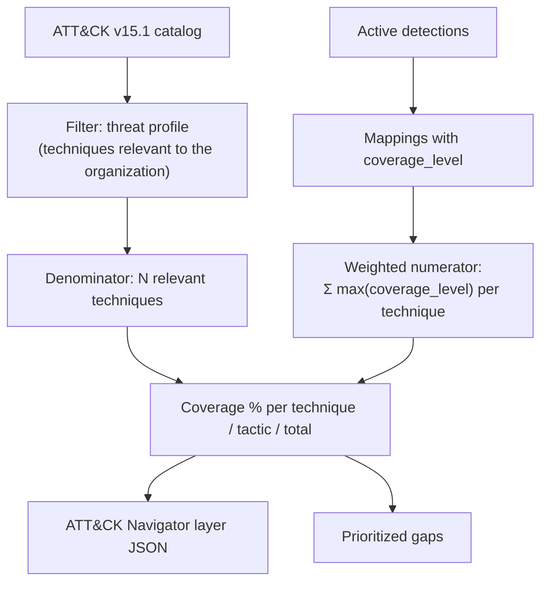
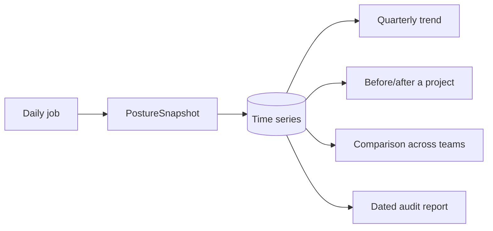

# 07 - Posture, Scoring and Metrics

> **Decision D-10:** there are **two** families of metrics that are **never** mixed:
> those of the **detection** (for the engineer) and those of the **program** (for the SOC Manager).

---

## 1. The two families



| | Detection Metrics | Program Metrics |
|---|---|---|
| **Subject** | A single `DET-XXXX` or `IMP-...` | The entire SOC, a platform, or a team |
| **Question** | "Does this rule work well?" | "Is our detection program mature?" |
| **Frequency** | Continuous | Weekly / monthly / quarterly |
| **Screen** | Detection Detail | Posture Dashboard |
| **Typical action** | Tune, revalidate, retire | Prioritize investment, report, allocate resources |

---

## 2. The 7 dimensions of the Detection Score



### Reference example (DET-0001)

| Dimension | Score |
|-----------|------:|
| Coverage | 95 |
| Quality | 78 |
| Health | 92 |
| Effectiveness | 87 |
| Governance | 90 |
| Layer Coverage | 70 |
| Production Effectiveness | 82 |
| **Detection Score** | **85** |

> With **equal weights** (1/7 each), the mean of these values is exactly 84.86 → **85**.
> That is the default. The weights are configurable in `taxonomy/scoring.yml`.

---

## 3. Exact formulas

### 3.1 Coverage (does it cover the threat well?)

```
Coverage = 100 × ( 0.40·MitreDepth + 0.25·SubtechniqueCoverage
                 + 0.20·DataSourceCompleteness + 0.15·ScopeClarity )
```

| Component | Calculation | Range |
|------------|---------|-------|
| `MitreDepth` | mean of the mappings' `coverage_level`, mapped as: `none=0, minimal=0.25, partial=0.5, significant=0.75, complete=1.0` | 0-1 |
| `SubtechniqueCoverage` | covered subtechniques / existing subtechniques of the primary technique | 0-1 |
| `DataSourceCompleteness` | data sources present and healthy / data sources declared as `required` | 0-1 |
| `ScopeClarity` | 1 if `intent.scope.included` and `excluded` are filled in; 0.5 if only one; 0 if neither | 0/0.5/1 |

### 3.2 Quality (is it well built?)

```
Quality = 100 × ( 0.30·DocCompleteness + 0.25·TestCompleteness
                + 0.20·LogicQuality + 0.15·MetadataCompleteness
                + 0.10·ExceptionHygiene )
```

| Component | Calculation |
|------------|---------|
| `DocCompleteness` | mandatory sections present / required (README, investigation, false-positives, response) - weighted by `word_count > minimum` |
| `TestCompleteness` | (defined tests ≥1 ? 0.4 : 0) + (negative test ≥1 ? 0.3 : 0) + (automated ratio × 0.3) |
| `LogicQuality` | 1 - penalties: no comments (-0.1), no `let` for a substitutable source (-0.15), complexity > threshold (-0.1), lint warnings (-0.05 each) |
| `MetadataCompleteness` | recommended fields filled in / total recommended (`hypothesis`, `evasion_notes`, `threat`, `runbook`, `confidence`…) |
| `ExceptionHygiene` | exceptions with justification + risk + not expired / total exceptions (1.0 if there are none) |

### 3.3 Health (is it alive and healthy?)

```
Health = 100 × ( 0.30·DataAvailability + 0.25·ValidationFreshness
               + 0.20·DriftStatus + 0.15·ExecutionHealth
               + 0.10·DependencyFreshness )
```

| Component | Calculation |
|------------|---------|
| `DataAvailability` | 1 if all required log sources are `active` with `last_seen < 24h`; 0.5 if `degraded`; 0 if `absent` |
| `ValidationFreshness` | `max(0, 1 - days_since_last_validation / revalidate_every_days)` |
| `DriftStatus` | `in_sync=1`, `local_ahead=0.7`, `remote_ahead=0.4`, `diverged=0`, `unknown=0.5` |
| `ExecutionHealth` | 1 - (execution errors in 30d / expected executions) |
| `DependencyFreshness` | watchlists/lookups updated within their threshold / total dependencies |

### 3.4 Effectiveness (is it right when it fires?)

```
Effectiveness = 100 × ( 0.45·Precision + 0.25·SignalRate
                      + 0.20·BacktestQuality + 0.10·TriageEfficiency )
```

| Component | Calculation |
|------------|---------|
| `Precision` | `TP / (TP + FP)` over the last 90 days. If there is no data → declared `expected`, with `confidence=low` |
| `SignalRate` | bell-shaped function: penalizes both 0 alerts (dead rule) and excessive volume. `1` within the declared target range, decays outside it |
| `BacktestQuality` | precision observed in the last backtest |
| `TriageEfficiency` | `1 - (actual mean triage time / estimated)` clamped to [0,1]; if there is no SOAR data → neutral 0.7 |

> **Note:** `SignalRate` is deliberately bidirectional. A rule that never fires
> is not "perfect": it is probably broken (Finding F-13).

### 3.5 Governance (does it have an owner and control?)

```
Governance = 100 × ( 0.25·HasOwner + 0.20·ReviewFreshness
                   + 0.20·ApprovalTrail + 0.20·VersioningDiscipline
                   + 0.15·FindingsHygiene )
```

| Component | Calculation |
|------------|---------|
| `HasOwner` | 1 if `owner` + `maintainer` + `approver` are defined; 0.5 if only owner; 0 if none |
| `ReviewFreshness` | `max(0, 1 - days_since_last_review / cadence_days)` |
| `ApprovalTrail` | 1 if all deployments to PROD have `approved_by` ≠ author; degraded proportionally |
| `VersioningDiscipline` | 1 if every logic change has a version bump + changelog; degraded by commits without a changelog |
| `FindingsHygiene` | 1 - (open findings > SLA / total findings) |

### 3.6 Layer Coverage (does it cover several layers?)

```
LayerCoverage = 100 × Σ( layer_weight × strength ) / Σ( layer_weight of applicable layers )
   where strength: primary=1.0, supporting=0.6, partial=0.3
```

The "applicable layers" come from `intent.attack_surface`. If the intent declares
`identity, endpoint, network` and there is only an implementation in `identity` (primary) and
`endpoint` (supporting), but nothing in `network`:

```
(1.0×1.0 + 1.0×0.6 + 1.0×0.0) / 3.0 = 0.533 → 53
```

Reaching 70 requires real coverage in more layers. **This dimension exists to
make visible that a single-layer detection is more fragile.**

### 3.7 Production Effectiveness (does it work in PROD?)

```
ProductionEffectiveness = 100 × ( 0.40·DeployedInProd + 0.30·ProdParity
                                + 0.20·ProdValidated + 0.10·ProdStability )
```

| Component | Calculation |
|------------|---------|
| `DeployedInProd` | 1 if there is an `active` and `enabled` implementation in an environment with `tier=prod` |
| `ProdParity` | 1 if PROD version and hash == DEV; 0.5 if PROD is one minor behind; 0 if diverged |
| `ProdValidated` | 1 if there is a `production_validation` or `deployment_validation` in the last 90d |
| `ProdStability` | 1 - (no. of rollbacks / no. of deployments in 180d) |

---

## 4. Detection Score aggregation

```
DetectionScore = Σ ( w_i × Dimension_i )      with Σ w_i = 1
```

`taxonomy/scoring.yml` (defaults):

```yaml
detection_score:
  weights:
    coverage:                 0.1429
    quality:                  0.1429
    health:                   0.1429
    effectiveness:            0.1429
    governance:               0.1429
    layer_coverage:           0.1428
    production_effectiveness: 0.1428
  rounding: nearest
  # Hard modifiers
  caps:
    - condition: "status in [draft, in_development]"
      max_score: 60
      reason: "Something that is not in production cannot score high"
    - condition: "has_open_finding(severity=critical)"
      max_score: 50
    - condition: "drift_status == diverged"
      max_score: 60
    - condition: "data_availability == 0"
      max_score: 40
  bands:
    excellent: [90, 100]
    good:      [75, 89]
    fair:      [60, 74]
    poor:      [40, 59]
    critical:  [0, 39]
```

> **The `caps` are important.** Without them, a detection with absent data could
> score 80 because it is well documented. The platform must not lie (principle 4).

---

## 5. Program posture

The same 7 dimensions, aggregated over the set of detections **in states that count**
(`production_candidate`, `active`, `tuning`, `degraded`).

```
ProgramDimension_i = weighted mean of Dimension_i over the detections that count
                     (weighted by severity: critical×2, high×1.5, medium×1, low×0.75)

OverallPosture = Σ ( w_i × ProgramDimension_i )
```

### Reference example (SOC)

| Dimension | Score |
|-----------|------:|
| Coverage | 81% |
| Quality | 76% |
| Health | 89% |
| Effectiveness | 73% |
| Governance | 91% |
| Detection Layers | 78% |
| Production | 69% |
| **Overall** | **79 / 100** |

> Arithmetic mean = 79.57 → reported truncated to **79** (policy: truncate, do not round,
> so as not to inflate the result in reports).



---

## 6. Detection Health - the exceptions panel

It complements the score: it does not say "how much", it says **"what to fix"**.

```
Detection Health
────────────────────────────────

120 detections

[WARN]  17 have open findings
[WARN]   9 have stale validation
[WARN]   6 have schema issues
[WARN]   4 have no owner
[WARN]  12 lack tests
[WARN]   5 have DEV/PROD drift
[WARN]   3 have absent data sources
[WARN]   7 have expired exceptions
[WARN]   2 have zero alerts in 90 days
[WARN]   1 failed red team
```

Each line is a **clickable filter** that leads to the corresponding list.
This panel is what turns the score into actionable work.

---

## 7. `metric_key` catalog

### 7.1 Scope `detection` / `implementation`

| `metric_key` | Unit | Source | Periodicity |
|--------------|--------|--------|--------------|
| `alerts.count` | count | connector | daily |
| `alerts.tp` | count | connector/SOAR | daily |
| `alerts.fp` | count | connector/SOAR | daily |
| `alerts.benign_positive` | count | SOAR | daily |
| `alerts.undetermined` | count | SOAR | daily |
| `alerts.precision` | ratio | computed | daily |
| `alerts.mean_triage_minutes` | minutes | SOAR | weekly |
| `alerts.escalation_rate` | ratio | SOAR | weekly |
| `execution.runtime_ms` | ms | connector | daily |
| `execution.rows_scanned` | count | connector | daily |
| `execution.errors` | count | connector | daily |
| `execution.cost_estimate` | currency | computed | monthly |
| `validation.days_since_last` | days | computed | daily |
| `validation.backtest_precision` | ratio | validation | per run |
| `findings.open` | count | computed | daily |
| `findings.open_critical` | count | computed | daily |
| `drift.status` | enum | drift engine | 4h |
| `score.coverage` … `score.overall` | 0-100 | posture engine | daily |

### 7.2 Scope `program`

| `metric_key` | Unit | Definition |
|--------------|--------|------------|
| `program.detections.total` | count | All non-`retired` |
| `program.detections.active` | count | In `active` state |
| `program.detections.documented_pct` | % | With complete documentation / total |
| `program.detections.tested_pct` | % | With ≥1 defined test / total |
| `program.detections.backtested_pct` | % | With backtest < 180d / active |
| `program.detections.healthy_pct` | % | With Health ≥ 75 / total |
| `program.detections.stale_count` | count | Expired validation |
| `program.detections.no_owner_count` | count | No owner |
| `program.detections.orphan_count` | count | No owner and no changes in 12 months |
| `program.mitre.technique_coverage_pct` | % | Covered techniques / techniques relevant to the threat profile |
| `program.mitre.tactic_coverage_pct` | % | Per tactic |
| `program.datasource.coverage_pct` | % | Data sources in use / available |
| `program.layers.coverage_pct` | % | Coverage per layer |
| `program.drift.count` | count | Implementations with drift |
| `program.findings.open` | count | |
| `program.findings.mttr_days` | days | Mean resolution time |
| `program.deployments.count` | count | Per period |
| `program.deployments.rollback_rate` | % | |
| `program.velocity.new_detections` | count/month | Creation pace |
| `program.velocity.time_to_production_days` | days | From `draft` to `active` |
| `program.alerts.total` | count | Aggregated volume |
| `program.alerts.precision` | ratio | Aggregated SOC precision |

---

## 8. MITRE coverage - calculation and presentation



**Critical point of honesty:** coverage is NOT calculated against the ~600 techniques of
full ATT&CK, because that produces falsely low and non-actionable numbers. It is calculated
against a **threat profile** defined in `coverage/threat-profile.yml`:

```yaml
threat_profile:
  name: "Corporate profile 2026"
  rationale: "Sector, exposed surface and threat intelligence"
  platforms: [windows, azure_ad, office365, network]
  priority_techniques:
    - technique: T1187
      priority: high
      rationale: "Exploited by PetitPotam against our DCs"
    - technique: T1110
      priority: high
  excluded_techniques:
    - technique: T1200      # Hardware Additions
      rationale: "Not applicable: no physical access to data centers"
```

**Two** numbers are reported, always together:
- **Profile coverage** (actionable) - e.g. 81%
- **Total ATT&CK Enterprise coverage** (context) - e.g. 23%

And the **accepted gaps** are shown with their justification, so that an auditor sees that
the gaps are decisions, not oversights.

---

## 9. coverage_level scale (aligned with DeTT&CT)

| Level | Value | Meaning |
|-------|:-----:|-------------|
| `none` | 0.00 | We detect nothing of this technique |
| `minimal` | 0.25 | We detect a very specific, evadable case |
| `partial` | 0.50 | We detect the most common variants |
| `significant` | 0.75 | We detect most known variants |
| `complete` | 1.00 | We detect the technique robustly and in a way that is hard to evade |

**Anti-inflation rule:** `complete` requires at least one `red_team` or `purple_team` with
a `pass` result on record. Without that evidence, the maximum that can be declared is `significant`.

---

## 10. Historical posture



Questions it makes it possible to answer:

- *"Did we improve Credential Access coverage this quarter?"*
- *"Did the Sentinel migration project temporarily lower our Health?"*
- *"Show me the posture as it was on June 30"* (for audit)

---

## 11. Reporting

| Report | Audience | Frequency | Content |
|---------|-----------|:----------:|-----------|
| **Detection Detail Report** | Engineer | on-demand | Everything about a detection + evidence |
| **Program Posture Report** | SOC Manager | monthly | 7 dimensions, trend, top gaps, health panel |
| **Executive Summary** | Leadership | quarterly | 1 page: score, trend, 3 risks, 3 investments |
| **MITRE Coverage Report** | Manager / Hunter | quarterly | Heatmap + prioritized gaps + justifications |
| **Audit Evidence Pack** | Auditor | on-demand | Per detection: definition, approvals, validations, hashed evidence, history |
| **Change Report** | Platform Owner | weekly | Deployments, rollbacks, drift |
| **Findings Backlog** | Engineer / Manager | weekly | Open findings by severity and age |

Export formats: PDF, XLSX, CSV, JSON, ATT&CK Navigator layer.

---

## 12. Anti-patterns to avoid in scoring

| Anti-pattern | Why it is bad | Mitigation in DEP |
|----------------|-----------------|-------------------|
| High score from nice documentation with absent data | Incentivizes writing, not detecting | `caps` by `data_availability` |
| MITRE coverage against all 600 techniques | Useless number, always low | Threat profile as the denominator |
| Counting "rule exists" as "rule works" | False sense of security | Health and Production Effectiveness kept separate |
| Declaring `complete` without evidence | Inflation | Requires a red team `pass` |
| Rewarding rules that never fire | Dead rules score perfectly | Bidirectional `SignalRate` |
| Mixing detection and program metrics | Confuses audiences | Structural separation (D-10) |
| Single score without breakdown | Not actionable | Always 7 dimensions + health panel |
| Comparing teams by raw score | Perverse incentives | Normalize by severity and maturity |
