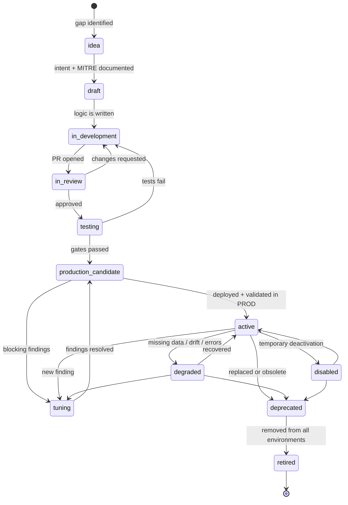
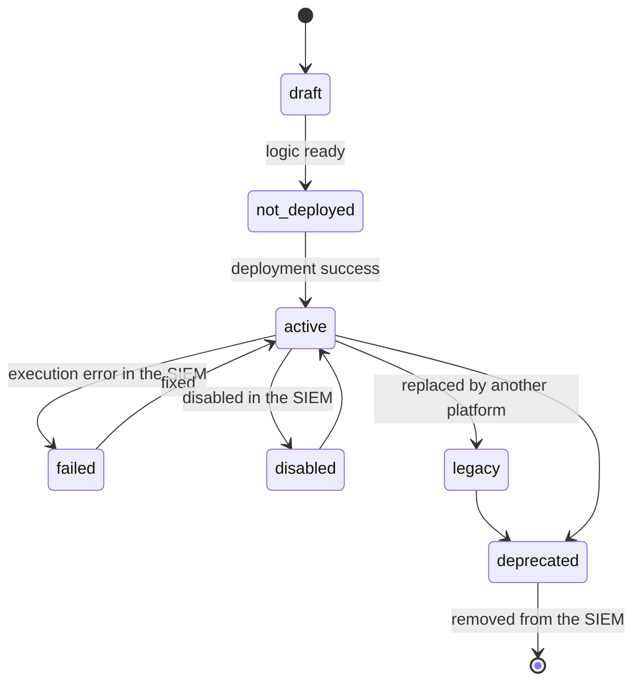
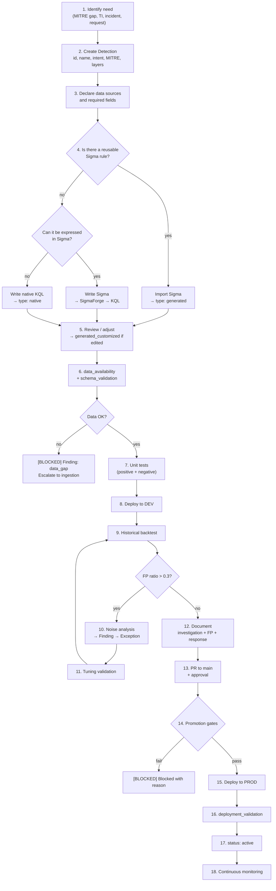
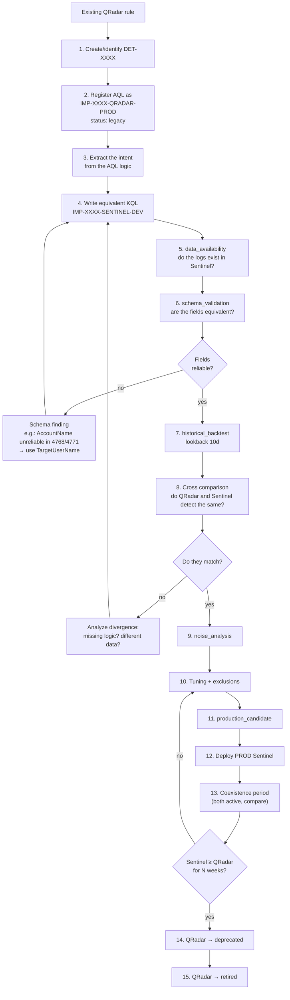
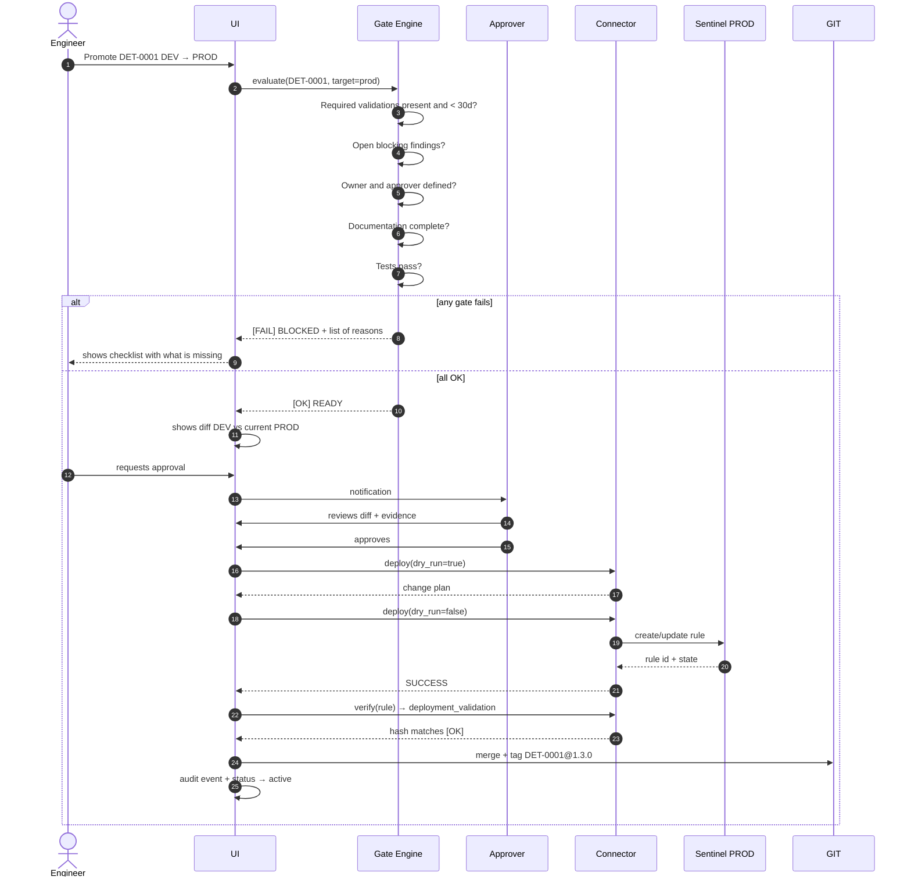
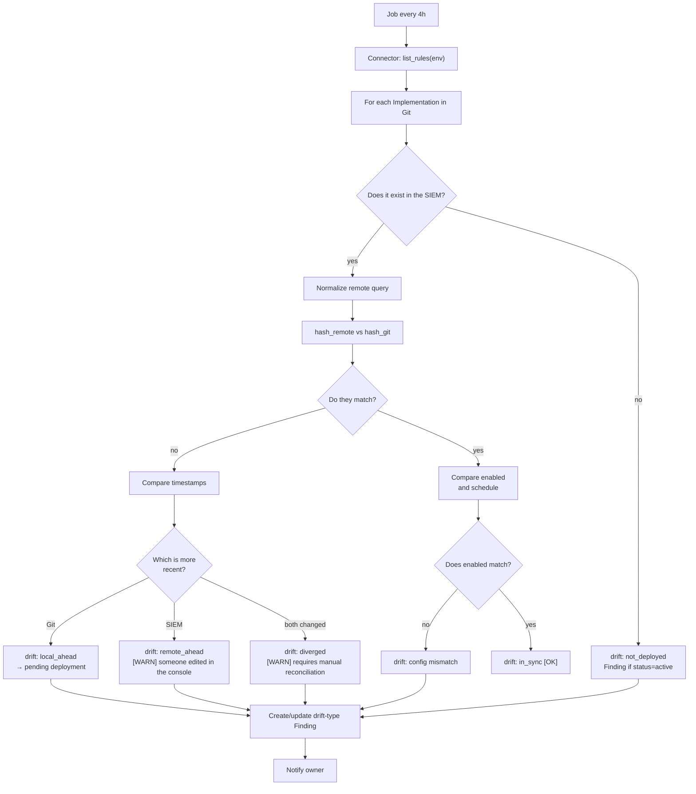
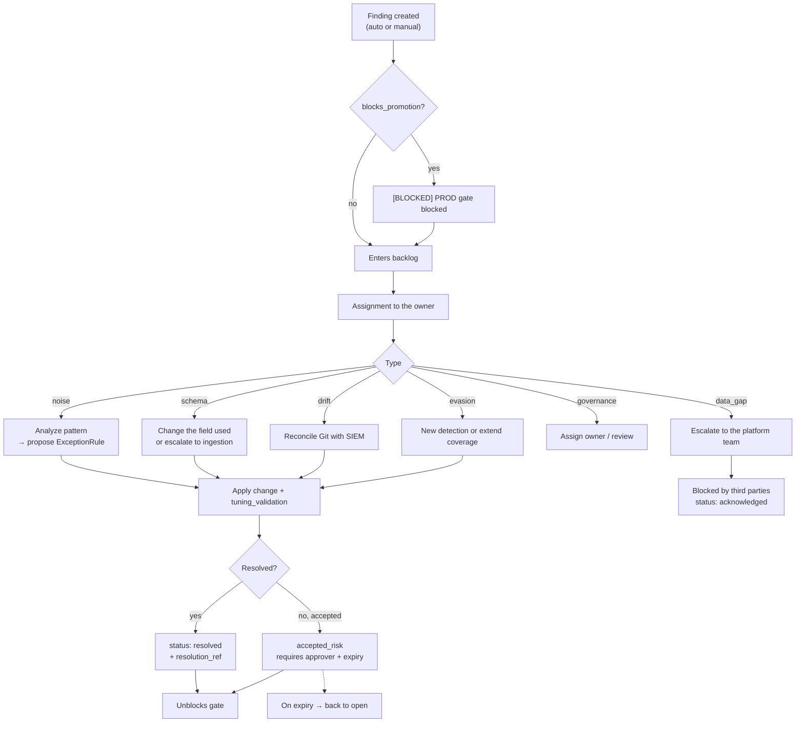
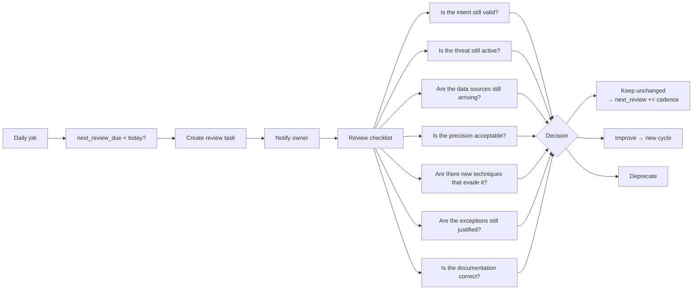
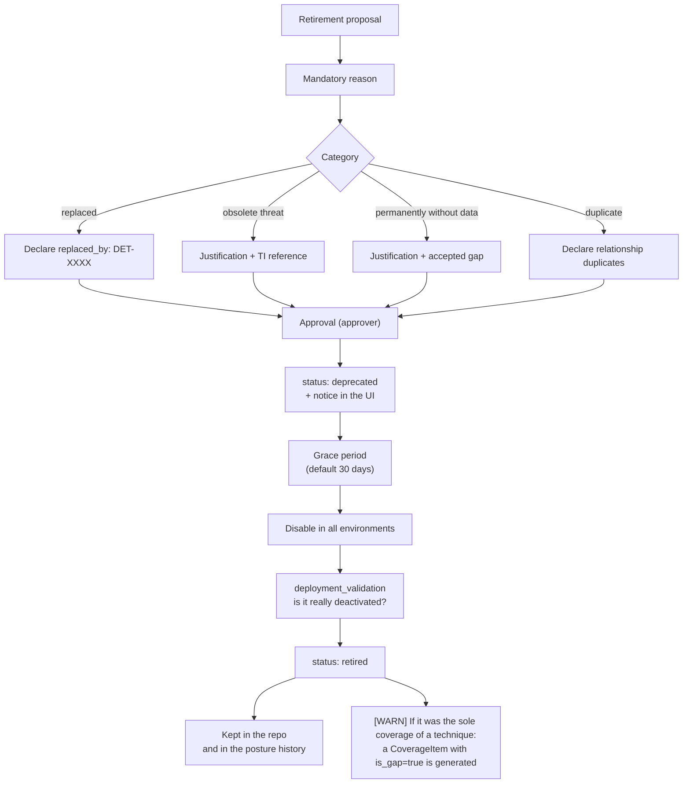

# 08 - Lifecycle and Operational Workflows

---

## 1. Complete lifecycle of a detection



### Transitions: who can perform them and what is required

| Transition | Role | Preconditions | Effects |
|------------|------|---------------|---------|
| `idea → draft` | engineer | Intent + ≥1 MITRE mapping | Folder and `detection.yml` are created |
| `draft → in_development` | engineer | Data sources declared | - |
| `in_development → in_review` | engineer | Logic present, `syntax_validation` PASS | Opens PR |
| `in_review → testing` | reviewer | 1 approval | Merge to `develop`, deploy to DEV |
| `testing → production_candidate` | engineer | Gates from `.dep/policies.yml` | - |
| `production_candidate → active` | approver | PROD deployment success + `deployment_validation` | Tag, audit event |
| `active → tuning` | system/engineer | Open finding with severity ≥ medium | Notification to the owner |
| `active → degraded` | system | F-01/F-04/F-05/F-06 | Operational alert, score cap |
| `active → disabled` | approver | Mandatory justification | Rule disabled in the SIEM |
| `* → deprecated` | approver + owner | `deprecation.reason` + `replaced_by` (or a justification for no replacement) | Marked; not deleted |
| `deprecated → retired` | approver | All deployed implementations removed or disabled | Archived; the `DET-` ID is never reused |

---

## 2. Lifecycle of an implementation



> `legacy` is the state of the QRadar implementation of `DET-0003`:
> it is still active and detecting, but it is not touched because the operational
> source of truth has moved to Sentinel.

---

## 3. Workflow: create a detection from scratch



---

## 4. Workflow: QRadar → Sentinel migration

This is **the real DET-0001 flow**, now formalized and repeatable.



**Key design point:** step 13 (coexistence) requires the model to support
**two simultaneously active implementations on different platforms** - which is exactly
what decision D-02 enables.

---

## 5. Workflow: DEV → PROD promotion



### Gates checklist (visible in the UI)

```
Promotion gates - DET-0001 → Sentinel PROD

[OK]    Syntax validation             passed 2026-08-28
[OK]    Data availability             passed 2026-08-26
[OK]    Schema validation             passed 2026-08-26
[OK]    Historical backtest           passed 2026-08-26  (2 days ago, limit 30)
[FAIL]  Blocking findings             1 open: FND-0001 (noise, medium)
[OK]    Owner assigned                detection-engineering
[OK]    Approver assigned             soc-lead
[OK]    Documentation complete        4/4 required sections
[OK]    Unit tests                    3/3 passed
[WARN]  Approver ≠ author             pending selection

[BLOCKED] PROMOTION BLOCKED - resolve FND-0001 first
```

---

## 6. Workflow: drift detection



**Normalization before comparing** (to avoid generating false drift):

| Ignored | Reason |
|---------|--------|
| Leading/trailing whitespace on a line | The SIEM reformats |
| `\r\n` vs `\n` line breaks | Platform differences |
| Comments (optional, configurable) | Noise |
| Order of JSON properties in metadata | Not semantic |

| NOT ignored | Reason |
|-------------|--------|
| Changes inside strings | They could be exclusions |
| Clause order | It may change the result |
| Numeric values (thresholds) | Semantic |

### Drift screen

```
[WARN]  Kerberos BF - DRIFT DETECTED

              Git (main)        Sentinel PROD      Sentinel DEV
─────────────────────────────────────────────────────────────────
Version       1.4.0             1.2.0              1.4.0
Hash          8f2a1c…           c93b44…            8f2a1c…
Enabled       true              true               true
Modified      2026-08-28        2026-07-14         2026-08-28
Modified by   j.perez           unknown (console)  j.perez
Status        -                 remote_ahead [WARN] in_sync [OK]

Diff PROD vs Git:
  - | where TargetUserName != "NOUSER"
  + | where TargetUserName !in ("NOUSER", "HEALTHCHECK")

[WARN]  Someone edited this rule directly in the Sentinel console on 2026-07-14.
        The change is NOT in Git.

Recommendation:
  ▸ Adopt remote change into Git  (creates a PR with the diff)
  ▸ Overwrite remote with Git     (redeploys 1.4.0)
  ▸ Mark as accepted divergence   (requires justification)
```

---

## 7. Workflow: managing a Finding



---

## 8. Workflow: periodic review



---

## 9. Workflow: retiring a detection



> **It is never deleted.** A retired detection stays in Git and in the history.
> The ID is never reused. This makes it possible to answer an auditor:
> *"what were you detecting in June 2025?"*

---

## 10. Inventory matrix (the view that makes everything evident)

```
Detection Inventory

                        SENTINEL          QRADAR      EDR    Health
                      DEV      PROD        PROD
────────────────────────────────────────────────────────────────────
Coerced Auth          ok       ok          ok         -      ● 92
Kerberos BF           ok       [WARN] drift ok        -      ◐ 74
Password Spray        ok       ok          -          -      ● 88
MFA Fatigue           ok       ok          -          -      ● 91
Golden Ticket         ok       -           ok         -      ◐ 61
LSASS Access          -        -           -          ok     ● 85
DNS Tunneling         ok       x disabled  -          -      ○ 38

Legend  ok active   [WARN] drift   x disabled   - not implemented
        ● healthy  ◐ degraded  ○ critical
```

Clicking on `[WARN] Kerberos BF`:

```
[WARN]  Kerberos BF - Environment inconsistency

DEV                    PROD                   QRadar
version 1.4.0          version 1.2.0          legacy implementation
hash 8f2a1c…           hash c93b44…           hash 55ee01…
enabled                enabled                enabled
validated 2026-08-28   validated 2026-06-02   validated 2025-11-10

Delta DEV → PROD:
  • Exclusion for loopback NOUSER (FND-0001) not present in PROD
  • Threshold changed from 3 to 5 failures

Recommendation:
  ▸ Promote DEV → PROD  (blocked: FND-0001 must be resolved first)
```

---

## 11. Notifications and events

| Event | Recipient | Channel | Priority |
|-------|-----------|---------|:--------:|
| Critical finding created | Owner + SOC lead | Email + Teams/Slack | high |
| Data source missing | Owner + Platform | Email + operational alert | high |
| `diverged` drift detected | Owner + Platform | Teams/Slack | high |
| Failed deployment to PROD | Author + Platform | Email | high |
| Pending approval | Approver | Teams/Slack | medium |
| Overdue periodic review | Owner | Weekly email | low |
| Exception about to expire (15d) | Owner + Approver | Email | medium |
| Monthly posture available | SOC Manager | Email with PDF | low |
| Detection with no alerts in 90d | Owner | Weekly email | low |
| New ATT&CK version | Detection team | Email | low |

All events are also emitted as **webhooks** (see doc 11) for integration with
SOAR/ITSM.
