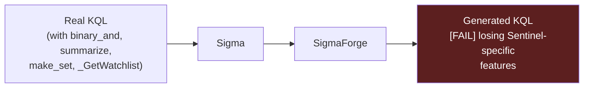
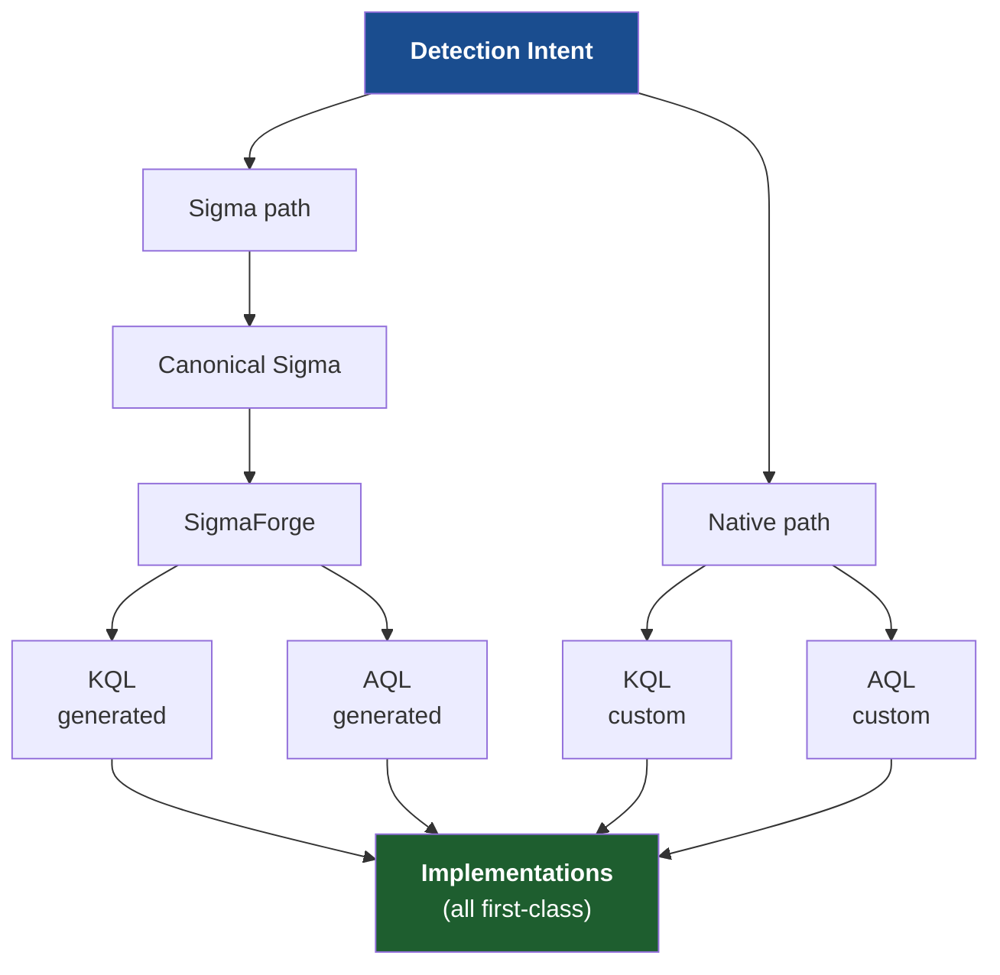
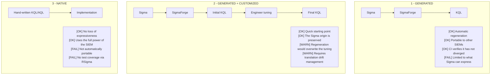
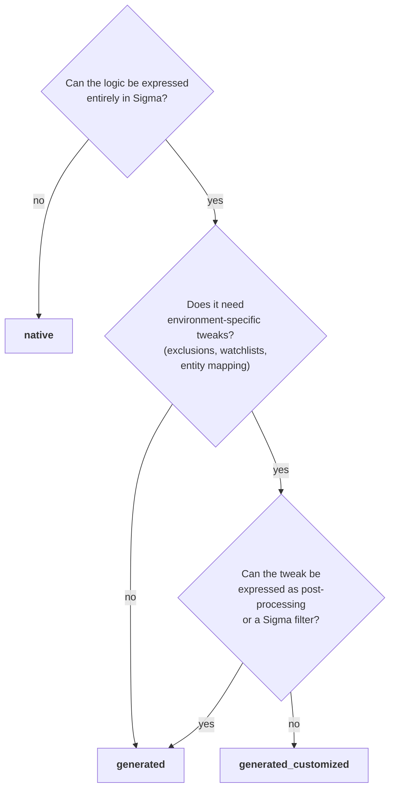
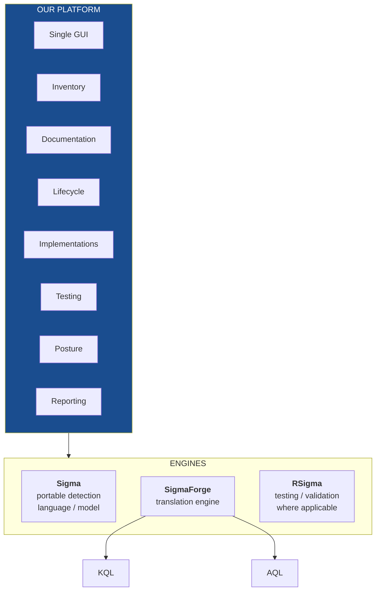
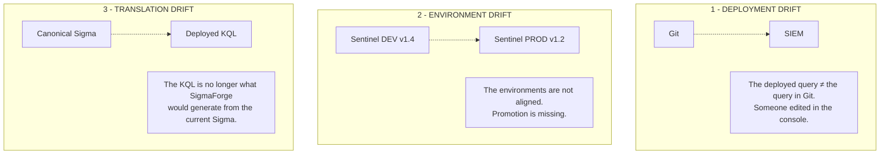
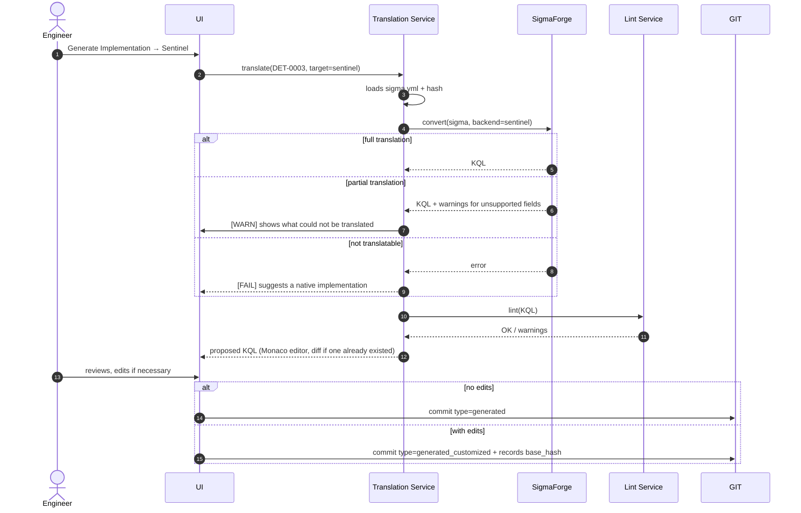

# 09 - Implementations, Sigma and Translation

> **Decision D-05:** a single GUI. SigmaForge is a **backend component**, not another
> tool the engineer has to open.
> **Decision D-06/D-07:** not every detection must go through automatic translation.

---

## 1. The problem we solve

What we do **not** want to happen:



What we **do** want:



**Both paths produce first-class implementations.** A `native` detection is not a
second-class citizen: it simply does not use the translation engine.

---

## 2. The three implementation types



### Decision table: which type to use?



| Signal in the query | Forced type |
|---------------------|-------------|
| `_GetWatchlist(...)` | `native` or `generated_customized` |
| `binary_and()`, `bitwise` | `native` |
| `summarize` with `make_set()` / `make_list()` | `native` |
| `join` across tables | `native` |
| `materialize()`, saved functions | `native` |
| Time series (`series_decompose_anomalies`) | `native` |
| `externaldata()` | `native` |
| Simple filter on fields of one table | `generated` |
| Filter + exclusion of known values | `generated` |
| Simple threshold with `summarize count()` | `generated` possible |

> These indicators are detected automatically by the `LintService` and recorded in
> `DetectionLogic.uses_functions`. The UI **suggests** the type; the engineer confirms.

---

## 3. Role of each component



| Component | Role | Does the user see it? |
|-----------|------|:---------------------:|
| **Sigma** | Portable detection language/model | Yes, as the "Detection Logic → Canonical" tab |
| **SigmaForge** | Sigma → KQL/AQL translation engine | No. It is invoked from "Generate Implementation" |
| **RSigma** | Testing/validation where applicable | No. It is invoked from "Run tests" |
| **DEP** | Inventory + documentation + lifecycle + implementations + testing + posture + reporting + UI | Yes, it is **the home** |

---

## 4. The "Detection Logic" tab in the UI

```
┌──────────────────────────────────────────────────────────────────────────┐
│ DET-0003 · Coerced Authentication                                  HIGH  │
├──────────────────────────────────────────────────────────────────────────┤
│ [Overview] [Detection Logic] [Implementations] [Validation] [Findings]   │
├──────────────────────────────────────────────────────────────────────────┤
│                                                                          │
│  CANONICAL DETECTION                              Sigma · partial (i)    │
│  ┌────────────────────────────────────────────────────────────────────┐  │
│  │ title: Coerced Authentication via lsarpc                           │  │
│  │ id: 7c1f4e9a-2b3d-4c5e-9a8b-1d2e3f4a5b6c                           │  │
│  │ logsource:                                                          │ │
│  │   product: windows                                                  │ │
│  │   service: security                                                 │ │
│  │ detection:                                                          │ │
│  │   selection:                                                        │ │
│  │     EventID: 5145                                                   │ │
│  │     RelativeTargetName: lsarpc                                      │ │
│  │   condition: selection                                              │ │
│  └────────────────────────────────────────────────────────────────────┘  │
│                                                                          │
│  [WARN] Not fully translatable:                                          │
│    • _GetWatchlist('nessus') exclusion                                   │
│    • custom entity mapping                                               │
│    → Implementations are maintained as NATIVE                            │
│                                                                          │
│  [ Generate Implementation ▾ ]   Target: Microsoft Sentinel ▾            │
│                                                                          │
├──────────────────────────────────────────────────────────────────────────┤
│  IMPLEMENTATIONS                                                         │
│                                                                          │
│  ● Sentinel   PROD   Active   native    v1.0.0   in sync    [View KQL]   │
│  ● Sentinel   DEV    Active   native    v1.0.0   in sync    [View KQL]   │
│  ◐ QRadar     PROD   Legacy   native    v0.9.0   in sync    [View AQL]   │
│                                                                          │
└──────────────────────────────────────────────────────────────────────────┘
```

When clicking **View KQL**:

```
Sentinel → KQL                                     IMP-0003-SENTINEL-PROD

let nessus = _GetWatchlist('nessus')
    | project ScannerIP;
SecurityEvent
| where EventID == 5145
| where RelativeTargetName =~ "lsarpc"
| where IpAddress !in (nessus)
| summarize Count = count(), Shares = make_set(ShareName)
    by Computer, SubjectUserName, IpAddress, bin(TimeGenerated, 1h)
```

When clicking **View AQL**:

```
QRadar → AQL                                         IMP-0003-QRADAR-PROD

APPLY _TW_Coerced Authentication
SELECT ...
```

---

## 5. Generation metadata and translation drift

This is **information of enormous value for Detection Engineering** and today it does not exist
anywhere:

```
Implementation: Sentinel PROD

Source:            Sigma-generated
Sigma version:     1.2.0  (hash d9e8…)
Generated:         2026-08-27  by SigmaForge v0.9.4
Customized:        YES
Last modified:     2026-08-28  by j.perez
Translation drift: [WARN] Manual changes detected

  What SigmaForge would generate today:
    SecurityEvent
    | where EventID == 5145 and RelativeTargetName =~ "lsarpc"

  What is actually deployed:
    let nessus = _GetWatchlist('nessus') | project ScannerIP;
    SecurityEvent
    | where EventID == 5145
    | where RelativeTargetName =~ "lsarpc"
    | where IpAddress !in (nessus)          ← manual addition

  ▸ Accept current (mark as generated_customized)
  ▸ Regenerate from Sigma ([WARN] discards manual changes)
  ▸ Update Sigma to include this logic
  ▸ Convert to native (stop tracking Sigma)
```

### The three types of drift (do not confuse them)



| Type | Detected by comparing | Typical action |
|------|-----------------------|----------------|
| Deployment drift | hash(SIEM) vs hash(Git) | Adopt or overwrite |
| Environment drift | version/hash across environments | Promote |
| Translation drift | SigmaForge(sigma) vs current logic | Accept, regenerate, update Sigma or switch to native |

---

## 6. Generation flow from the GUI



---

## 7. SigmaForge adapter

Interface the core expects. It isolates the project from changes in SigmaForge.

```python
class TranslationResult(BaseModel):
    success: bool
    query: str | None
    language: str
    backend: str
    backend_version: str
    warnings: list[str]          # unsupported fields, approximations
    unsupported_features: list[str]
    pipeline_used: str | None    # processing pipeline applied
    generated_at: datetime
    source_hash: str             # hash of the source Sigma

class BaseTranslator(Protocol):
    def supported_backends(self) -> list[str]: ...
    def translate(self, sigma_yaml: str, backend: str,
                  pipeline: str | None = None) -> TranslationResult: ...
    def validate_sigma(self, sigma_yaml: str) -> list[str]: ...
    def can_translate(self, sigma_yaml: str, backend: str) -> tuple[bool, list[str]]: ...
```

**Failure behavior:** translation never blocks work. If SigmaForge
cannot translate, the UI offers to create the implementation as `native` and records in
`sigma.untranslatable[]` **why**, which is valuable information (it makes it possible to answer:
*"what percentage of our catalog is not portable, and why?"*).

---

## 8. When Sigma is authoritative

```yaml
sigma:
  present: true
  authoritative: true    # ← the canonical logic rules
```

| `authoritative` | Meaning | CI behavior |
|:---------------:|---------|-------------|
| `false` (default) | Sigma is documentation/portability. The truth is in the KQL/AQL. | Does not regenerate. Only warns about translation drift. |
| `true` | The Sigma is the source. Implementations are generated from it. | **Regenerates on every PR and fails if the result differs from the committed file.** |

**Recommendation for this environment:** start with `authoritative: false` on 100% of the
migrated detections, and enable it only on new, simple detections. It is the only way
not to lose the real KQL during the migration.

---

## 9. Portability: the report this enables

```
Detection Portability Report

120 detections

  Sigma-backed (generated)              18   16%
  Sigma-backed (customized)             24   22%
  Native only                           68   62%

Why native? (top reasons)
  _GetWatchlist / lookup enrichment     31
  summarize + make_set aggregation      22
  join across tables                    14
  bitwise operations (binary_and)        9
  time series / anomaly functions        6
  externaldata                           3

Portability score:  38%
  → If we had to migrate to a third SIEM tomorrow,
    38% could be regenerated automatically.
```

This metric is a **business decision**, not a defect. Seeing 62% native detections
is not a failure: it is the reality of a mature SOC. But knowing it makes it possible to decide
consciously how much effort to invest in portability.

---

## 10. Non-SIEM implementations (EDR, Network)

The model supports non-SIEM platforms from day 1, even though connectors will not be implemented
until v0.3+:

| Platform | `type` | Language | Notes |
|----------|--------|----------|-------|
| CrowdStrike Falcon | `edr` | FQL / IOA rules | Deployment via API |
| Microsoft Defender XDR | `edr` | KQL (advanced hunting) | Shares its language with Sentinel but **is a different platform** |
| Zeek | `ndr` | Zeek script | Deployment via file |
| Suricata | `ndr` | Suricata rules | Compatible with Sigma for simple rules |
| Elastic Security | `siem` | EQL / KQL Lucene | |

> **Important detail:** Defender XDR and Sentinel both use KQL but have different schemas
> (`DeviceProcessEvents` vs `SecurityEvent`). They are modeled as **separate
> platforms**, never as the same `platform_id`.
