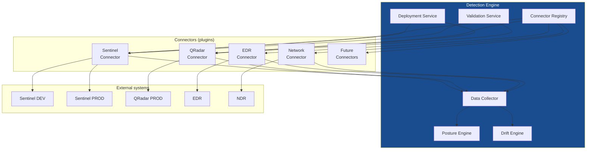
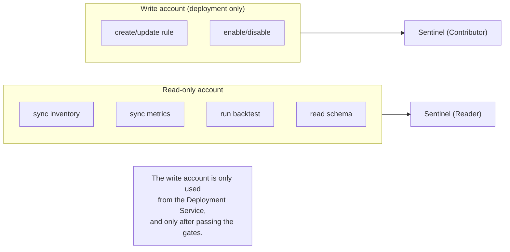
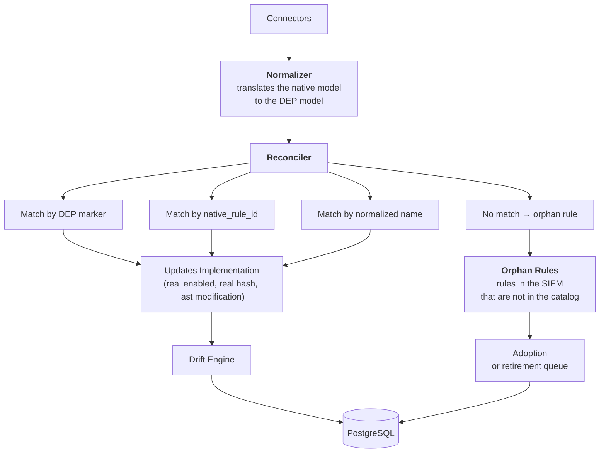
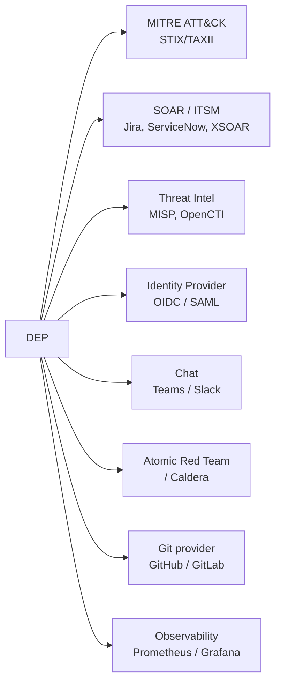
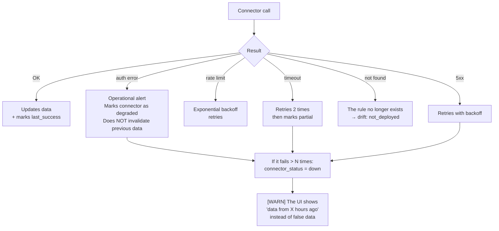
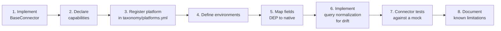

# 10 - Connectors and Integrations

> **Decision D-14:** the real state of the SIEMs is **discovered**, not declared.
> Without connectors, the inventory is a list of good intentions.

---

## 1. Connector architecture



---

## 2. Capabilities per connector

A connector declares what it can do. The UI **disables** what is not supported
instead of failing.

| Capability | Description | Sentinel | QRadar | EDR |
|------------|-------------|:--------:|:------:|:---:|
| `LIST` | Enumerate existing rules | Yes | Yes | Yes |
| `READ` | Get the full definition of a rule | Yes | Yes | Yes |
| `DEPLOY` | Create/update rules | Yes | Optional | Limited |
| `DISABLE` | Disable without deleting | Yes | Yes | Yes |
| `DELETE` | Delete | Yes | Yes | Limited |
| `QUERY` | Run ad-hoc queries (backtest) | Yes | Yes | Yes |
| `SCHEMA` | List tables and fields | Yes | Partial | Limited |
| `METRICS` | Alerts generated, TP/FP | Yes | Yes | Limited |
| `ENRICHMENT` | List watchlists / reference sets | Yes | Yes | No |
| `HEALTH` | Rule execution errors | Yes | Yes | Limited |
| `COST` | Query cost estimation | Yes | No | No |

> **Operational recommendation:** in the first phase, QRadar is configured **without `DEPLOY`**.
> It is a legacy platform and we do not want the tool to write to it.

---

## 3. Sentinel Connector

### 3.1 APIs used

| Function | API | Minimum permission |
|----------|-----|--------------------|
| List/read/create rules | Azure Management API - `Microsoft.SecurityInsights/alertRules` | `Microsoft Sentinel Reader` (read) / `Microsoft Sentinel Contributor` (write) |
| Run queries | Log Analytics Query API | `Log Analytics Reader` |
| List tables and schema | Log Analytics - `/metadata` | `Log Analytics Reader` |
| Incidents and classification (TP/FP) | `Microsoft.SecurityInsights/incidents` | `Microsoft Sentinel Reader` |
| Watchlists | `Microsoft.SecurityInsights/watchlists` | `Microsoft Sentinel Reader` |
| Rule health | `Microsoft.SecurityInsights/alertRules/{id}/health` | Reader |

### 3.2 Credential separation



### 3.3 Field mapping: `Implementation` <-> Sentinel rule

| DEP field | Sentinel field (`ScheduledAlertRule`) |
|-----------|---------------------------------------|
| `native_rule_name` | `displayName` |
| `native_rule_id` | `name` (GUID) |
| `logic.code` | `query` |
| `schedule.frequency` | `queryFrequency` |
| `schedule.lookback` | `queryPeriod` |
| `threshold.operator` | `triggerOperator` |
| `threshold.value` | `triggerThreshold` |
| `enabled` | `enabled` |
| `Detection.severity` | `severity` |
| `mitre.mappings[].tactic` | `tactics` |
| `mitre.mappings[].technique` | `techniques` |
| `entity_mappings` | `entityMappings` |
| `custom_details` | `customDetails` |
| `suppression` | `suppressionEnabled` / `suppressionDuration` |
| `alert_grouping` | `incidentConfiguration.groupingConfiguration` |
| `Detection.description` | `description` |
| `DET-XXXX` + `version` | `alertRuleTemplateName` [FAIL] **no** - it is injected into `description` or into a tag |

> **Known problem:** Sentinel has no native field for an "external ID".
> **Solution adopted:** a structured marker is inserted at the end of `description`:
> ```
> [DEP:DET-0003:v1.0.0:8f2a1c]
> ```
> The connector parses it to reconcile. Alternative: `labels`/tags if the resource supports them.
> This decision must be validated in the week 1 spike.

### 3.4 Content Hub rules

Rules inherited from the Content Hub have an `alertRuleTemplateName`. The connector:

1. Marks them with `source.origin: content_hub` and `source.reference: <templateName>`.
2. Records the template version (`templateVersion`).
3. A job checks whether Microsoft has published a new version → generates a Finding
   of type `governance` ("upstream template updated").
4. If the team has modified the rule relative to the template → `customized: true`,
   which is a fourth type of drift: **upstream drift**.

---

## 4. QRadar Connector

| Function | API |
|----------|-----|
| List rules | `GET /api/analytics/rules` |
| Read rule | `GET /api/analytics/rules/{id}` |
| Run AQL | `POST /api/ariel/searches` + polling |
| Reference sets | `GET /api/reference_data/sets` |
| Offenses (metrics) | `GET /api/siem/offenses` |
| Log sources | `GET /api/config/event_sources/log_source_management/log_sources` |

**Known limitations to document:**

| Limitation | Impact | Mitigation |
|------------|--------|------------|
| The API exposes CRE rules but the logic "content" is not always retrievable as plain text | Partial drift detection | Compare by metadata + hash of the exportable definition; mark `drift_status: unknown` if not comparable |
| Ariel searches are asynchronous and can take a long time | Slow backtests | Asynchronous job with polling and a long timeout |
| There is no notion of a DEV "environment" | PROD only | `environments.yml` declares only `qradar-prod` |
| TP/FP classification depends on the use of "closing reasons" | Precision metrics possibly incomplete | Document the closing reasons → TP/FP mapping in `taxonomy/` |

---

## 5. Data Collector



### The orphan rules report

One of the first tangible values of the platform:

```
Orphan Rules - active rules in the SIEM that are not in the catalog

Sentinel PROD                                          14 rules
  ▸ "Test rule - do not delete"          modified 2024-03-11   0 alerts/90d
  ▸ "TEMP MFA check v3"                  modified 2025-01-22   1.2k alerts/90d
  ▸ "Copy of Password Spray"             modified 2025-06-08   340 alerts/90d
  ...

QRadar PROD                                             9 rules

Actions:  [Adopt into catalog]  [Mark for retirement]  [Ignore (justify)]
```

> This screen, by itself, usually justifies the project to a SOC Manager.

---

## 6. Additional integrations



| Integration | Direction | Use | Priority |
|-------------|:---------:|-----|:--------:|
| MITRE ATT&CK | inbound | Technique catalog, monthly update | v0.1 |
| Git provider | bidirectional | Source of truth, PRs, webhooks | v0.1 |
| IdP (OIDC) | inbound | SSO, roles | v0.2 |
| Teams/Slack | outbound | Notifications | v0.2 |
| SOAR/ITSM | bidirectional | Findings → tickets; TP/FP classification → metrics | v0.3 |
| Atomic Red Team | outbound | Run atomic tests and record ValidationRuns | v0.3 |
| MISP / OpenCTI | inbound | `ThreatMapping`, gap prioritization | v1.0 |
| Prometheus | outbound | Platform operational metrics | v0.2 |

---

## 7. Sync scheduling

```mermaid
gantt
    title Daily sync cycle
    dateFormat HH:mm
    axisFormat %H:%M
    section Inventory
    sync-inventory (4h)      :00:00, 15m
    sync-inventory           :04:00, 15m
    sync-inventory           :08:00, 15m
    sync-inventory           :12:00, 15m
    sync-inventory           :16:00, 15m
    sync-inventory           :20:00, 15m
    section Drift
    detect-drift             :00:20, 10m
    detect-drift             :04:20, 10m
    detect-drift             :08:20, 10m
    section Data
    check-data-sources       :01:00, 20m
    enrichment-freshness     :01:30, 10m
    section Metrics
    sync-metrics             :02:00, 30m
    section Computation
    check-staleness          :03:00, 10m
    recompute-posture        :03:30, 20m
    generate-snapshot        :04:00, 5m
```



**Configurable parameters** in `.dep/config.yml`:

```yaml
sync:
  inventory:
    interval: PT4H
    parallel_environments: 2
    timeout: PT10M
  metrics:
    interval: P1D
    lookback: P7D
  data_sources:
    interval: P1D
    staleness_threshold: PT48H
  posture:
    interval: P1D
    snapshot: true
  attack_catalog:
    interval: P30D

rate_limits:
  sentinel:
    queries_per_minute: 30
    max_concurrent: 3
  qradar:
    searches_per_minute: 10
    max_concurrent: 2
```

---

## 8. Connector error handling



> **Principle 4 applied:** if the connector is down, the UI **says** the data is
> old. It never shows a state as if it were current.

---

## 9. Data the connector must NOT fetch

| Do not fetch | Reason |
|--------------|--------|
| Full alert content with PII | Risk of personal data in DEP |
| Raw logs | DEP is not a data lake |
| Credentials or secrets that appear in queries | Exposure risk |
| Real usernames in PROD evidence | Anonymize (`redacted: true`) |

Backtests in PROD apply **automatic redaction** by default: hashing of users,
internal IPs and hostnames in the stored evidence, while preserving the pattern needed for
analysis (e.g. `NOUSER` and `::1` are kept because they are relevant literals, not PII).

---

## 10. Adding a new connector (guide)



Minimum checklist to accept a new connector:

- [ ] `health_check()` implemented and used by `/readyz`
- [ ] Capabilities declared honestly (do not declare `DEPLOY` if it is unstable)
- [ ] Rate limit and backoff handling
- [ ] Query normalization documented (what is ignored when comparing)
- [ ] Credentials read from a secret manager, never from config
- [ ] Tests against recorded responses (fixtures)
- [ ] Limitations document in `docs/connectors/<platform>.md`
