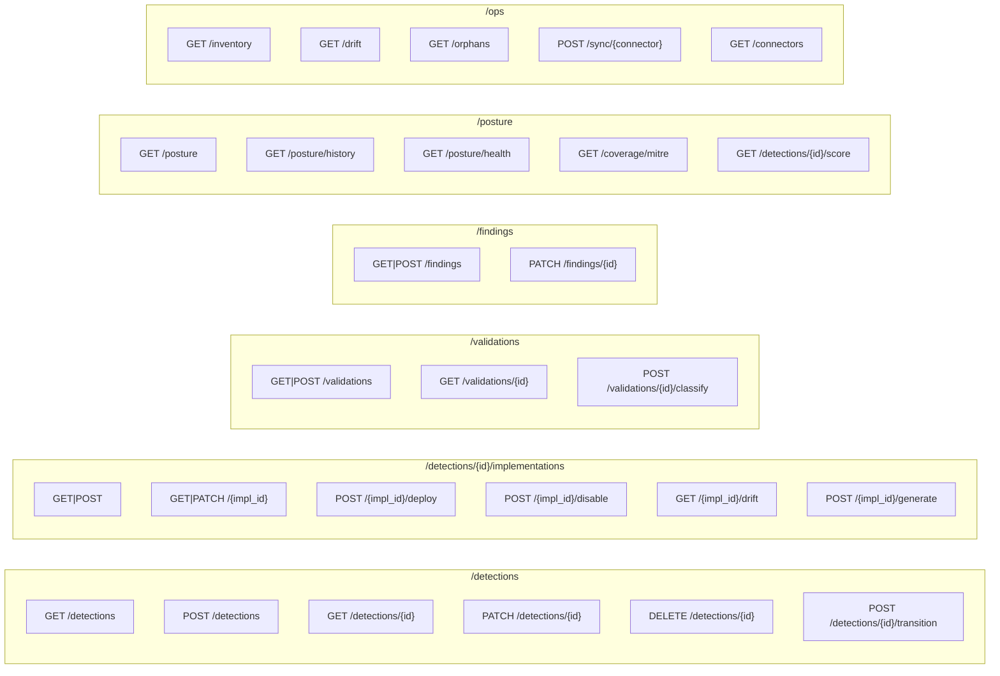
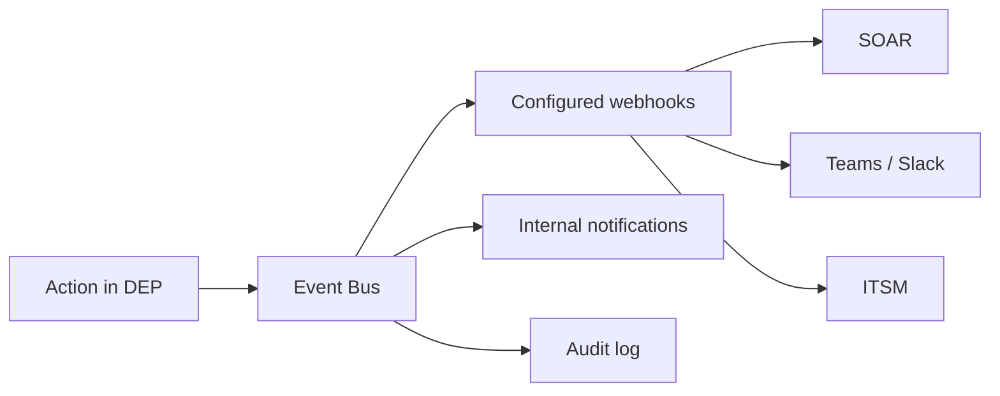

# 11 - API and Contracts

---

## 1. API Principles

1. **Everything the UI does can be done through the API.** The UI is just another client.
2. **Every write produces a commit in Git.** The API has no path that bypasses the source of truth.
3. **Every write produces an `AuditEvent`.**
4. **Idempotency** in deployment operations (`Idempotency-Key`).
5. **Versioned**: `/api/v1/...`. Breaking changes → `/api/v2`.
6. **OpenAPI 3.1** auto-generated from the Pydantic models.

---

## 2. Endpoint Map



---

## 3. Main Endpoints

### 3.1 Catalog

| Method | Path | Description | Minimum role |
|--------|------|-------------|------------|
| `GET` | `/api/v1/detections` | List with filters and pagination | viewer |
| `POST` | `/api/v1/detections` | Creates a detection (commit + PR) | engineer |
| `GET` | `/api/v1/detections/{id}` | Full detail | viewer |
| `PATCH` | `/api/v1/detections/{id}` | Updates fields | engineer |
| `POST` | `/api/v1/detections/{id}/transition` | Changes `status` with transition validation | depends on transition |
| `GET` | `/api/v1/detections/{id}/versions` | History | viewer |
| `GET` | `/api/v1/detections/{id}/diff?from=&to=` | Diff between versions | analyst |
| `POST` | `/api/v1/detections/{id}/deprecate` | Marks as deprecated | approver |
| `GET` | `/api/v1/detections/{id}/documentation/{type}` | Rendered Markdown | viewer |
| `PUT` | `/api/v1/detections/{id}/documentation/{type}` | Updates documentation | engineer |

**`GET /detections` filters:**

```
?status=active,tuning
&severity=high,critical
&platform=sentinel
&environment=prod
&layer=identity
&technique=T1187
&data_source=windows-security-events
&owner=detection-engineering
&has_open_findings=true
&drift=diverged,remote_ahead
&score_lt=60
&validation_stale=true
&implementation_type=native
&tag=kerberos
&q=brute+force
&sort=-score.overall
&page=1&size=50
```

### 3.2 Implementations

| Method | Path | Description |
|--------|------|-------------|
| `GET` | `/detections/{id}/implementations` | List |
| `POST` | `/detections/{id}/implementations` | Creates (native or generated) |
| `GET` | `/implementations/{impl_id}` | Detail + logic |
| `PATCH` | `/implementations/{impl_id}` | Updates logic/config |
| `POST` | `/implementations/{impl_id}/generate` | Generates from Sigma via SigmaForge |
| `POST` | `/implementations/{impl_id}/lint` | Validates syntax |
| `POST` | `/implementations/{impl_id}/deploy` | Deploys (with gates) |
| `POST` | `/implementations/{impl_id}/disable` | Disables in the SIEM |
| `GET` | `/implementations/{impl_id}/drift` | Drift status + diff |
| `POST` | `/implementations/{impl_id}/drift/resolve` | `adopt` / `overwrite` / `accept` |
| `GET` | `/implementations/{impl_id}/deployments` | History |

**`POST /implementations/{id}/deploy`**

```json
{
  "dry_run": false,
  "approval_ref": "PR-482",
  "reason": "Promote v1.3.0 with FND-0001 exclusion",
  "idempotency_key": "dep-2026-09-03-DET0001-prod-01"
}
```

Response if the gates fail (`409 Conflict`):

```json
{
  "error": "PROMOTION_BLOCKED",
  "gates": [
    {"gate": "blocking_findings", "status": "failed",
     "detail": "FND-0001 (noise, medium) is open and blocks promotion"},
    {"gate": "approver_differs_from_author", "status": "failed",
     "detail": "j.perez cannot approve their own change"},
    {"gate": "backtest_freshness", "status": "passed", "detail": "2 days ago"}
  ]
}
```

### 3.3 Validation

| Method | Path | Description |
|--------|------|-------------|
| `POST` | `/validations` | Launches a validation (async → returns `job_id`) |
| `GET` | `/validations/{id}` | Detail |
| `GET` | `/validations?detection=DET-0001` | History |
| `POST` | `/validations/{id}/classify` | Classifies TP/FP results by pattern |
| `POST` | `/validations/{id}/evidence` | Uploads evidence (multipart) |
| `GET` | `/jobs/{job_id}` | Status of an asynchronous job |

**`POST /validations`**

```json
{
  "detection": "DET-0001",
  "implementation": "IMP-0001-SENTINEL-DEV",
  "type": "historical_backtest",
  "input_dataset": {"type": "historical", "lookback": "P10D"},
  "expected_result": "Few matches, all genuine bursts",
  "options": {"max_rows_stored": 1000, "redact": true}
}
```

### 3.4 Findings

| Method | Path | Description |
|--------|------|-------------|
| `GET` | `/findings?status=open&severity=high` | Backlog |
| `POST` | `/findings` | Create manually |
| `PATCH` | `/findings/{id}` | Change status, assign |
| `POST` | `/findings/{id}/accept-risk` | Requires approver + expiry |
| `POST` | `/findings/{id}/resolve` | Requires `resolution_ref` |

### 3.5 Posture

| Method | Path | Description |
|--------|------|-------------|
| `GET` | `/posture` | Current program snapshot |
| `GET` | `/posture/history?from=&to=` | Time series |
| `GET` | `/posture/health` | Exceptions panel (17 findings, 9 stale…) |
| `GET` | `/detections/{id}/score` | 7 dimensions + component breakdown |
| `GET` | `/coverage/mitre?profile=corporate-2026` | Coverage by technique |
| `GET` | `/coverage/mitre/navigator` | ATT&CK Navigator layer JSON |
| `GET` | `/coverage/data-sources` | Coverage by source |
| `GET` | `/coverage/layers` | Coverage by layer |
| `GET` | `/coverage/gaps` | Prioritized gaps |
| `POST` | `/posture/recompute` | Forces recomputation (admin) |

### 3.6 Operations

| Method | Path | Description |
|--------|------|-------------|
| `GET` | `/inventory` | Detection × environment matrix |
| `GET` | `/drift` | All divergences |
| `GET` | `/orphans` | Rules in the SIEM outside the catalog |
| `POST` | `/orphans/{native_id}/adopt` | Imports into the catalog |
| `GET` | `/connectors` | Status of each connector |
| `POST` | `/connectors/{id}/sync` | Manual sync |
| `POST` | `/connectors/{id}/test` | Connectivity test |
| `GET` | `/audit?entity=DET-0001` | Audit log |
| `GET` | `/reports/{type}` | Generates a report |

---

## 4. Response Model: `GET /detections/DET-0003`

```json
{
  "id": "DET-0003",
  "uuid": "7c1f4e9a-2b3d-4c5e-9a8b-1d2e3f4a5b6c",
  "name": "Coerced Authentication",
  "version": "1.0.0",
  "status": "production_candidate",
  "severity": "high",
  "description": "Detects attempts to coerce authentication...",
  "intent": {
    "summary": "Detect authentication coercion attempts through lsarpc.",
    "adversary_behavior": ["authentication-coercion", "smb", "lsarpc"],
    "scope": {"included": ["Domain Controllers"], "excluded": ["EFSRPC coercion"]}
  },
  "mitre": {
    "attack_version": "v15.1",
    "mappings": [
      {"tactic": "TA0006", "technique": "T1187", "coverage_level": "significant",
       "primary": true}
    ]
  },
  "layers": [
    {"id": "identity", "strength": "primary"},
    {"id": "endpoint", "strength": "supporting"},
    {"id": "network", "strength": "supporting"}
  ],
  "data_sources": [
    {"id": "windows-security-events", "required": true, "health": "active",
     "log_sources": [{"platform": "sentinel", "table": "SecurityEvent",
                      "event_ids": ["5145"], "ingest_status": "active",
                      "last_seen_at": "2026-09-03T08:12:00Z"}]}
  ],
  "implementations": [
    {"id": "IMP-0003-SENTINEL-PROD", "platform": "sentinel", "environment": "prod",
     "type": "native", "status": "active", "enabled": true, "version": "1.0.0",
     "language": "kql", "drift_status": "in_sync",
     "logic_hash": "sha256:8f2a1c...", "last_deployed_at": "2026-08-30T10:00:00Z"},
    {"id": "IMP-0003-SENTINEL-DEV", "platform": "sentinel", "environment": "dev",
     "type": "native", "status": "active", "enabled": true, "version": "1.0.0",
     "drift_status": "in_sync"},
    {"id": "IMP-0003-QRADAR-PROD", "platform": "qradar", "environment": "prod",
     "type": "native", "status": "legacy", "enabled": true, "version": "0.9.0",
     "language": "aql", "drift_status": "unknown"}
  ],
  "sigma": {"present": true, "authoritative": false,
            "translation_coverage": "partial",
            "untranslatable": ["_GetWatchlist('nessus') exclusion"]},
  "validation": {
    "status": "partial",
    "last_run": "2026-08-26",
    "coverage_by_type": {"data_availability": "pass", "schema_validation": "pass",
                         "historical_backtest": "pass", "red_team": "not_started"},
    "next_due": "2027-02-22"
  },
  "findings": {"open": 0, "resolved": 2, "blocking": 0},
  "score": {
    "overall": 85,
    "coverage": 95, "quality": 78, "health": 92, "effectiveness": 87,
    "governance": 90, "layer_coverage": 70, "production_effectiveness": 82,
    "band": "good", "computed_at": "2026-09-03T03:45:00Z"
  },
  "governance": {
    "owner": {"team": "detection-engineering", "contact": "detection-eng@example.com"},
    "author": "j.perez", "approver": "soc-lead",
    "review": {"last": "2026-08-20", "next_due": "2027-02-16", "cadence_days": 180}
  },
  "documentation": {
    "overview": "README.md", "investigation": "docs/investigation.md",
    "false_positives": "docs/false-positives.md", "completeness": 1.0
  },
  "git": {"path": "detections/endpoint/DET-0003-coerced-authentication",
          "commit": "a3f91c2", "branch": "main"},
  "_links": {
    "self": "/api/v1/detections/DET-0003",
    "implementations": "/api/v1/detections/DET-0003/implementations",
    "validations": "/api/v1/validations?detection=DET-0003",
    "findings": "/api/v1/findings?detection=DET-0003",
    "score": "/api/v1/detections/DET-0003/score"
  }
}
```

---

## 5. Events and Webhooks



Event catalog:

| Event | Key payload |
|--------|---------------|
| `detection.created` | id, name, author |
| `detection.updated` | id, version, changed_fields |
| `detection.status_changed` | id, from, to, actor |
| `detection.deprecated` | id, reason, replaced_by |
| `implementation.deployed` | impl_id, environment, version, actor, approved_by |
| `implementation.deploy_failed` | impl_id, error |
| `implementation.drift_detected` | impl_id, drift_status, diff_summary |
| `validation.completed` | val_id, type, result, metrics |
| `finding.created` | finding_id, type, severity, blocks_promotion |
| `finding.resolved` | finding_id, resolution_ref |
| `finding.risk_accepted` | finding_id, approver, expires_at |
| `datasource.unavailable` | data_source, log_source, last_seen |
| `posture.snapshot_created` | snapshot_id, overall, deltas |
| `connector.degraded` | connector_id, error |
| `review.due` | detection_id, days_overdue |
| `exception.expiring` | exception_id, expires_at |

Webhook signature: HMAC-SHA256 in the `X-DEP-Signature` header, with a timestamp to
prevent replay.

---

## 6. Authentication and Authorization

| Method | Usage |
|--------|-----|
| OIDC (Authorization Code + PKCE) | Users in the UI |
| API tokens (scoped, with expiry) | Automation, CI |
| Service accounts | Connectors and internal jobs |

Expected token claims: `sub`, `email`, `groups` → mapped to DEP roles
in `.dep/config.yml`:

```yaml
auth:
  provider: oidc
  role_mapping:
    "SOC-Detection-Engineers": engineer
    "SOC-Leads": approver
    "SOC-Analysts": analyst
    "IT-Audit": auditor
    "Platform-Admins": admin
  default_role: viewer
```

API token scopes:
`detections:read`, `detections:write`, `implementations:deploy`, `validations:run`,
`findings:write`, `posture:read`, `reports:export`, `admin:*`.

---

## 7. Standard Errors

```json
{
  "error": "VALIDATION_FAILED",
  "code": "DEP-SCH-001",
  "message": "detection.yml does not conform to schema 1.0.0",
  "details": [
    {"field": "mitre.mappings[0].technique", "issue": "T9999 does not exist in ATT&CK v15.1"}
  ],
  "request_id": "req_01J8XYZ",
  "documentation_url": "https://.../errors/DEP-SCH-001"
}
```

| HTTP | When |
|------|--------|
| 400 | Invalid payload |
| 401 | Unauthenticated |
| 403 | Insufficient role |
| 404 | Does not exist |
| 409 | Conflict: blocked gates, outdated version, duplicate ID |
| 422 | Business validation failed (R-01..R-18) |
| 423 | Resource locked (deployment in progress) |
| 429 | Rate limit (own or downstream SIEM) |
| 502/504 | External connector down or slow |

---

## 8. Asynchronous Operations

Backtests, syncs, and deployments return a job:

```json
{ "job_id": "job_01J8XYZ", "status": "queued",
  "links": {"self": "/api/v1/jobs/job_01J8XYZ"} }
```

States: `queued` → `running` → `succeeded` | `failed` | `cancelled` | `timeout`.
They can be followed by polling or by SSE at `/api/v1/jobs/{id}/stream`.

---

## 9. Export Contract (for audit)

`GET /api/v1/reports/audit-pack?detection=DET-0001&format=zip`

Contents of the ZIP:

```
DET-0001-audit-pack-2026-09-03/
├── manifest.json          # inventory + sha256 of each file + signature
├── detection.yml
├── README.md
├── docs/
├── implementations/       # KQL/AQL exactly as they were
├── validations/           # all ValidationRuns
├── findings/
├── evidence/              # with verified hashes
├── deployments.csv        # who deployed what and when, with approvals
├── audit-log.csv          # detection events
└── score-history.csv      # score evolution
```

The `manifest.json` includes the Git commit and the server signature, so that an
auditor can verify that the package has not been tampered with.
