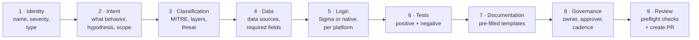

# 12 - UI / UX and Screens

> **Decision D-05:** a single GUI. The Detection Engineer should not have to think
> *"now I have to open SigmaForge"*. They enter the platform and do everything from there.

---

## 1. Navigation Map

```mermaid
flowchart TB
    ROOT["DEP"]
    ROOT --> N1["Home / My Work"]
    ROOT --> N2["Detections"]
    ROOT --> N3["Coverage"]
    ROOT --> N4["Posture"]
    ROOT --> N5["Validation"]
    ROOT --> N6["Findings"]
    ROOT --> N7["Operations"]
    ROOT --> N8["Reports"]
    ROOT --> N9["Admin"]

    N2 --> D1["Catalog (list/table)"]
    N2 --> D2["Detection Detail"]
    N2 --> D3["Detection Editor"]
    N2 --> D4["Compare / Diff"]
    N2 --> D5["New Detection wizard"]

    D2 --> T1["Overview"]
    D2 --> T2["Detection Logic"]
    D2 --> T3["Implementations"]
    D2 --> T4["Validation"]
    D2 --> T5["Findings"]
    D2 --> T6["Documentation"]
    D2 --> T7["Metrics"]
    D2 --> T8["History / Audit"]

    N3 --> C1["MITRE Heatmap"]
    N3 --> C2["Data Source Coverage"]
    N3 --> C3["Layer Coverage"]
    N3 --> C4["Gaps"]
    N3 --> C5["Threat Profile"]

    N4 --> P1["Program Scorecard"]
    N4 --> P2["Detection Health panel"]
    N4 --> P3["Trends / History"]
    N4 --> P4["By team / platform"]

    N7 --> O1["Inventory matrix"]
    N7 --> O2["Drift"]
    N7 --> O3["Orphan rules"]
    N7 --> O4["Deployments"]
    N7 --> O5["Connectors"]
    N7 --> O6["Jobs"]
```



---

## 2. Structure of "Detections" (the engineer's home)

```
Detections
├── Search
├── Create
├── Edit
├── Validate
├── Test
├── Deploy
├── Compare
└── Report
```

These eight actions are **always** accessible from the detection detail view.
None of them requires leaving the platform.

---

## 3. Screen: Catalog

```
┌───────────────────────────────────────────────────────────────────────────────┐
│ Detections                                    [+ New Detection]  [Import ▾]   │
├───────────────────────────────────────────────────────────────────────────────┤
│ [ kerberos                            ]                                       │
│                                                                               │
│ Status ▾   Severity ▾   Platform ▾   Layer ▾   Technique ▾   Owner ▾  More ▾  │
│ Active ×   High ×                                              [Clear all]    │
├───────────────────────────────────────────────────────────────────────────────┤
│ ID       Name                  Sev   Status    Impl        Score  Health  [WARN] │
├───────────────────────────────────────────────────────────────────────────────┤
│ DET-0001 Kerberos Brute Force  HIGH  tuning    S:Dok P[WARN] Qok   74    ◐       2 │
│ DET-0002 Password Spray        HIGH  active    S:Dok Pok      88    ●       0 │
│ DET-0003 Coerced Authentication HIGH prod_cand S:Dok Pok Qok   85    ●       0│
│ DET-0004 MFA Fatigue           MED   active    S:Dok Pok      91    ●       0 │
│ DET-0005 Golden Ticket         CRIT  degraded  S:Dok Qok      61    ○       3 │
│ DET-0006 DNS Tunneling         MED   disabled  S:Dok Px      38    ○       1  │
├───────────────────────────────────────────────────────────────────────────────┤
│ 120 detections · 104 active · 6 degraded · 5 disabled · 5 draft               │
│                                            Showing 1-25 of 120   ‹ 1 2 3 4 5 ›│
└───────────────────────────────────────────────────────────────────────────────┘

Impl legend:  S=Sentinel  Q=QRadar  D=DEV  P=PROD   ok active  [WARN] drift  x disabled
```

**Alternative views of the same catalog:** table (default), cards,
inventory matrix, ATT&CK heatmap.

---

## 4. Screen: Detection Detail - Overview

```
┌───────────────────────────────────────────────────────────────────────────────┐
│ ← Detections                                                                  │
│ DET-0003 · Coerced Authentication                              HIGH   v1.0.0  │
│ ● production_candidate      Owner: detection-engineering      Score: 85 ● good│
│                                                                               │
│ [Overview] [Logic] [Implementations] [Validation] [Findings] [Docs] [Metrics] │
│                                            [Edit] [Validate] [Deploy] [⋯]     │
├───────────────────────────────────────────────────────────────────────────────┤
│                                                                               │
│  INTENT                                                                       │
│  Detect authentication coercion via lsarpc                                    │
│                                                                               │
│  Hypothesis                                                                   │
│  An adversary with network access will invoke MS-RPC methods over the lsarpc  │
│  named pipe to force a machine account to authenticate to an attacker host.   │
│                                                                               │
│  ┌─────────────────────────┬──────────────────────────────────────────────┐   │
│  │ MITRE ATT&CK            │ T1187 · Forced Authentication  ● significant │   │
│  │                         │ T1550.002 · Pass the Hash      ○ minimal     │   │
│  ├─────────────────────────┼──────────────────────────────────────────────┤   │
│  │ Detection Layers        │ Identity ▮ Endpoint ▯ Network ▯              │   │
│  ├─────────────────────────┼──────────────────────────────────────────────┤   │
│  │ Data Sources            │ windows-security-events  ● healthy           │   │
│  │                         │ └ SecurityEvent · 5145 · last seen 12 min ago│   │
│  ├─────────────────────────┼──────────────────────────────────────────────┤   │
│  │ Threat                  │ PetitPotam · CVE-2021-36942 · APT29          │   │
│  ├─────────────────────────┼──────────────────────────────────────────────┤   │
│  │ Scope excluded          │ EFSRPC coercion → see DET-0004               │   │
│  └─────────────────────────┴──────────────────────────────────────────────┘   │
│                                                                               │
│  IMPLEMENTATIONS                                                              │
│  ┌───────────────────────────────────────────────────────────────────────┐    │
│  │ Sentinel     PROD     ● Active     native   v1.0.0   in sync    [KQL] │    │
│  │ Sentinel     DEV      ● Active     native   v1.0.0   in sync    [KQL] │    │
│  │ QRadar       PROD     ◐ Legacy     native   v0.9.0   unknown    [AQL] │    │
│  └───────────────────────────────────────────────────────────────────────┘    │
│                                                                               │
│  SCORE BREAKDOWN                        VALIDATION                            │
│  Coverage        95 ████████████████▏   ● Data availability      2026-08-26   │
│  Quality         78 ████████████▍       ● Schema validation      2026-08-26   │
│  Health          92 ███████████████▌    ● Historical backtest    2026-08-26   │
│  Effectiveness   87 ██████████████▎     ○ Red team               not started  │
│  Governance      90 ██████████████▊     ○ Production validation  not started  │
│  Layer Coverage  70 ███████████▎                                              │
│  Production Eff. 82 █████████████▎      Next review due: 2027-02-16           │
└───────────────────────────────────────────────────────────────────────────────┘
```

---

## 5. Screen: Detection Logic

Already described in doc 09 §4. Key elements:

- **Canonical Detection (Sigma)** with a `translation_coverage` badge
- Explicit list of **what is not translatable** and why
- **Generate Implementation ▾** button with a target selector
- Monaco editor with per-language syntax highlighting
- Side-by-side diff when regenerated

---

## 6. Screen: Implementations

```
┌───────────────────────────────────────────────────────────────────────────────┐
│ DET-0001 · Kerberos Brute Force            Implementations                    │
├───────────────────────────────────────────────────────────────────────────────┤
│                                                    [+ Add implementation]     │
│                                                                               │
│ ┌─ Sentinel · DEV ────────────────────────────────────── ● Active ──────────┐ │
│ │ Type: generated_customized      Version: 1.4.0     Drift: in sync [OK]       │ │
│ │ Source: Sigma-generated 2026-08-27 · SigmaForge v0.9.4                    │ │
│ │ Customized: YES · last modified 2026-08-28 by j.perez                     │ │
│ │ Schedule: every 1h, lookback 24h    Threshold: > 5    Suppression: off    │ │
│ │ Depends on: watchlist:nessus (updated 2 days ago [OK])                       │ │
│ │                                                                            ││
│ │ [View/Edit KQL]  [Lint]  [Run backtest]  [Compare with PROD]  [Deploy →]  │ │
│ └────────────────────────────────────────────────────────────────────────────┘│
│                                                                               │
│ ┌─ Sentinel · PROD ──────────────────────────────── ● Active · [WARN] DRIFT ─────┐ │
│ │ Type: generated_customized      Version: 1.2.0     Drift: remote_ahead [WARN]   │ │
│ │ [WARN] Someone edited this rule in the Sentinel console on 2026-07-14.          │ │
│ │   The change is NOT in Git.                                                ││
│ │                                                                            ││
│ │   - | where TargetUserName != "NOUSER"                                     ││
│ │   + | where TargetUserName !in ("NOUSER", "HEALTHCHECK")                   ││
│ │                                                                            ││
│ │ [Adopt remote into Git]  [Overwrite with Git]  [Accept divergence]         ││
│ └────────────────────────────────────────────────────────────────────────────┘│
│                                                                               │
│ ┌─ QRadar · PROD ────────────────────────────────────── ◐ Legacy ───────────┐ │
│ │ Type: native (AQL)              Version: 0.9.0     Drift: unknown          ││
│ │ (i) Kept until Sentinel migration is fully validated. Do not modify.         │ │
│ │ [View AQL]  [Compare logic with Sentinel]                                  ││
│ └────────────────────────────────────────────────────────────────────────────┘│
└───────────────────────────────────────────────────────────────────────────────┘
```

---

## 7. Screen: Posture Dashboard (SOC Manager)

```
┌───────────────────────────────────────────────────────────────────────────────┐
│ SOC Detection Posture                        Period: Sep 2026   [Export ▾]    │
├───────────────────────────────────────────────────────────────────────────────┤
│                                                                               │
│            ┌─────────────────────┐    Coverage        81%  ████████░░  ▲ +3   │
│            │                     │    Quality         76%  ███████▌░░  ▲ +5   │
│            │    OVERALL          │    Health          89%  ████████▉░  ▼ -2   │
│            │      79 / 100       │    Effectiveness   73%  ███████▎░░  ▲ +1   │
│            │       ▲ +4          │    Governance      91%  █████████░  ─  0   │
│            │                     │    Detection Layers 78% ███████▊░░  ▲ +2   │
│            └─────────────────────┘    Production      69%  ██████▉░░░  ▲ +6   │
│                                                                               │
├───────────────────────────────────────────────────────────────────────────────┤
│ DETECTION HEALTH                            PROGRAM METRICS                   │
│                                                                               │
│ 120 detections                              92%  documented                   │
│                                             87%  tested                       │
│ [WARN] 17 have open findings          →          81%  MITRE coverage (profile)│
│ [WARN]  9 have stale validation       →          76%  healthy                 │
│ [WARN]  6 have schema issues          →          64%  with backtesting        │
│ [WARN]  4 have no owner               →          12   stale                   │
│ [WARN] 12 lack tests                  →           8   without owner           │
│ [WARN]  5 have DEV/PROD drift         →                                       │
│ [WARN]  3 have absent data sources    →          Velocity: 4 new detections/month │
│ [WARN]  2 have zero alerts in 90 days →          Time to production: 18 days avg │
│                                                                               │
├───────────────────────────────────────────────────────────────────────────────┤
│ TREND (12 months)                                                             │
│  100 ┤                                                                        │
│   80 ┤                                    ╭──────╮      ╭───                  │
│   60 ┤        ╭────╮      ╭───────────────╯      ╰──────╯                     │
│   40 ┤────────╯    ╰──────╯                                                   │
│      └┬────┬────┬────┬────┬────┬────┬────┬────┬────┬────┬────┬───             │
│       O    N    D    J    F    M    A    M    J    J    A    S                │
└───────────────────────────────────────────────────────────────────────────────┘
```

**Design rule:** program metrics and detection metrics **never appear on the
same card** (D-10). The Health panel links to filtered catalog lists, which is
where detection metrics live.

---

## 8. Screen: MITRE Coverage

```
┌───────────────────────────────────────────────────────────────────────────────┐
│ MITRE ATT&CK Coverage      Profile: Corporate 2026 ▾   ATT&CK v15.1           │
│                                              [Export Navigator layer] [PDF]   │
├───────────────────────────────────────────────────────────────────────────────┤
│ Profile coverage:  81%  (94 of 116 relevant techniques)                       │
│ Full Enterprise:   23%  (138 of 600 techniques)          (i) context only     │
├───────────────────────────────────────────────────────────────────────────────┤
│ Initial   Execution  Persist.  PrivEsc  Defense  Credential  Discovery  Lateral│
│ Access                                            Access                      │
│ ▓▓▓░░     ▓▓▓▓░      ▓▓░░░     ▓▓▓░░    ▓▓░░░    ▓▓▓▓▓      ▓▓░░░     ▓▓▓░░   │
│                                                                               │
│  ┌──────────────┐  ┌──────────────┐  ┌──────────────┐                         │
│  │ T1187        │  │ T1110        │  │ T1558.003    │  ← click for details    │
│  │ Forced Auth  │  │ Brute Force  │  │ Kerberoasting│                         │
│  │ ████ signif. │  │ ███  partial │  │ ░░░░ none    │                         │
│  │ DET-0003     │  │ DET-0001     │  │ [WARN] GAP        │                    │
│  └──────────────┘  └──────────────┘  └──────────────┘                         │
├───────────────────────────────────────────────────────────────────────────────┤
│ TOP GAPS (prioritized)                                                        │
│ 1. T1558.003 Kerberoasting          HIGH   No detection   Data: available [OK]│
│ 2. T1021.006 WinRM                  HIGH   No detection   Data: available [OK]│
│ 3. T1046   Network Service Scanning MED    Minimal only   Data: partial [WARN]│
│                                                                               │
│ ACCEPTED GAPS (5)                                                    [show ▾] │
│ • T1200 Hardware Additions - no physical access to data centers (approved)    │
└───────────────────────────────────────────────────────────────────────────────┘
```

---

## 9. Screen: Findings

```
┌───────────────────────────────────────────────────────────────────────────────┐
│ Findings                                                     [+ New]          │
├───────────────────────────────────────────────────────────────────────────────┤
│ Status: Open ×   Severity: ▾   Type: ▾   Owner: ▾   Blocking: ▾               │
├───────────────────────────────────────────────────────────────────────────────┤
│ ID       Detection   Type      Title                    Sev   Age   Blocking  │
├───────────────────────────────────────────────────────────────────────────────┤
│ FND-0001 DET-0001    noise     NOUSER + ::1 + 0x6       MED    8d   [BLOCKED] yes │
│ FND-0002 DET-0001    schema    AccountName unreliable   MED   12d   no        │
│ FND-0014 DET-0005    data_gap  DeviceLogonEvents empty  HIGH   3d   [BLOCKED] yes │
│ FND-0018 DET-0009    drift     PROD edited in console   HIGH   1d   [BLOCKED] yes │
│ FND-0021 DET-0012    evasion   Red team not detected    HIGH  22d   no        │
├───────────────────────────────────────────────────────────────────────────────┤
│ 17 open · 4 blocking promotion · MTTR 22 days · 2 recurring                   │
└───────────────────────────────────────────────────────────────────────────────┘
```

Finding detail:

```
┌───────────────────────────────────────────────────────────────────────────────┐
│ FND-0001 · Noise                                          MEDIUM · [BLOCKED] blocking│
│ DET-0001 Kerberos Brute Force · IMP-0001-SENTINEL-DEV                         │
├───────────────────────────────────────────────────────────────────────────────┤
│ Discovered by: VAL-2026-0812 (historical_backtest) on 2026-08-26              │
│                                                                               │
│ Observation                                                                   │
│ During the 10-day backtest, 3 of 5 matches originated from ::1 with           │
│ TargetUserName = NOUSER and failure code 0x6.                                 │
│                                                                               │
│ Pattern       NOUSER + ::1 + 0x6                                              │
│ Impact        ~60% of alerts would be false positives                         │
│ Recommendation Exclude loopback source addresses combined with NOUSER         │
│                                                                               │
│ Evidence      [file] noise-pattern.csv  (sha256 4c5d6e… [OK] verified)        │
│                                                                               │
│ [Create exception]  [Assign]  [Resolve]  [Accept risk]  [Won't fix]           │
└───────────────────────────────────────────────────────────────────────────────┘
```

---

## 10. Screen: Inventory matrix

```
┌───────────────────────────────────────────────────────────────────────────────┐
│ Detection Inventory                              [Sync now]  [Export CSV]     │
│ Last sync: 12 minutes ago · Sentinel [OK] · QRadar [OK] · EDR [WARN] degraded │
├───────────────────────────────────────────────────────────────────────────────┤
│                        SENTINEL           QRADAR      EDR     Score  Health   │
│                      DEV      PROD         PROD                               │
├───────────────────────────────────────────────────────────────────────────────┤
│ Coerced Auth          ok        ok            ok          -       85     ●    │
│ Kerberos BF           ok        [WARN]            ok          -       74     ◐│
│ Password Spray        ok        ok            -          -       88     ●     │
│ MFA Fatigue           ok        ok            -          -       91     ●     │
│ Golden Ticket         ok        -            ok          -       61     ◐     │
│ LSASS Access          -        -            -          ok       85     ●      │
│ DNS Tunneling         ok        x            -          -       38     ○      │
├───────────────────────────────────────────────────────────────────────────────┤
│ [WARN] 14 orphan rules found in Sentinel PROD that are not in the catalog  [Review]│
└───────────────────────────────────────────────────────────────────────────────┘
```

---

## 11. Screen: New Detection wizard



Step 4 runs `data_availability` **live** before allowing you to continue: if the table
has no data, you are warned before writing a single line of KQL.

---

## 12. UX Principles

| # | Principle | Concrete application |
|---|-----------|---------------------|
| 1 | **Never lie about state** | If the connector fails, show "data from 6h ago", not a [OK] |
| 2 | **Every state is clickable** | "9 have stale validation" leads to the filtered list |
| 3 | **The action lives where the information is** | "Create exception" button inside the finding |
| 4 | **Diffs are always visual** | Drift, versions, DEV→PROD promotion |
| 5 | **A block explains its reason** | Never "you cannot deploy"; always the list of gates |
| 6 | **Progressive disclosure** | Summarized overview; detail on demand |
| 7 | **High density for experts** | Table with many columns by default, not giant cards |
| 8 | **Global search (Cmd+K)** | Jump to `DET-0001`, `T1187`, or a finding in 2 keystrokes |
| 9 | **Useful empty states** | "No validations" offers "Run the first one" |
| 10 | **Accessibility** | Do not rely on color alone: icons + text in states |

---

## 13. Standard Visual States

| Symbol | Meaning | Color |
|:-------:|-------------|-------|
| ● | Healthy / active | green |
| ◐ | Degraded / partial / legacy | amber |
| ○ | Critical / not started | red / gray |
| ok | Present and correct | green |
| [WARN] | Attention required | amber |
| x | Disabled | gray |
| [BLOCKED] | Blocking | red |
| - | Not applicable / not implemented | gray |

---

## 14. Responsive and Modes

- **Desktop first.** It is a work tool, not a mobile app.
- **Dark mode** mandatory (SOCs work in the dark).
- **Presentation mode** for the Posture Dashboard (large screen in the SOC).
- **Read mode** for analysts: no write buttons, focus on the runbook.
