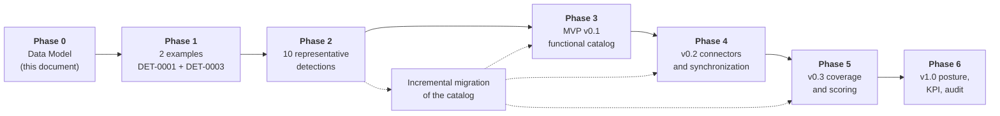
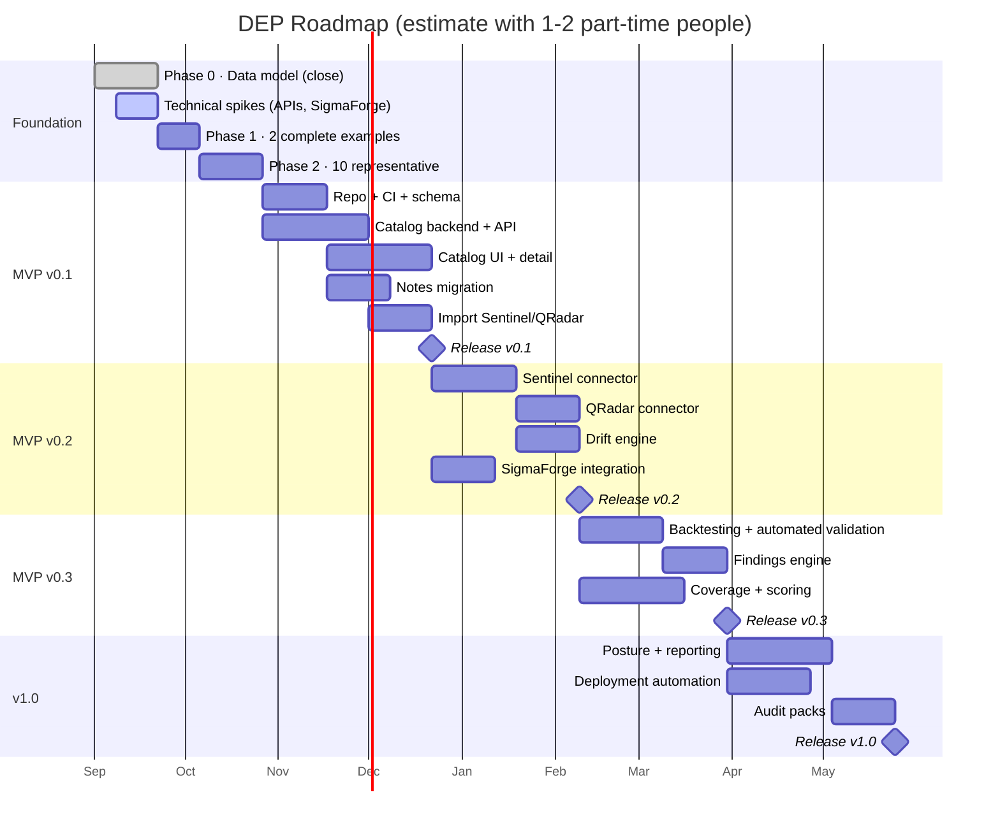
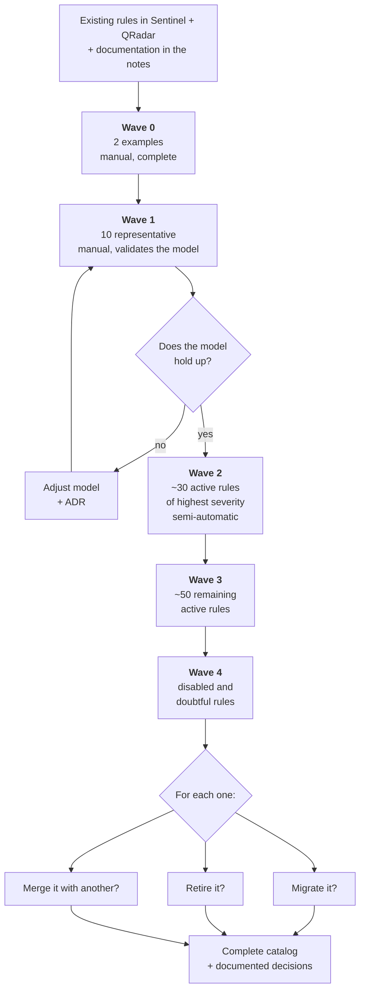
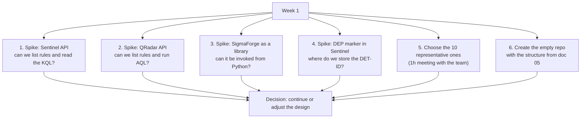

# 13 - Roadmap, MVP and Migration Plan

> **Decision D-12:** do not migrate the full catalog yet.
> First build the model with 2 examples, then validate it against 10 representative ones.
> If the model correctly represents those 10, it will probably represent the full catalog.

---

## 1. Overall strategy

The full catalog is **not** migrated before the model is validated. Migration is
**incremental and parallel** to development, not a big bang up front.

---

## 2. The 10 representative detections

These 10 must be chosen **before writing code**, and their purpose is to **break the model**
if the model is wrong.

| # | Required profile | What it tests | Candidate |
|---|------------------|---------------|-----------|
| 1 | **A simple one** | The happy path: Sigma → KQL, no complications | _(to be chosen)_ |
| 2 | **A complex one** | Long logic, multiple conditions, `implementation_type: native` | _(to be chosen)_ |
| 3 | **One with a Watchlist** | `EnrichmentAsset`, external dependencies, `_GetWatchlist()` | Coerced Authentication |
| 4 | **One with a join** | Non-translatable query, complexity, performance | _(to be chosen)_ |
| 5 | **One with summarize** | Aggregation, threshold, `make_set()` | Kerberos Brute Force |
| 6 | **One inherited from Content Hub** | `source.origin`, upstream drift, Microsoft templates | _(to be chosen)_ |
| 7 | **One with a QRadar implementation** | Two implementations, AQL, legacy platform | Coerced Authentication |
| 8 | **One with multiple implementations** | Sentinel DEV + PROD + QRadar under one `DET-` | Kerberos Brute Force |
| 9 | **One with data problems** | `LogSource.ingest_status`, `SchemaField.reliability`, schema Finding | _(to be chosen)_ |
| 10 | **One currently disabled** | `status: disabled`, why?, does it count toward posture? | _(to be chosen)_ |

### Phase 2 acceptance criterion

> **The model is considered validated if all 10 detections can be fully represented
> in `detection.yml` + satellite files, without needing `custom_*` fields or
> free-text notes to express anything structural.**

If any of them requires a new field → it is added to the model and documented as an ADR.
If three or more require new fields of the same kind → the model has a design problem.

---

## 3. MVP v0.1 - Functional catalog

**Goal:** replace the scattered notes. The catalog becomes the place where people look.

| ok | Capability | Detail |
|:-:|-----------|---------|
| ok | Detection catalog | List, search, filters, detail |
| ok | Git repository | Full structure, validation CI |
| ok | Markdown documentation | Migrated from the notes, rendered in the UI |
| ok | Detection metadata | `detection.yml` with JSON Schema |
| ok | Sentinel implementations | KQL preserved, DEV and PROD |
| ok | QRadar implementations | AQL preserved |
| ok | DEV/PROD | As separate implementations |
| ok | MITRE | Mappings + loaded catalog |
| ok | Detection layers | Taxonomy + assignment |
| ok | Data sources | Taxonomy + per-detection declaration |
| ok | Owner | Basic governance model |
| ok | Lifecycle | States + validated transitions |
| ok | Validation/evidence | Manual ValidationRuns + evidence with hash |
| ok | Rule versioning | Semver + changelog + Git history |
| ok | Basic dashboard | Counters, no scoring yet |

**Out of v0.1:** connectors, scoring, drift, automatic deployment.
Synchronization with the SIEM is **manual** (one-off import).

**Exit criteria:**
- The 10 representative detections live in the repo.
- An engineer can answer "what does X detect and how?" without opening Sentinel or the notes.
- CI validates 100% of the `detection.yml` files.

---

## 4. MVP v0.2 - Connectors and synchronization

| ok | Capability | Detail |
|:-:|-----------|---------|
| ok | Sentinel inventory sync | Discovery of real rules |
| ok | Environment drift | DEV vs PROD vs Git |
| ok | Schema validation | Tables and fields via API |
| ok | Automated tests | Unit tests in CI |
| ok | Sigma/SigmaForge | Translation from the GUI |
| ok | RSigma | Testing where applicable |
| + | Orphan rules | SIEM rules outside the catalog |
| + | Data availability checks | Daily job |
| + | Notifications | Teams/Slack + email |
| + | SSO | OIDC |

**Exit criteria:**
- The inventory matrix reflects reality without manual intervention.
- The first real drift is detected and resolved through the defined flow.
- The orphan rules report is presented to the SOC Manager.

---

## 5. MVP v0.3 - Coverage, health and scoring

| ok | Capability | Detail |
|:-:|-----------|---------|
| ok | MITRE coverage | Against threat profile + Navigator export |
| ok | Data source coverage | Which sources we use and which we do not |
| ok | Layer coverage | Per layer, with targets |
| ok | Backtesting | From the GUI, with cost guard |
| ok | Rule health | Health monitor + degraded states |
| ok | Findings | Automatic engine + backlog |
| ok | Detection Score | 7 dimensions |
| + | Exception management | With expiry and approval |
| + | Assisted noise analysis | Grouping by patterns |

**Exit criteria:**
- We can answer "what do we NOT detect and why?" with data.
- The Detection Score of the whole catalog is credible to the team (it does not produce absurd results).

---

## 6. v1.0 - Posture, KPI and audit

| ok | Capability | Detail |
|:-:|-----------|---------|
| ok | Posture dashboard | 7 dimensions at program level |
| ok | SOC KPI reporting | Monthly/quarterly reports |
| ok | Audit reports | Signed Audit Evidence Pack |
| ok | Historical posture | Snapshots + trends |
| ok | Automated deployment | Deployment with gates and approval |
| ok | Additional SIEM/EDR connectors | EDR and/or Network |
| + | Full approval workflow | Segregation of duties |
| + | SOAR integration | Findings <-> tickets, TP/FP <-> metrics |
| + | Red team integration | Atomic Red Team |

---

## 7. Indicative timeline

> Durations are **indicative** and assume part-time dedication. What is not negotiable
> is the **order**: model → examples → 10 representative → catalog → connectors →
> scoring → posture.

---

## 8. Migration plan for the existing catalog

### Per-rule process (Wave 2 onward)

```mermaid
flowchart LR
    A["1. Automatic import<br/>KQL/AQL + metadata"] --> B["2. Assign DET-ID<br/>and location"]
    B --> C["3. Reconcile<br/>Sentinel and QRadar"]
    C --> D["4. Link documentation<br/>from the notes"]
    D --> E["5. Complete intent<br/>(human, ~15 min)"]
    E --> F["6. Complete MITRE,<br/>layers, owner"]
    F --> G["7. data_availability<br/>+ schema_validation"]
    G --> H["8. Record actual state<br/>(active/disabled/degraded)"]
    H --> I["9. PR + review"]
```

**Effort estimate per rule:**

| Activity | Automatic | Human |
|-----------|:----------:|:------:|
| Import of logic and technical metadata | Yes | - |
| ID and folder assignment | Yes | review |
| Sentinel<->QRadar reconciliation | proposal | Yes, confirm |
| Linking with the notes | proposal | Yes, confirm |
| Intent + hypothesis + scope | No | ~15 min |
| MITRE + layers | proposal | ~5 min |
| Owner | No | ~2 min |
| Initial validations | Yes | review |
| **Estimated total** | | **~25-30 min/rule** |

N rules × ~27 min ≈ **0.45 h per rule** of human work, spread across waves.

> **Recommendation:** run the waves in 2h sessions with two people
> (one writes, one reviews). It is faster and the quality of the intent is much better.

### What to do with problematic rules

| Situation | Decision |
|-----------|----------|
| Rule without documentation and without a known owner | Wave 4. Retirement candidate. Imported as `draft` with a governance Finding |
| Rule disabled for >6 months | Import as `deprecated` with reason "disabled long-term, pending review" |
| Two nearly identical rules | Import both + `DetectionRelationship: duplicates` + decide during review |
| Unmodified Content Hub rule | Import with `source.origin: content_hub`, low documentation priority |
| Rule that has never fired | Import + Finding F-13 + review whether it is broken |
| Rule that uses a table that no longer exists | Import as `degraded` + Finding `data_gap` |

---

## 9. Plan risks and mitigations

| Risk | Prob. | Impact | Mitigation |
|--------|:-----:|:-------:|------------|
| The model does not support some rule in the catalog and has to be redone | medium | high | Phase 2 with the 10 representative ones **before** building |
| Migration stalls and the team goes back to the notes | medium | high | Short waves; make v0.1 useful from the first week |
| The Sentinel/QRadar APIs do not provide what we need | medium | high | **Spikes in week 1**, before committing to the design |
| SigmaForge does not fit as a library | medium | medium | Isolated adapter; if it fails, everything is `native` and the project continues |
| Backtests drive up Log Analytics cost | high | medium | Cost guard + quotas + limited lookback |
| Nobody fills in the intent and the catalog ends up meaningless | high | high | Gate: cannot leave `draft` without intent; pair sessions |
| Scoring produces absurd numbers and loses credibility | medium | high | Hard caps; calibrate against the 10 before showing to management |
| A single developer → bus factor 1 | high | high | Documentation (this), simple code, no magic |
| It becomes an endless project that never delivers | medium | high | Milestones with explicit exit criteria |

---

## 10. Project success metrics

| Horizon | Metric | Target |
|-----------|---------|---------:|
| v0.1 | Detections in the catalog | 100% of the existing catalog |
| v0.1 | Documentation migrated without loss | 100% |
| v0.1 | Time to answer "what does X detect?" | < 1 min |
| v0.2 | Orphan rules identified | > 0 (there always are some) |
| v0.2 | Drift detected and resolved | ≥ 5 cases |
| v0.2 | Reduction in analyst onboarding time | -50% |
| v0.3 | Detections with recorded validation | > 80% |
| v0.3 | Open findings with owner and plan | 100% |
| v1.0 | Posture report accepted by management | yes |
| v1.0 | Time to prepare an audit | from days to hours |
| v1.0 | Detections without owner | 0 |

---

## 11. First things to do (week 1)

None of these tasks requires writing the platform. All of them reduce design risk.
